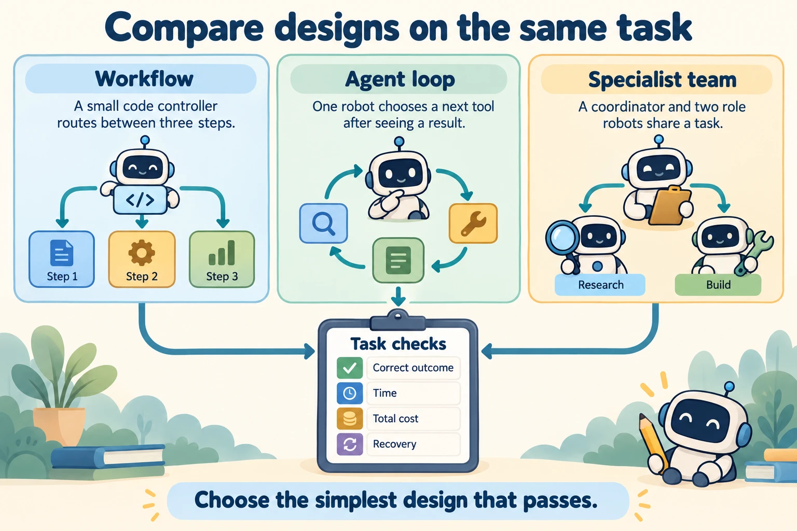

<!--
---
title: Architecture trade-offs
unit_id: P1-02-08
summary: Compares orchestration patterns across determinism, latency, token expenditure,
  observability, failure propagation, and termination guarantees to guide minimal
  architecture selection.
prerequisites:
- Read [Architecture selection criteria](01-architecture-selection-criteria.md).
- Read [Supervisors, handoffs, and agent-as-tool](07-supervisors-handoffs-and-agent-as-tool.md).
learning_objectives:
- Evaluate the six core trade-off dimensions across deterministic pipelines, reactive
  loops, evaluator-optimizer loops, state graphs, and multi-agent systems.
- Apply the simplicity principle to select the least dynamic architecture that satisfies
  functional requirements.
- Calculate token cost and latency multipliers when transitioning from single-agent
  to multi-agent topologies.
- Design failure isolation boundaries to restrict the blast radius of rogue tool executions
  and infinite loops.
source_records:
- p1-02-08-anthropic-building-effective-agents-2024
- p1-02-08-google-cloud-agent-design-patterns-2024
- p1-02-08-microsoft-patterns-enterprise-agents-2024
visual_assets:
- assets/images/02-agent-architectures/08-architecture-trade-offs/03-measured-architecture-selection.webp
example_paths:
- examples/02-agent-architectures/08-architecture-trade-offs/architecture_tradeoff_benchmarker.py
pass: architecture
learning_path: main
status: complete
last_reviewed: '2026-10-10'
---
-->

# Architecture trade-offs

## Why this matters

The shop can answer the same question through a fixed workflow, an iterative agent or a group of specialists. Each design spends time and resources differently, and each can fail at different boundaries.

Compare these patterns using the same tasks and operating conditions. Add complexity when it resolves a measured limitation. This synthesis connects [foundations](../01-agent-foundations/chapter-plan.md) to the detailed [building blocks](../03-building-blocks/chapter-plan.md).

## Simple mental model

Think of selecting transportation for a delivery logistics network:

1. **Conveyor Belt (Deterministic Pipeline)**: Inflexible and fixed to a track, and is useful for repeating a defined sequence.
2. **Delivery Van with GPS Route (Evaluator-Optimizer / Router)**: Follows designated routes, rerouting when traffic reports (critique) indicate a road blockage. Highly predictable and moderately flexible.
3. **Autonomous Delivery Drone (Reactive Agent Loop)**: Navigates open city airspace dynamically, sensing and dodging obstacles in real time, but consumes significantly more battery power and requires safety geofencing.
4. **Fleet of Specialized Transport Vehicles (Multi-Agent Supervisor)**: Cargo planes, long-haul trucks, and last-mile couriers coordinated by a central logistics dispatcher. Solves massive global shipments, but requires extensive coordination protocols and adds coordination work that must be measured.

In software architecture, you do not hire a cargo fleet when a conveyor belt solves the problem.

## Position in the agent workflow

The figure compares three designs using one shared set of checks. It does not rank their costs in advance.



*Figure 1. Follow each design down to the same task checks. Compare measured results before choosing a pattern; extra roles do not automatically improve quality or isolate permissions.*

## How it works

Comparing agent architectures requires evaluating six fundamental engineering dimensions (Microsoft, 2024):

1. **Control flow versus flexibility:** Code-selected workflows constrain routes. Model-directed loops choose actions during execution. Neither implies identical model outputs or external observations.
2. **End-to-end latency:** Count serial dependencies, parallel work, model calls, retries and human waiting time. A single call can still be slow.
3. **Token and infrastructure cost:** Measure all model calls, tool work and execution environments. Additional roles can add cost, while selection and parallelism can change the balance.
4. **Observability & Traceability**: Linear workflows produce simple linear traces. Dynamic multi-agent loops produce branching call trees requiring distributed tracing and message correlation IDs.
5. **Failure propagation:** Examine shared context, state, credentials and execution environments. A worker role alone does not isolate these resources.
6. **Termination Guarantees**: Unbounded agent loops risk infinite livelocks unless protected by hard step counters, time budgets, or deterministic graph exit guards.

### The simplicity principle

The overarching rule for production AI engineering is the **Simplicity Principle** (Anthropic, 2024): *Default to the least dynamic pattern that achieves the goal.* Only introduce loops, dynamic routing, reflection, or multi-agent delegation when simpler static designs measurably fail acceptance benchmarks.

## Main variants

1. **Hybrid tiered orchestrator:** Route routine requests to a fixed workflow and other requests to an iterative design. Choose the split using evaluation, not a universal traffic ratio.
2. **Static Plan with Dynamic Fallback**: A system attempts a rigid plan-and-execute sequence first; if a step fails validation twice, it falls back to an open-ended reactive loop to explore alternative solutions.
3. **Speculative Parallel Routing**: Running a fast deterministic classifier and a small model router in parallel, canceling the model call if the rule engine matches with high confidence.

## Minimal implementation

The following mock compares fixed arithmetic assumptions for three patterns. Its output is illustrative, not a benchmark of real models, latency or failure rates:

<details>
<summary>Expand minimal Python implementation</summary>

```python
from typing import Dict, Any
import time

class ArchitectureBenchmark:
    """Simulates latency and token consumption metrics across architectural patterns."""

    @staticmethod
    def run_pipeline(task: str) -> Dict[str, Any]:
        """Pattern 1: Single-pass deterministic pipeline."""
        start = time.perf_counter()
        prompt_tokens = 150
        completion_tokens = 80
        elapsed_ms = (time.perf_counter() - start) * 1000 + 120.0
        return {
            "pattern": "Deterministic Pipeline",
            "total_tokens": prompt_tokens + completion_tokens,
            "turns": 1,
            "latency_ms": round(elapsed_ms, 2),
            "blast_radius": "Low (Zero Loop Risk)"
        }

    @staticmethod
    def run_evaluator_optimizer(task: str, rounds: int = 2) -> Dict[str, Any]:
        """Pattern 2: Iterative generator-evaluator critique loop."""
        start = time.perf_counter()
        prompt_tokens = rounds * 300
        completion_tokens = rounds * 120
        elapsed_ms = (time.perf_counter() - start) * 1000 + (rounds * 240.0)
        return {
            "pattern": "Evaluator-Optimizer",
            "total_tokens": prompt_tokens + completion_tokens,
            "turns": rounds * 2,
            "latency_ms": round(elapsed_ms, 2),
            "blast_radius": "Moderate (Max Cap Enforced)"
        }

    @staticmethod
    def run_multi_agent_supervisor(task: str, num_workers: int = 2) -> Dict[str, Any]:
        """Pattern 3: Hierarchical supervisor with isolated subagent workers."""
        start = time.perf_counter()
        sup_tokens = 310 + 550
        worker_tokens = num_workers * 800
        total_tokens = sup_tokens + worker_tokens
        elapsed_ms = (time.perf_counter() - start) * 1000 + 580.0
        return {
            "pattern": "Multi-Agent Supervisor",
            "total_tokens": total_tokens,
            "turns": 2 + num_workers,
            "latency_ms": round(elapsed_ms, 2),
            "blast_radius": "Isolated Workers (Scoped Privilege)"
        }
```

</details>

## Framework implementations

- **LangGraph & LangChain**: Provides explicit primitives to transition smoothly between simple chains (`RunnableSequence`), cyclic graphs (`StateGraph`), and multi-agent supervisor networks.
- **Google Agent Development Kit (ADK)**: Recommends starting with workflow-based verifiers and deterministic tools before assembling multi-agent teams.
- **Semantic Kernel (Microsoft)**: Organizes agents into tiered plugins and process frameworks, enabling developers to enforce deterministic guardrails around model planners.

## Data flow and state changes

The table below summarizes the trade-off profile across all major architectural patterns:

| Architecture pattern | Latency considerations | Work and cost | Control flow | Inspection | Suitable tasks |
| --- | --- | --- | --- | --- | --- |
| **Direct generation** | One model call; measure duration | Count tokens and provider work | No tool loop; variable outputs | Preserve input and output | Bounded text tasks |
| **Code-selected pipeline** | Serial work on defined routes | Count actual model and tool calls | Explicit routes; variable outputs | Usually straightforward | Bounded lookup and extraction |
| **Parallel fan-out** | Independent branches can overlap | Count all branch work | Explicit join behavior | Needs branch correlation | Independent subtasks |
| **Evaluator-optimizer** | Revisions add serial work | Count drafts and evaluations | Criteria-dependent stop | Preserve feedback | Iterative artifact improvement |
| **Reactive agent loop** | Depends on selected actions | Count complete trajectories | Model-directed routes | Preserve observations | Exploration |
| **State graph** | Depends on nodes and waits | Count executed paths | Explicit transition contract | Requires state records | Pause and resume |
| **Multi-agent supervisor** | Depends on delegation and joins | Count all participating roles | Coordination-dependent | Requires cross-role records | Tasks needing distinct roles |

## Trust boundaries

1. **Component boundaries:** Count connections and shared resources, then evaluate their actual failure behavior. Risk is not a simple multiplier of component count.
2. **Authority allocation:** Both one-agent and multi-agent systems can use bounded authority. The deployment and resource-service policy determine the permissions.
3. **Execution boundary:** Code execution needs a defined environment and resource contract. Compare the isolation mechanisms introduced in the execution chapter.

## Reliability failures

- **Over-Architected Fragility**: Deploying a 5-agent conversational mesh for a simple retrieval task, resulting in intermittent timeouts, high API bills, and frequent hallucinations.
- **Cascading Step Failures**: A pipeline where error handling is omitted, causing a single upstream schema mismatch to crash downstream processing nodes.
- **Unbounded Cost Runaways**: A reactive loop without a hard turn ceiling spending thousands of tokens re-querying an unavailable API endpoint.

## Worked example

Consider this synthetic customer-support redesign. Every dollar amount, percentage and timing below is an illustrative assumption, not a measured result:
1. **Initial Assessment (Anti-Pattern)**: The team initially builds a fully autonomous multi-agent swarm where an AI agent freely issues refunds, changes shipping addresses, and edits database records.
2. **Production Failures**: The swarm occasionally hallucinates order statuses, experiences ping-pong handoffs, and costs $0.45 per customer turn.
3. **Architectural Redesign (Trade-Off Optimization)**:
   - **Step 1 (Deterministic Router)**: A lightweight classifier routes 70% of standard queries (FAQ, return policy) to static cached documents ($0.001 cost, 50ms latency).
   - **Step 2 (Deterministic Pipeline)**: Order status lookups run through a deterministic database API pipeline ($0.01 cost, 200ms latency).
   - **Step 3 (State Graph with HITL Gate)**: Refund requests over $50 trigger a state graph with a durable checkpointer, pausing for human agent approval before executing the payment tool.
4. **Outcome to evaluate:** Measure cost, task success, authorization decisions and latency before and after the redesign. The scenario supplies no measured percentage improvement.

## Limitations and trade-offs

- **Static vs Dynamic Trade-Off**: No single architecture is universally superior; optimal systems strategically compose multiple patterns to match specific operational requirements.
- **Maintenance Burden**: High-complexity state graphs and multi-agent meshes require specialized observability tooling and ongoing schema maintenance.

## Security preview

Architecture selection directly dictates system attack surface. A deterministic pipeline cannot be coerced into unauthorized tool execution via prompt injection because its control flow is fixed in code. Conversely, autonomous loops and multi-agent meshes must defend against indirect injection, state tampering, and delegation cascades. We examine component vulnerability mappings in [threat modeling](../06-threat-model/chapter-plan.md) and Pass 2 security chapters.

## Open research questions

- Can automated orchestration compilers dynamically optimize an agent graph's topology at runtime to minimize token expenditure while maintaining accuracy guarantees?
- What formal verification metrics can reliably quantify the security blast radius of an architecture before production deployment?

## Key takeaways

- Always follow the **Simplicity Principle**: use the least dynamic architecture that satisfies your functional requirements.
- **Pipelines and Routers** offer the lowest cost, lowest latency, and highest determinism for predictable tasks.
- **Evaluator-Optimizer Loops** provide controlled iterative refinement for tasks requiring objective test verification.
- **State Machine Graphs** deliver essential durability, fault tolerance, and human-in-the-loop control for mission-critical operations.
- **Multi-Agent Supervisors** are justified when tasks demand strict context window isolation or separated credential boundaries.

<details><summary>Check your understanding</summary>

Is the most flexible architecture necessarily the best choice? No. Compare accepted outcomes and operating costs under the same conditions.

</details>

## References

- Anthropic. *Building Effective Agents: Architecture Trade-Offs and Simplicity Principles*. Anthropic Research & Engineering Guidance, December 2024. [Anthropic Research](https://www.anthropic.com/research/building-effective-agents).
- Google Cloud Architecture Center. *Enterprise Generative AI Agent Design Patterns and Evaluation*. Google Cloud Whitepaper, 2024. [Google Cloud AI Patterns](https://cloud.google.com/architecture/ai-ml).
- Microsoft Azure Architecture Center. *Design Patterns for Multi-Agent AI Systems in Enterprise Applications*. Microsoft Technical Guidance, 2024. [Azure Architecture Guide](https://learn.microsoft.com/en-us/azure/architecture/guide/ai/).

---

[Next Unit: Building blocks plan →](../03-building-blocks/chapter-plan.md)
