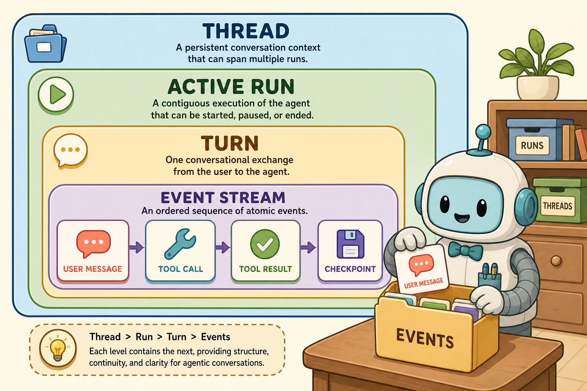
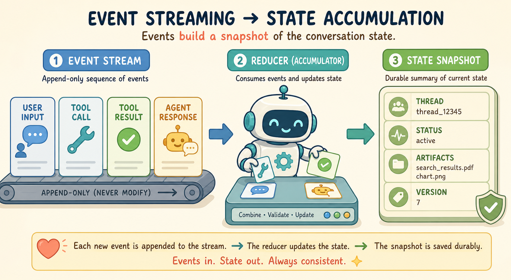
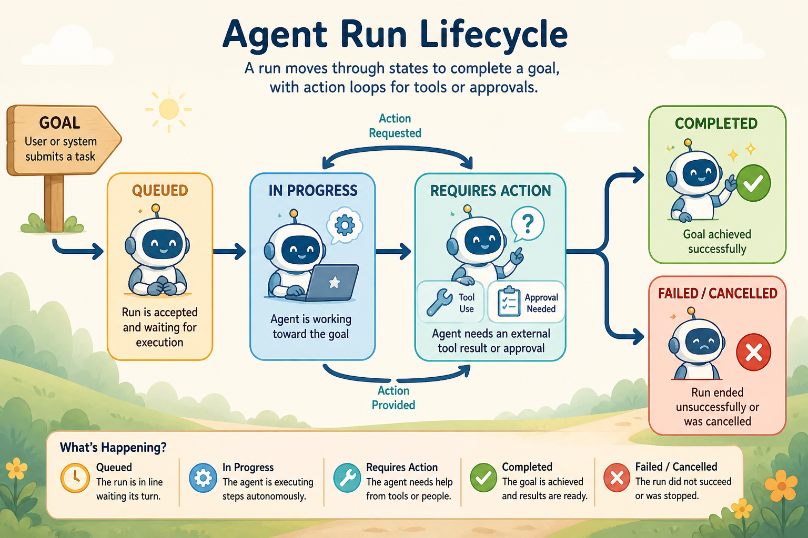

<!--
---
title: Run, thread, and event models
unit_id: P1-03-04-01
summary: Separate continuing conversations, task attempts, events and state, with
  explicit lifecycle conventions and runtime ownership.
prerequisites:
- Read [Planning and reasoning](../03-planning-and-reasoning/chapter-plan.md).
learning_objectives:
- Define thread, run, turn and event conventions.
- Distinguish state snapshots and event history.
- Interpret lifecycle endpoints without assuming task success.
- Separate harness, execution environment and application ownership.
source_records:
- p1-03-04-01-cloudevents-specification-1-0
- p1-03-04-01-langgraph-persistence-2026
- p1-03-04-01-openai-managed-architecture-2026
- p1-03-04-01-openai-deprecations-2026
visual_assets:
- assets/images/03-building-blocks/04-state-and-lifecycle/01-run-thread-and-event-models/01-run-thread-turn-hierarchy.png
- assets/images/03-building-blocks/04-state-and-lifecycle/01-run-thread-and-event-models/02-event-stream-and-state-accumulation.png
- assets/images/03-building-blocks/04-state-and-lifecycle/01-run-thread-and-event-models/03-run-lifecycle-state-machine.png
example_paths:
- examples/03-building-blocks/04-state-and-lifecycle/01-run-thread-and-event-models/thread_run_event_runtime.py
pass: architecture
learning_path: main
status: complete
last_reviewed: '2026-10-10'
---
-->

# Run, thread, and event models

## Why this matters

Lee asks the shop assistant about an order, then returns later with a delivery question. The application needs to distinguish the continuing conversation from the work performed for each request. It also needs a record of whether a stock lookup finished or a run stopped while waiting.

This chapter names those pieces and follows one small execution. The names are a framework-neutral teaching model; implementations can use different objects and state labels.

## Simple mental model

A **thread** is a continuing record that groups related interactions. A **run** is one attempt to carry out a task. A **turn** is an interaction step; frameworks differ on whether they count user exchanges, model calls or another unit. Define the convention before comparing turn counts.

For Lee, the order conversation is the thread. Answering the first lookup is one run; answering tomorrow's delivery question is another. A run may contain several model and tool steps.



*Figure 1. The hierarchy is this chapter's organizational model. A framework need not expose all three levels with these names.*

## How it works

### Separate records from execution

**State** is the information the runtime uses to decide what to do next, such as a pending tool request or the latest stock count. An **event** records that something happened, such as a tool result arriving. An event may trigger a state change, but the event and the current state answer different questions.

A thread identifier groups records; it is not an access credential. A run identifier distinguishes attempts. Event identifiers help distinguish individual records, and sequence numbers can express order within the application's event stream.

CloudEvents defines an event envelope with metadata such as an identifier, source and type. It does not define an agent's run states or require event sourcing. The example uses its own event objects, not a conforming CloudEvents serializer. [CloudEvents 1.0.2](https://github.com/cloudevents/spec/blob/v1.0.2/cloudevents/spec.md).

### Choose how to remember progress

With **snapshot storage**, the application saves selected current state. With **event sourcing**, the persisted event history is the source from which state is reconstructed. A **reducer** applies an event to state. A reducer can also be useful in a system whose event log is only for diagnostics.

Rebuilding local state from recorded events does not repeat or undo a remote reservation. External outcomes need their own receipts and reconciliation. Replaying a record should not silently perform a fresh side effect.



*Figure 2. Follow the records into the reducer. Durable reconstruction requires an actual persistence backend, retained events and compatible reducer code.*

LangGraph distinguishes checkpointers for thread-scoped graph state from stores for cross-thread application data. An in-memory implementation loses its contents when the process exits. [Persistence](https://docs.langchain.com/oss/python/langgraph/persistence).

### Define a lifecycle that matches the application

The illustration and mock use these application-defined labels:

| Label | Meaning in this example |
| --- | --- |
| QUEUED | A run is waiting to start |
| IN_PROGRESS | The runtime is processing steps |
| REQUIRES_ACTION | A named external result or decision is needed |
| COMPLETED | The runtime reached its normal endpoint |
| FAILED | Processing ended with an error |

The diagram also shows cancellation as a possible terminal outcome. The small script does not implement cancellation; the [termination chapter](04-termination-cancellation-and-cleanup.md) develops that contract. Define owners, deadlines and permitted transitions for every waiting state.



*Figure 3. These labels illustrate lifecycle design rather than a universal standard. COMPLETED records a runtime endpoint; separate evaluation establishes whether the user received a correct answer.*

### Name the owner of the runtime

An application can own its model-and-tool loop or call a provider-managed harness. A **harness** is the surrounding software that runs the loop and supplies its operating context. The execution environment, where commands and files are handled, can have a different owner from the harness.

The current OpenAI Agents API documents a provider-managed harness, optional environment and application server. The application still handles its function tools and product integration. This differs from treating every SDK run as a remotely stored hosted thread. [Agents API architecture](https://developers.openai.com/api/docs/guides/agents-api/architecture).

The former Assistants API is a historical example: its documented shutdown date was 2026-08-26. Its status vocabulary should not define all current runtime designs. [Deprecations](https://developers.openai.com/api/docs/deprecations).

## Worked example

The [offline runtime](../../../examples/03-building-blocks/04-state-and-lifecycle/01-run-thread-and-event-models/thread_run_event_runtime.py) keeps a thread across two simulated requests. It emits events, records a mocked tool result and updates variables through a reducer. It demonstrates grouping and projection of events into state.

## Minimal implementation

<details><summary>Expand minimal Python implementation</summary>

```python
if event.event_type == EventType.TOOL_EXECUTION_COMPLETED:
    name = event.payload.get("store_as")
    if name:
        self.variables[name] = event.payload.get("result")
```

</details>

The script uses process-local dictionaries and a mocked model. It does not persist across crashes, verify task quality or implement distributed concurrency. Its recorded plan text is a mock runtime event, not access to a model's hidden reasoning.

## Limitations and trade-offs

Retained histories can grow beyond a model request's context budget. A durable store and a context-selection policy solve different problems. Concurrent writers also need an explicit ordering or conflict policy. These responsibilities continue in [checkpoints and resumption](02-checkpoints-interrupts-and-resumption.md) and the optional concurrency chapter.

Run state tracks execution progress. Reusable [memory](../05-memory/chapter-plan.md) helps future decisions, while [planning](../03-planning-and-reasoning/chapter-plan.md) chooses the work to attempt.

## Security preview

State identifiers, stored content and event delivery introduce boundaries studied in [instructions, context and model security](../../07-security-by-component-and-workflow-stage/01-instructions-context-and-models/chapter-plan.md).

## Key takeaways

- Define thread, run and turn conventions for the chosen runtime.
- Events describe occurrences; state supports the next decision.
- Durable storage and event replay do not guarantee correct task outcomes.
- Name who owns the harness, tool handlers and execution environment.

<details><summary>Check your understanding</summary>

Does a COMPLETED run prove Lee's answer was correct? No. It reports an execution endpoint. Task evaluation needs its own evidence.

</details>

## References

- CNCF. [CloudEvents 1.0.2](https://github.com/cloudevents/spec/blob/v1.0.2/cloudevents/spec.md).
- LangChain. [LangGraph persistence](https://docs.langchain.com/oss/python/langgraph/persistence).
- OpenAI. [Agents API architecture](https://developers.openai.com/api/docs/guides/agents-api/architecture) and [deprecations](https://developers.openai.com/api/docs/deprecations).
- Living documentation checked 2026-10-10.

---

[Next unit: Checkpoints, interrupts, and resumption →](02-checkpoints-interrupts-and-resumption.md)
