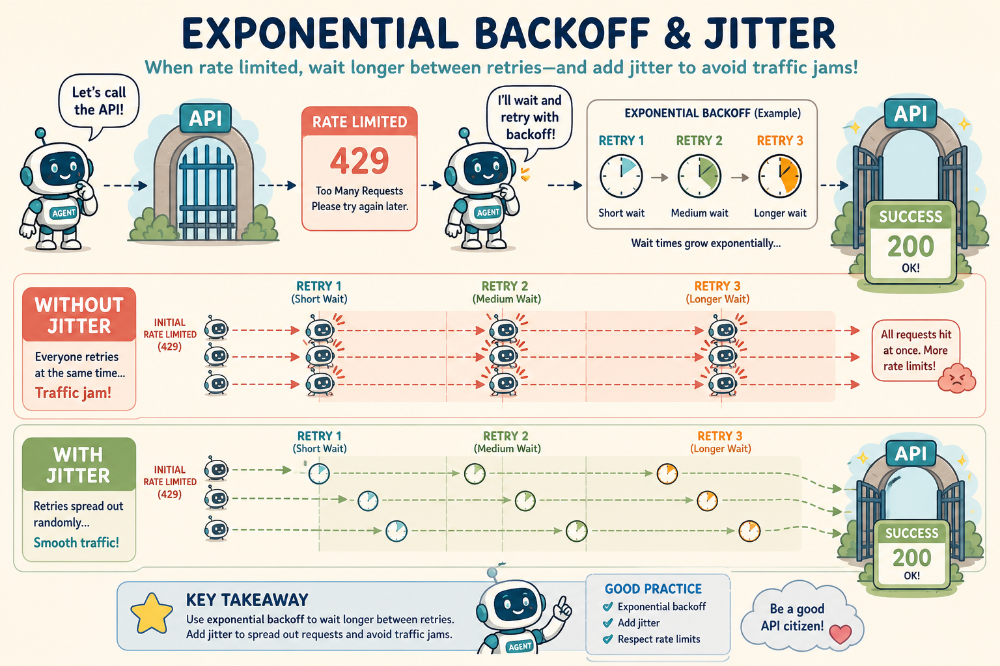
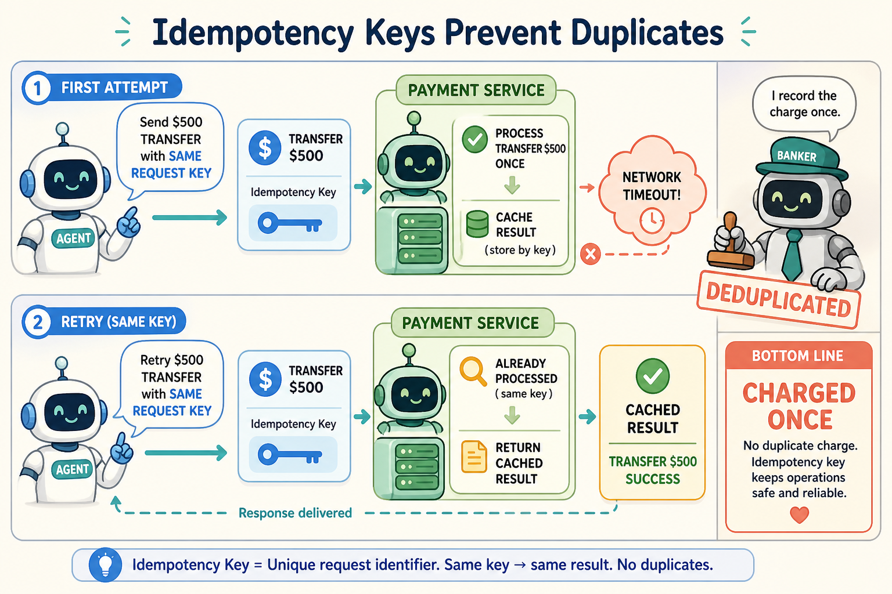
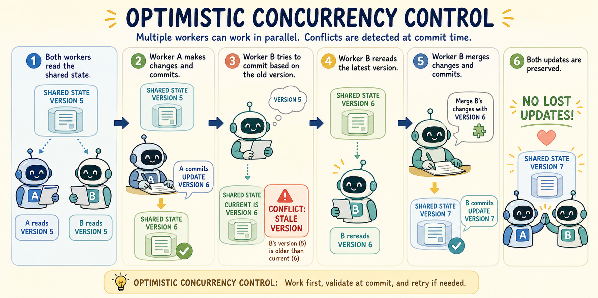

<!--
---
title: Retries, idempotency, and concurrency
unit_id: P1-03-04-03
summary: Explains resilient tool retries with exponential backoff and jitter, idempotency
  keys for duplicate side-effect prevention, and concurrency controls in multi-agent
  runtimes.
prerequisites:
- Read [Checkpoints, interrupts, and resumption](02-checkpoints-interrupts-and-resumption.md).
learning_objectives:
- Differentiate between transient network/model errors and permanent contract/logic
  failures.
- Implement exponential backoff with full jitter to prevent thundering herd retry
  storms.
- Explain the service contract needed to deduplicate mutation retries.
- Apply optimistic concurrency control and version vectors to prevent state corruption
  during parallel execution.
source_records:
- p1-03-04-03-ietf-httpapi-idempotency-key-2024
- p1-03-04-03-aws-exponential-backoff-jitter-2023
- p1-03-04-03-langgraph-concurrency-and-locks-2024
- p1-03-04-03-martin-kleppmann-distributed-systems-2023
visual_assets:
- assets/images/03-building-blocks/04-state-and-lifecycle/03-retries-idempotency-and-concurrency/01-exponential-backoff-and-jitter.png
- assets/images/03-building-blocks/04-state-and-lifecycle/03-retries-idempotency-and-concurrency/02-idempotency-keys-and-duplicate-prevention.png
- assets/images/03-building-blocks/04-state-and-lifecycle/03-retries-idempotency-and-concurrency/03-optimistic-locking-and-concurrency-control.png
example_paths:
- examples/03-building-blocks/04-state-and-lifecycle/03-retries-idempotency-and-concurrency/retry_idempotency_concurrency.py
pass: architecture
learning_path: deep-dive
status: complete
last_reviewed: '2026-10-10'
---
-->

# Retries, idempotency, and concurrency

## Why this matters

The order service receives a reservation request, but its reply is lost. The assistant cannot infer from a timeout whether the reservation exists. A retry must preserve the operation's intended identity.

**Idempotency** gives repeated requests a defined effect under the service contract. **Concurrency** concerns operations that overlap. Keys, storage and conflict checks work together; a key alone does not prevent duplicates.

## Simple mental model

Think of ordering food on a delivery app over an unstable mobile connection:

1. **The transient error:** you press "Place Order ($35)", but your phone loses cellular signal for two seconds and displays a connection error.
2. **The idempotency key:** the app attaches a unique order token (`order_id: 88291`) to the request. Even if you press "Retry" three times, the restaurant server checks the token, sees the charge was already processed, and confirms the existing order instead of cooking three separate meals.
3. **Exponential backoff with jitter:** rather than hammering the restaurant server every millisecond, the app waits one second, then three seconds, adding slight randomized delays so millions of phones do not crash the payment gateway simultaneously.
4. **Optimistic concurrency:** if you and your spouse both have the shared family cart open on two phones, the app verifies the cart version before checkout. If one person adds drinks while the other checks out, the second phone is prompted to refresh rather than silently overwriting the cart.

Retry, deduplication and conflict handling need coordinated service contracts. They reduce particular failure modes without promising exactly-once execution across all systems.

## Position in the agent workflow

Retry, idempotency, and concurrency controls sit at the execution boundary between the agent runtime, external tool APIs, and the state checkpointer.

When a tool call fails, the retry manager determines whether the error is transient before scheduling a jittered re-invocation. When mutating external systems, the dispatch layer attaches deterministic idempotency keys. When multiple nodes or subagents commit state deltas in parallel, the example state store checks an expected version to detect conflicting updates.

## How it works

Reliable execution and concurrency control operate across four core mechanisms:

### 1. Transient versus permanent error classification

Before retrying, the runtime must classify the error:

- **Transient errors (retriable):** Temporary HTTP 429 (rate limits), HTTP 503 (service unavailable), socket timeouts, and transient database lock contentions. These failures warrant automated retries.
- **Permanent errors (non-retriable):** HTTP 400 (malformed JSON/arguments), HTTP 401/403 (unauthorized/forbidden), and schema validation rejections. Retrying permanent errors wastes tokens and compute without resolving the root cause.

### 2. Exponential backoff and jitter algorithms

When retrying transient errors, naive fixed-interval retries cause synchronized waves of traffic known as **thundering herds** (AWS Architecture Center, 2023). Robust runtimes apply exponential backoff with **full jitter**:

$$t_{	ext{sleep}} = 	ext{Uniform}\left(0, \min\left(t_{\max}, t_{	ext{base}} \cdot 2^{	ext{attempt}}
ight)
ight)$$

Randomizing the sleep duration spreads client retry traffic evenly across the recovery window, allowing recovering upstream services to stabilize.



*Figure 1. Exponential backoff with jitter. Randomized delays distribute retries while the upstream service recovers.*

### 3. Idempotency keys for safe mutation retries

An operation is **idempotent** if repeating it has the same intended effect as applying it once. Responses and timestamps may differ. A mutation API can offer a deduplication contract for retries; a header alone does not create that contract. For state-mutating HTTP POST or tool requests:

1. Our example derives an **idempotency key** from a logical step and canonical arguments. Reuse the same key for retries of the same operation, and a new key for a genuinely new operation. The hash formula is a local convention:

$$	ext{Key} = 	ext{SHA256}(	ext{thread\_id} \,||\, 	ext{step\_id} \,||\, 	ext{args})$$

2. A supporting service checks a key within its stated scope and retention period. It must reject reuse with different arguments and coordinate deduplication with the mutation. An ambiguous network result still needs reconciliation when the service cannot establish what happened.



*Figure 2. Idempotent retry. A supporting service can return a recorded result for the same logical request. This requires server-side deduplication and a valid retention window.*

### 4. Optimistic concurrency control (OCC)

When parallel subagents or asynchronous event workers access shared thread state, uncoordinated writes cause **lost updates** (LangChain, 2024; Kleppmann, 2023). Under Optimistic Concurrency Control:

1. A worker reads the current state snapshot and records its `version` integer (e.g. `version = 4`).
2. The worker computes its state delta.
3. The worker attempts to commit the delta specifying `expected_version = 4`.
4. If another worker already committed `version = 5`, the store rejects the stale commit; an HTTP wrapper may represent that as `409 Conflict`.
5. The rejected worker re-reads `version = 5`, reconciles its state delta via an associative state reducer, and retries the commit.



*Figure 3. Optimistic concurrency control. Version checking rejects stale writes so parallel workers do not silently lose one another's updates.*

## Main variants

1. **Idempotency-Key proposal:** The linked document is an expired Internet-Draft, not an RFC, as checked on 2026-10-10. Services can support their own documented idempotency contract. [IETF record](https://datatracker.ietf.org/doc/draft-ietf-httpapi-idempotency-key-header/).
2. **LangGraph State Reducers:** Employs typed state channels with associative operator reducers (such as append or merge) allowing parallel graph branches to write state deltas without race conditions (LangChain, 2024).
3. **Distributed lease locks:** A lease grants a worker a time-limited claim. A paused worker can continue after its lease expires. Use a fencing token, an increasing generation number checked by the resource being changed, to reject stale writes. A lease alone does not guarantee exclusive execution.

## Minimal implementation

The following Python snippet demonstrates exponential backoff with jitter, idempotency key caching, and optimistic concurrency version checking. The [full runnable example](../../../examples/03-building-blocks/04-state-and-lifecycle/03-retries-idempotency-and-concurrency/retry_idempotency_concurrency.py) simulates concurrent worker updates and deduplicated mutations.

<details>
<summary>Expand minimal Python implementation</summary>

```python
from dataclasses import dataclass
import random
import time
from typing import Any, Dict, Optional, Tuple

class IdempotencyCache:
    def __init__(self):
        self.cache: Dict[str, Dict[str, Any]] = {}

    def execute_idempotent(self, key: str, payload: Dict[str, Any]) -> Tuple[Dict[str, Any], bool]:
        if key in self.cache:
            return self.cache[key], True  # Cached result, 0 side effects
        result = {"txn_id": "txn_001", "status": "COMMITTED", "data": payload}
        self.cache[key] = result
        return result, False

@dataclass
class VersionedState:
    version: int
    data: Dict[str, Any]

class OCCStore:
    def __init__(self):
        self.state = VersionedState(version=1, data={})

    def commit(self, expected_version: int, new_data: Dict[str, Any]) -> VersionedState:
        if self.state.version != expected_version:
            raise ValueError(f"OCC Conflict: Stale version {expected_version}, current is {self.state.version}")
        self.state = VersionedState(version=self.state.version + 1, data=new_data)
        return self.state

def retry_with_jitter(fn, max_retries=3, base=0.1, max_delay=1.0):
    for attempt in range(max_retries):
        try:
            return fn()
        except Exception:
            if attempt == max_retries - 1:
                raise
            delay = random.uniform(0, min(max_delay, base * (2 ** attempt)))
            time.sleep(delay)
```

</details>

Run [retry_idempotency_concurrency.py](../../../examples/03-building-blocks/04-state-and-lifecycle/03-retries-idempotency-and-concurrency/retry_idempotency_concurrency.py) to inspect the deduplicated execution trace, retry timing calculations, and OCC conflict resolution.

## Data flow and state changes

1. **Tool dispatch:** The agent generates tool arguments and derives a deterministic `Idempotency-Key`.
2. **Transient failure:** The downstream service times out or returns HTTP 429.
3. **Jittered backoff:** The retry governor calculates exponential sleep with full jitter and pauses execution.
4. **Deduplicated re-invocation:** The agent resends the request with the identical `Idempotency-Key`.
5. **State merge:** The result returns and the worker attempts an OCC commit specifying the expected thread version.
6. **Conflict reconciliation:** If another concurrent subagent modified state in the interim, the worker re-reads the latest snapshot and reapplies its delta.

## Trust boundaries

- **Idempotency key scope:** Idempotency keys must be scoped to specific tenant and thread boundaries to prevent an attacker from predicting keys and causing cross-tenant cache poisoning.
- **Retry budget boundaries:** Retries must have strict global invocation and token limits. A model caught in a non-convergent retry loop must be terminated by the runtime.
- **Concurrency race protection:** Shared persistent state stores must enforce atomic Compare-And-Swap (CAS) or version vector validation at the database level.

## Reliability failures

- **Idempotency key collision:** If keys are derived without incorporating unique argument parameters, distinct legitimate operations can accidentally return cached results from earlier steps.
- **Retry amplification storm:** Unbounded retries across multiple interconnected microservices can cascade into an uncontrollable traffic storm that prevents service recovery.
- **OCC starvation under high contention:** If dozens of subagents write to a single thread state simultaneously, repeated OCC conflict rejections can cause high latency and worker starvation.

## Limitations and trade-offs

- **Cache storage overhead:** Maintaining idempotency key stores across millions of transactions requires memory-efficient caching with Time-To-Live (TTL) expiration policies.
- **Latency overhead:** Exponential backoff delays increase overall end-to-end task completion times during degraded network conditions.
- **Complexity of distributed locking:** Implementing distributed leases requires reliable consensus backends and careful lease timeout tuning to prevent split-brain execution.

## Security preview

In Pass 2, retry and concurrency architectures are evaluated against **Race Conditions, Replay Forgery, and Resource Exhaustion via Retries**. Attackers exploit concurrent state writes to create double-spend conditions, forge idempotency keys to suppress critical alerts, or trigger retry loops to exhaust billing quotas. We examine atomic transaction gates, cryptographically hashed idempotency tokens, and distributed rate limiters in [Instructions, context, and model security](../../07-security-by-component-and-workflow-stage/01-instructions-context-and-models/chapter-plan.md).

## Open research questions

- How can multi-agent systems automatically synthesize conflict-free replicated data types (CRDTs) to eliminate OCC retry conflicts in highly concurrent group chats?
- What dynamic retry algorithms can automatically adapt backoff parameters based on real-time cluster telemetry rather than static heuristic formulas?

## Key takeaways

- Distinguishing between transient network errors and permanent validation failures prevents wasteful retries.
- Exponential backoff combined with full jitter prevents thundering herd retry storms when downstream services recover.
- Idempotency depends on the service-side operation identity, retained records, request comparison and atomic effect handling.
- Optimistic Concurrency Control (OCC) and version vectors maintain thread state consistency during parallel multi-agent execution.

<details><summary>Check your understanding</summary>

Is an idempotency key enough without service-side handling? No. The service must define storage, comparison, atomicity and the relevant lifetime.

</details>

## References

- IETF HTTPAPI Working Group. [The Idempotency-Key HTTP Header Field](https://datatracker.ietf.org/doc/draft-ietf-httpapi-idempotency-key-header/). Revision 07, October 15, 2025; expired April 18, 2026. Not an RFC.
- AWS Architecture Center. *Exponential Backoff And Jitter*. Amazon Web Services, 2023. [AWS Architecture](https://aws.amazon.com/blogs/architecture/exponential-backoff-and-jitter/).
- LangChain Community. *Managing Concurrency and Parallel Branching in LangGraph*. LangGraph Documentation, 2024. [LangGraph Concurrency](https://docs.langchain.com/oss/python/langgraph/concurrency).
- Kleppmann, M. *Designing Data-Intensive Applications: Concurrency Control and Idempotency*. O'Reilly Media, 2023. [Designing Data-Intensive Applications](https://dataintensive.net/).

---

[Next Unit: Termination, cancellation, and cleanup →](chapter-plan.md)
