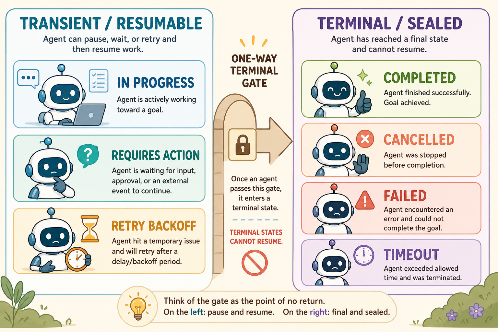
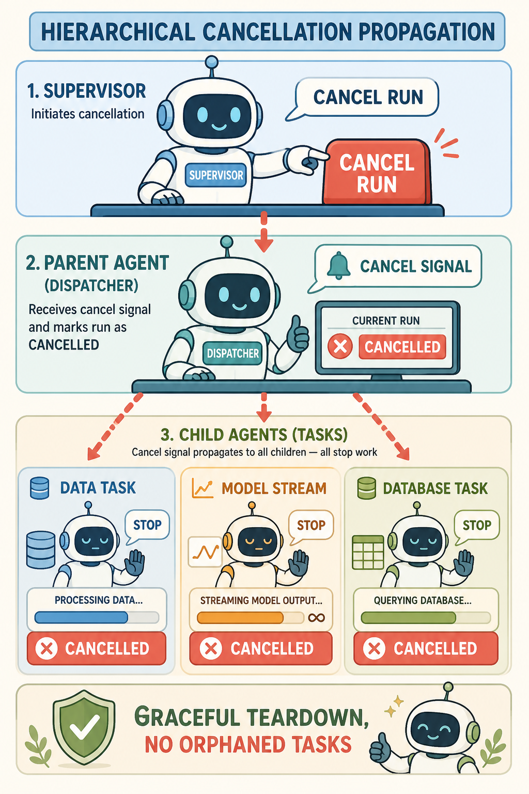
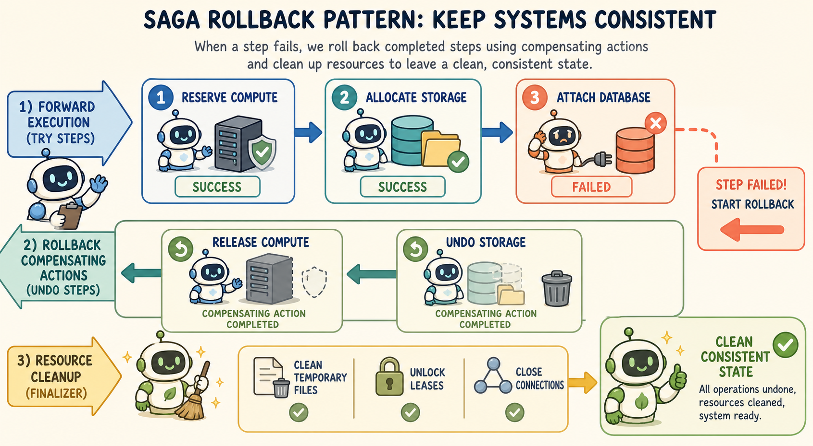

<!--
---
title: Termination, cancellation, and cleanup
unit_id: P1-03-04-04
summary: Distinguish stopping from successful completion; explain cooperative cancellation,
  compensating actions and resource cleanup limits.
prerequisites:
- Read [Retries, idempotency, and concurrency](03-retries-idempotency-and-concurrency.md).
learning_objectives:
- Distinguish transient and terminal states in a stated runtime contract.
- Explain why cancellation requests need acknowledgement and may leave external work
  running.
- Use compensating actions while recognizing that they can fail or differ from rollback.
- Plan resource finalization and recovery for process crashes.
source_records:
- p1-03-04-04-autogen-termination-2024
- p1-03-04-04-temporal-cancellation-compensation-2024
- p1-03-04-04-langgraph-cancellation-tokens-2024
- p1-03-04-04-garcia-molina-sagas-1987
visual_assets:
- assets/images/03-building-blocks/04-state-and-lifecycle/04-termination-cancellation-and-cleanup/01-terminal-state-classification.png
- assets/images/03-building-blocks/04-state-and-lifecycle/04-termination-cancellation-and-cleanup/02-cancellation-propagation-hierarchy.png
- assets/images/03-building-blocks/04-state-and-lifecycle/04-termination-cancellation-and-cleanup/03-compensating-actions-saga-rollback.png
example_paths:
- examples/03-building-blocks/04-state-and-lifecycle/04-termination-cancellation-and-cleanup/cancellation_sagas_cleanup.py
pass: architecture
learning_path: main
status: complete
last_reviewed: '2026-10-10'
---
-->

# Termination, cancellation, and cleanup

## Why this matters

Lee cancels while a remote reservation is processing. The local worker can stop waiting while the service still finishes. The application needs to report that uncertainty and reconcile the outcome.

**Termination** ends a run, **cancellation** requests that work stop and **cleanup** releases resources. An undo operation, when available, is a separate effect that can also fail.

## Simple mental model

Think of an automated flight and hotel booking service:

1. **The forward workflow:** the agent reserves a flight ticket, reserves a rental car, and attempts to book a hotel room.
2. **The unexpected failure:** the hotel API rejects the reservation because no rooms remain available.
3. **The compensating rollback (the Saga):** rather than leaving the user with an isolated flight ticket and rental car, the system automatically triggers compensating actions in reverse order: it cancels the rental car reservation and refunds the flight ticket.
4. **The cancellation signal:** if the user presses "Cancel Booking" while the agent is searching, the system immediately halts background search queries and releases temporary hold holds.
5. **Final cleanup:** the booking session is sealed as `CANCELLED`, temporary payment tokens are wiped, and zero orphaned charges remain.

Cancellation, cleanup and compensation have separate outcomes. A compensating action can fail or only partially reverse an effect; record unresolved work for reconciliation.

## Position in the agent workflow

Termination and cleanup sit at the exit boundary of the agent lifecycle. Regardless of whether an agent finishes through natural goal satisfaction, explicit user cancellation, policy rejection, or hard execution timeout, the runtime intercepts the exit transition.

The finalizer executes compensating actions for any partially completed subtasks, closes network descriptors and temporary sandbox folders, persists the terminal status in the checkpointer database, and flushes audit logs.

## How it works

Structured termination and resource cleanup operate across four core mechanisms:

### 1. Terminal states versus transient states

Our example distinguishes transient states from terminal states. The names and allowed transitions are runtime-specific:

- **Transient states:** `QUEUED`, `IN_PROGRESS`, `REQUIRES_ACTION`, and `RETRY_BACKOFF`. These states hold active leases and can transition to other states.
- **Terminal states:** `COMPLETED` (execution finished), `CANCELLED` (user or supervisor abort), `FAILED_FATAL` (unrecoverable error), and `TIMEOUT` (execution budget exhausted). In this example, new work after termination uses a new run ID. Other runtimes support different continuation and correction mechanisms.



*Figure 1. State classification. A transient state can resume or change, while a terminal state is sealed and requires a new run for new work.*

### 2. Hierarchical cancellation token propagation

When a user or supervisor aborts an active run, the runtime emits an **Abort Signal / Cancellation Token** (Temporal Technologies, 2024; LangChain, 2024). The signal propagates hierarchically:

1. The parent run sets its cancellation flag.
2. In-flight LLM token streaming connections are closed immediately to halt token billing.
3. Cancellation signals are delivered to all active child subagents and background worker tasks.
4. Active tool workers detect the cancellation token cooperatively and abort long-running computations.



*Figure 2. Cancellation propagation. The same cancellation signal reaches every active child task so that no orphaned work continues after a run is aborted.*

### 3. The Saga pattern and compensating actions

When a multi-step workflow fails midway through execution, traditional database ACID rollbacks are impossible because external tools and microservices have already executed real-world side effects. Agent runtimes apply the **Saga Pattern** (Garcia-Molina & Salem, 1987; Temporal Technologies, 2024):

- Every forward tool action $F_i$ is paired with a corresponding backward compensating action $C_i$ (such as `provision_vm` paired with `delete_vm`).
- If step $k$ fails, the runtime pauses forward execution and invokes compensating actions for all previously completed steps in reverse order:

$$	ext{Rollback Sequence} = [C_{k-1}, C_{k-2}, ..., C_1]$$

Compensating actions restore the external environment to a consistent baseline state.



*Figure 3. Saga compensation. After a later action fails, the runtime reverses earlier completed actions in the opposite order before finalizing resources.*

### 4. Deterministic resource finalization

When the runtime observes a terminal state, it attempts its finalizers. A crashed or disconnected process may not run them, so durable resources need an independent lifecycle owner.

- Releases distributed locks and thread leases in Redis or Consul.
- Deletes temporary working directories, scratch files, and sandbox containers.
- Closes database connection pools and open socket descriptors.
- Emits terminal audit records and telemetry metrics.

## Main variants

1. **Rule-Based Termination (AutoGen):** Multi-agent conversations define explicit termination conditions (such as detecting `TERMINATE` strings, reaching max consecutive turns, or evaluating custom boolean predicates) (Microsoft, 2024).
2. **Temporal Cancellation Scopes:** Workflows wrap subtasks in nested cancellation scopes that automatically invoke cleanup handlers upon receiving external cancellation signals (Temporal Technologies, 2024).
3. **LangGraph Finalizers and Rollback Channels:** Graph workflows define cleanup nodes connected to error edges, ensuring state teardown occurs before graph exit (LangChain, 2024).

## Minimal implementation

The following Python snippet demonstrates cooperative cancellation token checking and Saga compensating action rollback. The [full runnable example](../../../examples/03-building-blocks/04-state-and-lifecycle/04-termination-cancellation-and-cleanup/cancellation_sagas_cleanup.py) demonstrates VM reservation, storage provisioning, database attachment failure, and clean backward compensation.

<details>
<summary>Expand minimal Python implementation</summary>

```python
from dataclasses import dataclass
from enum import Enum, auto
from typing import Callable, List, Tuple

class TerminalState(Enum):
    COMPLETED = auto()
    CANCELLED = auto()
    FAILED_COMPENSATED = auto()

@dataclass
class SagaStep:
    name: str
    forward: Callable[[], bool]
    compensate: Callable[[], bool]

class SagaManager:
    def __init__(self):
        self.completed = []

    def run(self, steps: List[SagaStep], is_cancelled: bool) -> Tuple[TerminalState, List[str]]:
        log = []
        for step in steps:
            if is_cancelled:
                self.rollback(log)
                return TerminalState.CANCELLED, log

            if step.forward():
                self.completed.append(step)
                log.append(f"Step {step.name} passed")
            else:
                log.append(f"Step {step.name} failed; rolling back")
                self.rollback(log)
                return TerminalState.FAILED_COMPENSATED, log

        return TerminalState.COMPLETED, log

    def rollback(self, log: List[str]):
        while self.completed:
            step = self.completed.pop()
            step.compensate()
            log.append(f"Compensated {step.name}")
```

</details>

Run [cancellation_sagas_cleanup.py](../../../examples/03-building-blocks/04-state-and-lifecycle/04-termination-cancellation-and-cleanup/cancellation_sagas_cleanup.py) to inspect the complete forward execution trace, failure detection, and compensating rollback execution.

## Data flow and state changes

1. **Execution dispatch:** The agent executes forward steps, registering each completed step in the saga stack.
2. **Interrupt or failure event:** An in-flight step returns a fatal error or the client issues an abort signal.
3. **Cancellation propagation:** The runtime interrupts active child workers and stops token generation.
4. **Compensation loop:** The runtime pops completed steps from the stack and executes their compensating actions in LIFO order.
5. **State finalization:** The runtime commits the terminal status (`FAILED_COMPENSATED` or `CANCELLED`) to the checkpointer.
6. **Resource teardown:** All temporary storage, leases, and connections are released.

## Trust boundaries

- **Cancellation authority:** Cancellation endpoints must authenticate callers to ensure that malicious actors cannot spoof cancellation signals to abort critical system workflows.
- **Compensation isolation:** Compensating actions must execute with verified credentials and isolated execution bounds so that a failed rollback does not escalate into wider system corruption.
- **Terminal state immutability:** Checkpointer storage must enforce read-only immutability on terminal records to prevent unauthorized reopening or tampering with concluded runs.

## Reliability failures

- **Dangling child tasks:** If cancellation tokens are not passed cooperatively to child processes, orphaned background tasks continue running and wasting compute.
- **Partial compensation failure:** If a compensating action itself fails (for example, due to network drop during cloud volume deletion), the system enters an inconsistent partial state requiring manual administrator intervention.
- **Resource leak on crash:** If a host server crashes during finalization before cleanup handlers execute, persistent leases can remain locked until lease TTL expiration.

## Limitations and trade-offs

- **Compensation complexity:** Writing and testing reliable compensating actions for every forward tool call adds substantial development and verification effort.
- **Non-compensable side effects:** Certain real-world actions (such as sending an SMS or publishing an email) cannot be undone; they can only be mitigated with follow-up apology notices.
- **Teardown latency:** Executing multi-step compensating rollbacks adds latency before a failed run can return its final response.

## Security preview

In Pass 2, termination and cleanup architectures are evaluated against **Denial of Service via Forged Cancellation, Orphaned Resource Exploitation, and Incomplete Rollback Tampering**. Attackers exploit partial rollbacks to leave vulnerable intermediate accounts open or flood cancellation endpoints to terminate security audits. We examine cryptographically verified abort signals, idempotent compensation verification, and automated lease reclamation in [Instructions, context, and model security](../../07-security-by-component-and-workflow-stage/01-instructions-context-and-models/chapter-plan.md).

## Open research questions

- How can LLMs autonomously generate verified, safe compensating action scripts when interacting with novel or unversioned third-party APIs?
- How should a workflow report and reconcile a failed compensation when the external system cannot undo the original operation?

## Key takeaways

- Terminal labels express lifecycle outcomes under the application contract. Storage must still enforce the intended transition and mutation rules.
- Cancellation tokens propagate hierarchically down agent trees to halt child subagents, network calls, and token generation immediately.
- The Saga pattern pairs every forward tool invocation with a backward compensating action to roll back partial side effects upon failure.
- Cleanup handlers attempt release; interrupted or failed cleanup requires reconciliation of remaining resources.

<details><summary>Check your understanding</summary>

Is cancellation equivalent to rollback? No. Cancellation asks work to stop; reversing a completed effect needs a separate supported operation.

</details>

## References

- Microsoft Research. *AutoGen: Termination Conditions, Stop Signals, and Cleanup*. AutoGen Documentation, 2024. [AutoGen Termination](https://microsoft.github.io/autogen/stable/user-guide/agentchat-user-guide/tutorial/termination.html).
- Temporal Technologies. *Workflow Cancellation, Scope Cleanup, and Compensating Actions*. Temporal Documentation, 2024. [Temporal Cancellation](https://docs.temporal.io/workflows#cancellation-scopes).
- LangChain Community. *Managing Cancellation, Timeouts, and Cleanup in LangGraph*. LangGraph Documentation, 2024. [LangGraph Cancellation](https://docs.langchain.com/oss/python/langgraph/cancellation).
- Garcia-Molina, H., & Salem, K. *Sagas*. ACM SIGMOD International Conference on Management of Data, 1987. [ACM Digital Library](https://doi.org/10.1145/38713.38742).

---

[Next Unit: Memory versus context and state →](../05-memory/chapter-plan.md)
