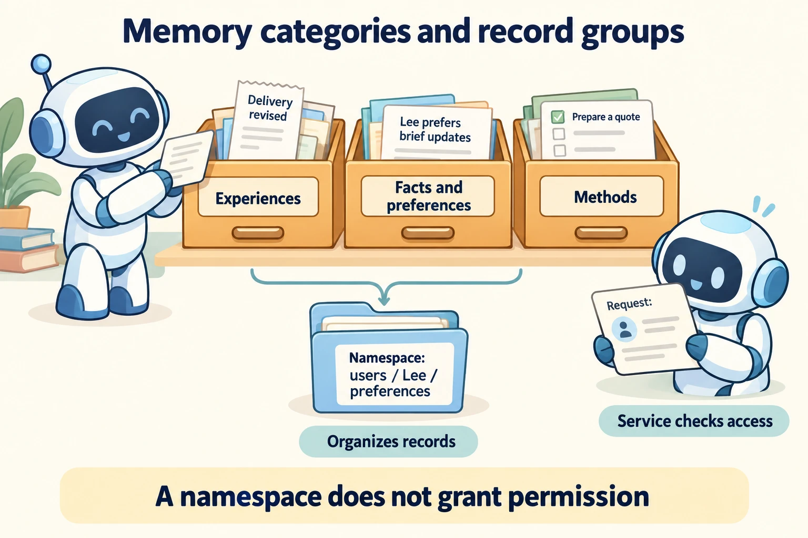
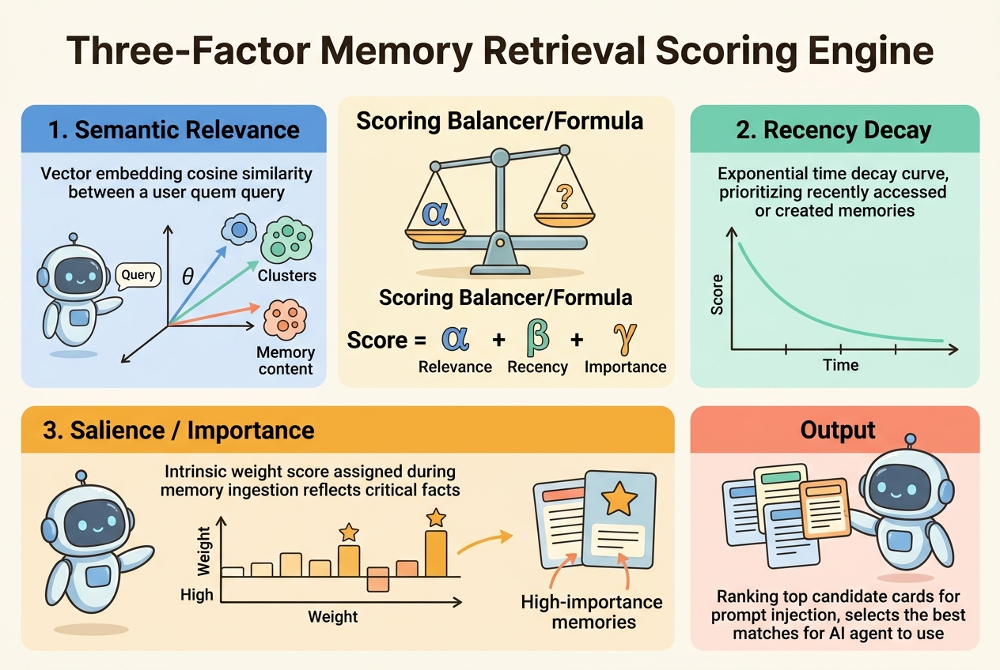
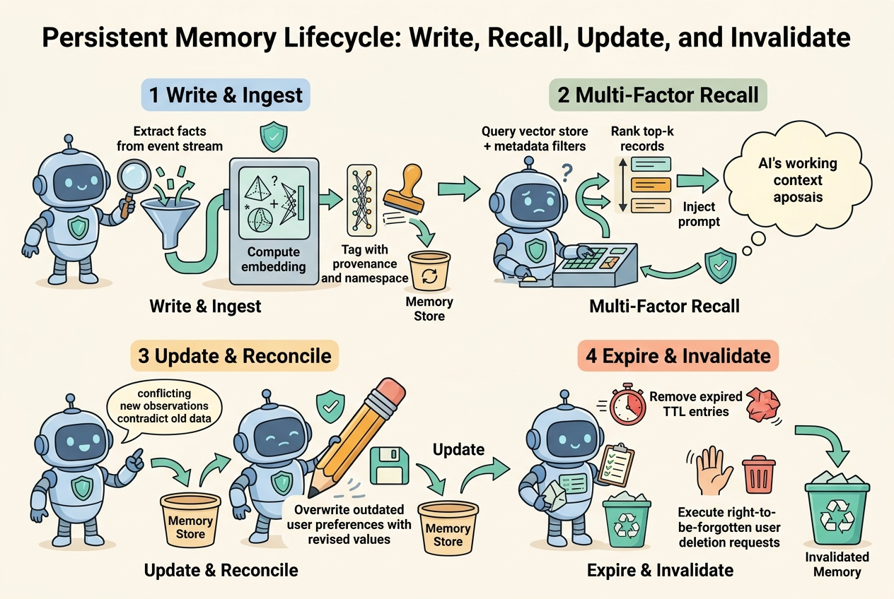

<!--
---
title: Persistent memory types and lifecycle
unit_id: P1-03-05-03
summary: Follow reusable memory records through writing, ranked recall, updates and
  deletion, with explicit storage and access limitations.
prerequisites:
- Read [Short-term and working memory](02-short-term-and-working-memory.md).
learning_objectives:
- Distinguish experience records, facts and reusable methods.
- Explain namespace organization separately from authorization.
- Evaluate recall signals and record lifecycle responsibilities.
source_records:
- p1-03-05-03-park-generative-agents-2023
- p1-03-05-03-packer-memgpt-2023
- p1-03-05-03-langgraph-stores-2026
visual_assets:
- assets/images/03-building-blocks/05-memory/03-persistent-memory-types-and-lifecycle/01-persistent-memory-taxonomy-and-namespaces.webp
- assets/images/03-building-blocks/05-memory/03-persistent-memory-types-and-lifecycle/02-three-factor-retrieval-scoring.png
- assets/images/03-building-blocks/05-memory/03-persistent-memory-types-and-lifecycle/03-persistent-memory-crud-lifecycle.png
example_paths:
- examples/03-building-blocks/05-memory/03-persistent-memory-types-and-lifecycle/persistent_memory_runtime.py
pass: architecture
learning_path: main
status: complete
last_reviewed: '2026-10-10'
---
-->

# Persistent memory types and lifecycle

## Why this matters

Lee asks the shop assistant to remember a preference for concise delivery updates. Next week, a new conversation starts. The preference can help only if the application saved it, can find it and decides it is still relevant.

**Persistent memory** stores reusable information beyond one run. It does not imply that every conversation should be retained, or that the model remembers stored information without receiving it. This chapter follows a record from creation through recall, update and deletion.

## Simple mental model

Think of three kinds of shop notes: a receipt describing what happened, a customer preference describing what currently matters, and a checklist describing how to complete a task. These correspond to useful memory categories:

| Category | Meaning | Shop example |
| --- | --- | --- |
| Episodic | A remembered experience | A delivery estimate was revised yesterday |
| Semantic | A fact or preference | Lee prefers concise updates |
| Procedural | A reusable method | Steps for preparing a delivery quote |

These categories help choose storage and recall behavior. They do not require three separate databases. Experience records may also need correction or deletion; calling them episodic does not make them immutable.

## How it works

### Give records an owner and a purpose

A memory record can contain an identifier, content, owner, source reference, timestamps and an expiry rule. Our shop also records its category and version. Choose fields that answer concrete questions: whose preference is this, where did it come from, and has it changed?

A **namespace** groups records under a name or a sequence of names. For example, `("users", "lee", "preferences")` groups Lee's preferences. A **key** identifies an item within that group. LangGraph stores use namespaces and keys for cross-thread data, with optional semantic search. [Stores](https://docs.langchain.com/oss/python/langgraph/stores).

Naming a group does not authenticate its caller or decide access. The resource service still needs the [identity and authorization](../08-identity-authorization-and-secrets/01-identity-authentication-authorization-and-delegation.md) relationship described later. A caller-controlled namespace string is not evidence of ownership.



*Figure 1. Categories describe the information; namespaces organize records. Access decisions belong to a separate service responsibility.*

### Choose what to write

The application may save an explicit user preference or extract candidate information from an interaction. Extraction can be wrong, so a candidate record and an accepted record may need different states. Preserve the source and the time of the observation.

The *Generative Agents* research uses observations, retrieval and reflections in a particular simulation. *MemGPT* explores model-directed management of context and external memory. These demonstrate possible designs, not a required store layout for every application. [Generative Agents](https://arxiv.org/abs/2304.03442), [MemGPT](https://arxiv.org/abs/2310.08560).

### Recall a useful subset

**Relevance** asks whether a memory helps the current request. **Recency** measures how recently it was created or accessed. **Salience** is an assigned importance estimate. The example combines these three signals to rank records, following the general retrieval approach illustrated by Generative Agents.

The weights are application choices. They do not guarantee useful results. An old but still applicable preference can matter more than a new unrelated note. Current user instructions and approved application rules also have different roles from retrieved memories.



*Figure 2. This is one ranking design. The runnable demo uses word overlap for relevance, while a real implementation might use embeddings or other signals. Neither the weights nor the selected records are guaranteed optimal.*

### Update and remove records deliberately

If Lee changes a preference, locate the relevant record and either replace it or create a new version. Decide what happens to the prior value and to summaries derived from it. **Provenance** is the record of where information came from; it helps find affected derived records.

**Expiration** ends a record's intended lifetime. **Deletion** removes it from a particular store. Neither automatically removes copies in caches, indexes, exports or backups. Document which stores own those operations. Avoid describing a local delete operation as proof of a complete legal deletion process.



*Figure 3. Follow one record around the lifecycle. Expiry and deletion need implementation in each affected store; the arrows are responsibilities, not automatic guarantees.*

## Worked example

The [offline store](../../../examples/03-building-blocks/05-memory/03-persistent-memory-types-and-lifecycle/persistent_memory_runtime.py) writes a preference, an experience note and a method under separate groups. It selects records under Alice's namespace, ranks them, updates a preference and deletes a note. Alice and Bob are synthetic names in this script; the same mechanics apply to Lee's shop record.

## Minimal implementation

<details><summary>Expand minimal Python implementation</summary>

```python
prefix = namespace_prefix.rstrip("/")
if record.namespace != prefix and not record.namespace.startswith(prefix + "/"):
    continue
```

</details>

The separator check keeps `/users/alice2` out of a `/users/alice` search. It implements hierarchical filtering, not authorization. The script uses a Python dictionary that disappears on process exit. It models persistent-memory operations without providing a durable backend or authentication. Its relevance score uses word overlap, not semantic embeddings.

## Limitations and trade-offs

More saved notes can increase search work and introduce distractions. Rank and budget memory for the actual task, and evaluate whether recall improves outcomes. Repeatedly accessing a stale note can keep it highly ranked if the recency policy uses last access; distinguish popularity from correctness.

Continue to [consolidation and forgetting](04-consolidation-forgetting-and-evaluation.md) before applying these ideas to [retrieval](../06-retrieval-and-rag/chapter-plan.md). Execution [state](../04-state-and-lifecycle/chapter-plan.md) records progress; memory provides reusable information for future decisions.

## Security preview

Ownership, retained content and derived records create boundaries studied in [retrieval, memory and data security](../../07-security-by-component-and-workflow-stage/02-retrieval-memory-and-data/chapter-plan.md).

## Key takeaways

- Episodic, semantic and procedural are useful categories, not mandatory storage tiers.
- Namespace organization does not enforce access policy.
- Relevance, recency and salience are choices to evaluate.
- Updating or deleting a source record can leave derived copies to reconcile.

<details><summary>Check your understanding</summary>

Does putting a record under Lee's namespace prove that only Lee can read it? No. The service must authenticate the request and enforce its access policy.

</details>

## References

- Park et al. [Generative Agents](https://arxiv.org/abs/2304.03442). Research architecture, 2023.
- Packer et al. [MemGPT](https://arxiv.org/abs/2310.08560). Research architecture, 2023.
- LangChain. [LangGraph stores](https://docs.langchain.com/oss/python/langgraph/stores). Living documentation, checked 2026-10-10.

---

[Next unit: Consolidation, forgetting, and evaluation →](04-consolidation-forgetting-and-evaluation.md)
