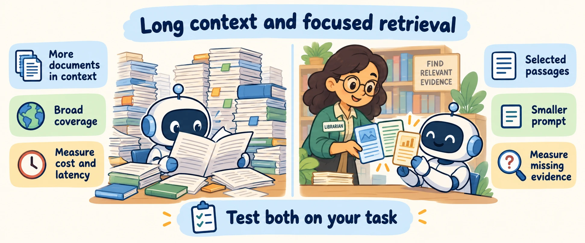
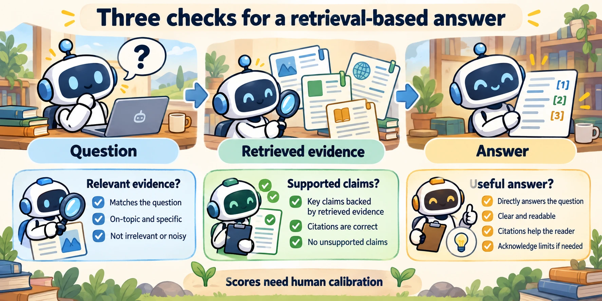

<!--
---
title: Grounding, long context, and retrieval evaluation
unit_id: P1-03-06-04
summary: Compare broad context and retrieval on measured tasks, separate ranking from
  claim support, and explain evaluator limitations.
prerequisites:
- Read [Chunking, ranking, and advanced retrieval](03-chunking-ranking-and-advanced-retrieval.md).
learning_objectives:
- Compare context and retrieval designs without fixed latency promises.
- Interpret ranking metrics with explicit conventions.
- Distinguish evidence support from truth and task usefulness.
source_records:
- p1-03-06-04-liu-lost-middle-2023
- p1-03-06-04-es-ragas-2023
- p1-03-06-04-gemini-long-context-2024
- p1-03-06-04-thakur-beir-2021
- p1-03-06-04-ragas-faithfulness-2026
visual_assets:
- assets/images/03-building-blocks/06-retrieval-and-rag/04-grounding-long-context-and-retrieval-evaluation/01-long-context-versus-retrieval-tradeoffs.webp
- assets/images/03-building-blocks/06-retrieval-and-rag/04-grounding-long-context-and-retrieval-evaluation/02-rag-triad-and-grounding-evaluation.webp
example_paths:
- examples/03-building-blocks/06-retrieval-and-rag/04-grounding-long-context-and-retrieval-evaluation/retrieval_evaluation_runtime.py
pass: architecture
learning_path: main
status: complete
last_reviewed: '2026-10-10'
---
-->

# Grounding, long context, and retrieval evaluation

## Why this matters

Lee asks the shop assistant whether a lamp can be returned after 30 days. The assistant retrieves a policy and gives a confident answer. Three things could still go wrong: it found the wrong policy, misunderstood the right policy, or answered a different question.

**Grounding** means connecting an answer to supplied evidence. **Retrieval-Augmented Generation (RAG)** retrieves evidence before generating an answer. Neither process proves the answer correct. This chapter compares retrieval with long context and shows how to measure the separate steps.

## Simple mental model

The assistant can read a complete policy handbook or search for selected passages. Reading more may preserve useful connections. Searching may remove distractions, but can omit an important exception. A third option searches first and then supplies complete matching documents.

The choice depends on the questions, document set, model and execution budget. Keep the same test questions when comparing designs.

## How it works

### Compare designs on the actual task

A **context window** limits how much input and output a model request can hold. Large windows make broad document input possible, but advertised capacity does not measure how well a model uses every passage. The Gemini 1.5 paper demonstrates long-context capabilities for specific models and tasks; it is historical evidence, not a current model catalog. [Gemini 1.5](https://arxiv.org/abs/2403.05530).

| Question to measure | Broad document context | Retrieval before generation |
| --- | --- | --- |
| What preparation is needed? | Parse and select documents that fit | Also build and maintain a searchable index |
| Where does time go? | Input processing and generation | Search, possible reranking, input processing and generation |
| What costs recur? | Document input, with provider-dependent caching | Index maintenance, search and selected document input |
| What can be missed? | Relevant details among other content | Evidence excluded by search or selection |
| How are changes included? | Supply updated documents or references | Update the source and its indexed representation |
| How is broad synthesis handled? | Supply related documents together | Retrieve larger units or assemble evidence through several searches |

Measure time to first token and time to the complete answer separately. Smaller inputs can reduce model work while search adds another step. Neither design promises sub-second responses.



*Figure 1. Both robots need the same task-level checks. Compare latency, cost and missing evidence rather than choosing from context size alone.*

The 2023 *Lost in the Middle* study found position-sensitive performance in the models and tasks it tested. Use that finding to design position and distractor tests for your chosen model, rather than assuming every current model has the same degradation curve. [Study](https://arxiv.org/abs/2307.03172).

### Assemble evidence and preserve its meaning

Each selected passage needs a document identifier, source version and text. For Lee's question, record the return-policy version and the exception paragraph alongside the main return rule. Instructions can ask the model to cite these references and acknowledge missing evidence.

A citation marker shows which source the model claims to use. Check separately that the referenced passage was supplied and that it supports the statement. Labels and document delimiters help organize input; they do not enforce model behavior or make the source trustworthy.

### Measure search independently

A **relevance judgment** labels whether a document helps answer a test question. A **ranking** orders search results. With a fixed set of judgments, these metrics answer different questions:

| Metric | Question |
| --- | --- |
| Precision@K | How many of the first K positions contain relevant results? |
| Recall@K | How much of the known relevant set appears in those positions? |
| Reciprocal rank | How early is the first relevant result? |
| NDCG@K | Does the order put the most useful graded results first? |

Here K is the evaluation cutoff. **Mean reciprocal rank (MRR)** averages reciprocal rank across questions. **Normalized discounted cumulative gain (NDCG)** compares an observed ranking with an ideal ranking using the same relevance grades. Record judgments, cutoff and aggregation alongside scores. BEIR illustrates evaluation across varied retrieval tasks. [BEIR](https://arxiv.org/abs/2104.08663).

### Measure the generated answer separately

Ask whether the retrieved context is relevant, the claims are supported and the answer addresses the request. Ragas offers automated evaluation for such dimensions, including approaches that do not require a reference answer. [Ragas paper](https://arxiv.org/abs/2309.15217).

**Faithfulness** estimates the proportion of answer claims supported by retrieved context. Its value depends on claim extraction and the evaluator. A score below one suggests unsupported claims under that evaluation; it does not establish that they came from model training data. A score of one can still support a wrong answer if the source itself is wrong. [Ragas faithfulness](https://docs.ragas.io/en/stable/concepts/metrics/available_metrics/faithfulness/).



*Figure 2. Inspect the question, evidence and answer separately. Automated scores need calibration against human judgments and do not prove truth.*

## Worked example

Suppose the correct policy allows ordinary returns for 30 days but requires a separate check for damaged goods. Retrieval finds the main rule and misses the exception. An answer about damaged goods could be faithful to the selected text yet fail Lee's task. Search coverage and answer usefulness therefore need separate checks.

## Minimal implementation

Run the [offline evaluation example](../../../examples/03-building-blocks/06-retrieval-and-rag/04-grounding-long-context-and-retrieval-evaluation/retrieval_evaluation_runtime.py). It calculates ranking metrics and demonstrates why word overlap cannot establish support: a negated statement can share nearly all the source's words.

<details><summary>Expand minimal Python implementation</summary>

```python
hits = len(set(retrieved[:k]) & relevant)
precision = hits / k
recall = hits / len(relevant) if relevant else 0.0
```

</details>

The full script requires unique result identifiers and a positive cutoff. Missing result positions count as non-relevant for Precision@K. Its lexical comparison is a deliberately limited heuristic, not an implementation of Ragas. No model or semantic evaluator is called.

## Limitations and trade-offs

Ground-truth relevance sets can be incomplete. Automated judges can disagree with people. Evaluate a representative human-reviewed sample and report the evaluator configuration. Online evaluation adds work; sampled offline evaluation delays feedback. Choose the cadence according to the debugging question.

Synthetic tests of a single fact do not establish performance on questions that need conflicting sources or several reasoning steps. Compare [memory](../05-memory/chapter-plan.md), retrieval and [tool](../07-tools-and-function-calling/chapter-plan.md) outcomes in the complete workflow.

## Security preview

Source content, citations and evaluator inputs introduce boundaries examined in [retrieval, memory and data security](../../07-security-by-component-and-workflow-stage/02-retrieval-memory-and-data/chapter-plan.md). This chapter establishes what is measured before that security analysis.

## Key takeaways

- Compare broad context, retrieval and hybrid designs on the same tasks.
- Separate search ranking, claim support and task usefulness.
- A citation or evaluation score does not prove truth.
- State metric conventions and the limits of mocked examples.

<details><summary>Check your understanding</summary>

Can an answer be faithful to retrieved text and still be wrong? Yes: the text may be outdated, incomplete or incorrect, or the answer may miss the user's request.

</details>

## References

- Liu et al. [Lost in the Middle](https://arxiv.org/abs/2307.03172). Research on the tested 2023 models and tasks.
- Es et al. [Ragas](https://arxiv.org/abs/2309.15217); Ragas [faithfulness documentation](https://docs.ragas.io/en/stable/concepts/metrics/available_metrics/faithfulness/), checked 2026-10-10.
- Gemini Team. [Gemini 1.5](https://arxiv.org/abs/2403.05530). Historical long-context study.
- Thakur et al. [BEIR](https://arxiv.org/abs/2104.08663).

---

[Next unit: Tool capabilities, schemas, selection, and dispatch →](../07-tools-and-function-calling/01-tool-capabilities-schemas-selection-and-dispatch.md)
