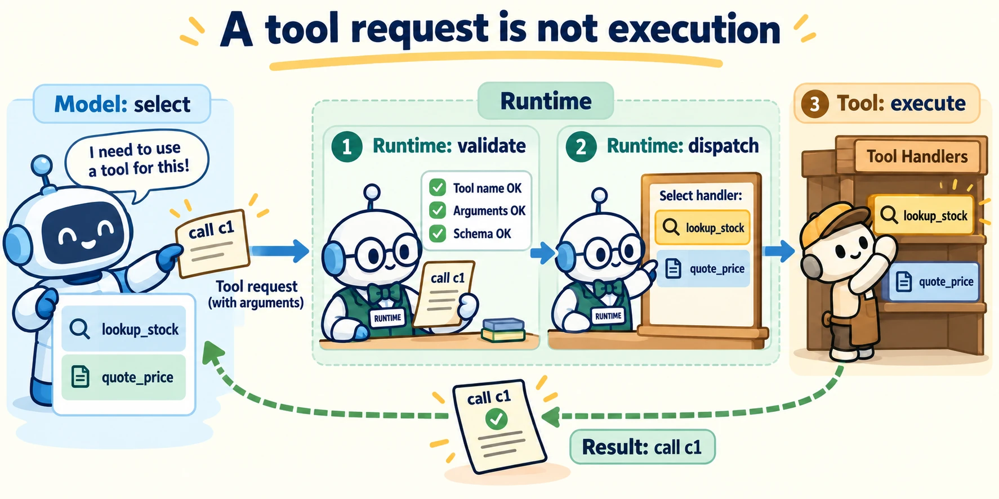

<!--
---
title: Tool capabilities, schemas, selection, and dispatch
unit_id: P1-03-07-01
summary: Follow a proposed tool call from a capability description through argument
  validation, dispatch and a correlated result.
prerequisites:
- Read [Grounding, long context, and retrieval evaluation](../06-retrieval-and-rag/04-grounding-long-context-and-retrieval-evaluation.md).
learning_objectives:
- Distinguish a tool capability from a function call and an action.
- Design clear descriptions and typed arguments.
- Explain selection, namespaces, discovery and dispatch.
source_records:
- p1-03-07-01-function-calling
- p1-03-07-01-sdk-tools
- p1-03-07-01-programmatic-tools-2026
visual_assets:
- assets/images/03-building-blocks/07-tools-and-function-calling/01-tool-capabilities-schemas-selection-and-dispatch/01-concept.webp
example_paths:
- examples/03-building-blocks/07-tools-and-function-calling/01-tool-capabilities-schemas-selection-and-dispatch/main.py
- examples/03-building-blocks/07-tools-and-function-calling/01-tool-capabilities-schemas-selection-and-dispatch/programmatic_tools.py
pass: architecture
learning_path: main
status: complete
last_reviewed: '2026-10-10'
---
-->

# Tool capabilities, schemas, selection, and dispatch

## Why this matters

A shop assistant can explain a lamp from memory, but it needs the shop inventory to answer “Are two lamps available, and what would they cost?” The application must give it a way to request those facts. A convincing sentence saying “I checked stock” is not evidence that any check happened.

This chapter connects [retrieval](../06-retrieval-and-rag/chapter-plan.md) to executable capabilities. Retrieval supplies evidence; tools also expose calculations and actions. The next chapter follows the result and any changes caused by execution.

## Simple mental model

Imagine a service counter with a short menu. Each menu entry says what the clerk can do and what information to supply. The assistant selects an entry and fills in a request slip. A separate clerk checks the slip, performs the operation and returns a receipt bearing the same request number.

A **tool** exposes a capability the system can use. A **function** is a callable implementation with named inputs. A **function call** requests one invocation. An **action** is an operation in the environment, which may change something there. Looking up stock and reserving stock are different capabilities even if both mention the same product.

## How it works

### Describe the contract before selecting a tool

A **schema** describes allowed input structure. An **argument** is a value supplied to one input. JSON Schema is a vocabulary for describing JSON values, such as objects containing a string product identifier and an integer quantity. Include the meaning of each field, its units and constraints. A quantity of two items should not be confused with two boxes.

A useful capability menu for our shop is:

| Tool name | Description | Arguments | Result meaning |
| --- | --- | --- | --- |
| `catalog.lookup_stock` | Read the current available count; does not reserve stock | `sku`: product identifier | Count observed at lookup time |
| `catalog.quote_price` | Calculate a price in cents; does not place an order | `sku`, `quantity` from 1 to 10 | Quote for this quantity |

Here **SKU** means the shop's product identifier. The shared `catalog` prefix is a **namespace**, a group of related capability names. These are our example names, not standardized API names.

### A request becomes an execution

The application sends tool definitions with model context. The model may return a tool request. The application executes the function and returns its output before the model continues. A call identifier ties each output to its request. OpenAI exposes selection options through `tool_choice`; strict mode constrains arguments to a supported schema. These API mechanisms do not decide whether a request makes sense for the user's goal. [Function calling](https://developers.openai.com/api/docs/guides/function-calling).

A **dispatcher** is application code that maps a requested name to its handler, the implementation that performs the operation. In our design it first parses arguments, checks their structure, constructs a typed request and then invokes the handler. A **registry** stores those name-to-handler mappings. Unknown names produce an error rather than a guess at which function to run.



*Figure 1. Read left to right, then follow the return arrow. The robot selects a capability; the runtime performs the call. The matching call ID connects the receipt to the request.*

### Selection and discovery are separate decisions

**Selection** chooses which available capability to request now. **Capability discovery** finds descriptions that were not already loaded. A large menu consumes context and can contain overlapping descriptions. Our shop could first expose catalog and delivery groups, then load delivery details only when the user asks about shipping. Discovery still needs a way to say that no matching capability exists.

The Agents SDK derives function-tool schemas from Python signatures and descriptions from docstrings. Its tool namespace and deferred-loading facilities can organize larger menus. These are SDK features, not a requirement that every agent discover tools dynamically. [SDK tools](https://openai.github.io/openai-agents-python/tools/).

### Coordinate tools through code

**Programmatic tool calling** lets a model propose code that coordinates several tools. The code can loop over products, call existing handlers and return a small summary. In a direct tool loop, the model sees each result and chooses the next request; in a programmatic loop, code can make some of those decisions. The dispatcher still checks each underlying call.

For Lee's shop, code can read stock and calculate a quote, then return whether the requested quantity was available at lookup time. It must preserve failures and units instead of silently dropping unsuccessful calls. Filtering results can reduce what enters model context, but later questions may need fields that were omitted. Compare task success, latency and total cost with the direct baseline before choosing this design.

OpenAI's implementation uses a JavaScript orchestration tool; underlying functions and MCP tools keep their execution locations. Code orchestration does not grant new permissions or turn a quote into an order. [Programmatic tool calling](https://developers.openai.com/api/docs/guides/tools-programmatic-tool-calling).

The [offline Python comparison](../../../examples/03-building-blocks/07-tools-and-function-calling/01-tool-capabilities-schemas-selection-and-dispatch/programmatic_tools.py) uses the same dispatcher as the direct example. It demonstrates aggregation and failure preservation, without implementing the provider API or measuring performance.

## Worked example

For “Are two lamps available, and what would they cost?”, the assistant requests a stock lookup and a quote. Our mock returns four available items and a 5,000-cent quote. Neither call reserves lamps. The final answer should describe that observation, not announce an order.

These reads have no dependency on each other's outputs and could run concurrently. By contrast, a call that needs an identifier returned by a previous call must wait. A model returning several requests in one response does not prove that concurrent execution is appropriate.

## Minimal implementation

The [runnable dispatcher](../../../examples/03-building-blocks/07-tools-and-function-calling/01-tool-capabilities-schemas-selection-and-dispatch/main.py) uses two typed request classes and standard-library validation. It intentionally checks types at runtime: Python annotations alone do not reject a string quantity, and a Boolean must not pass as an integer quantity. Its assertions exercise malformed JSON, extra fields, missing products and unknown tools.

<details><summary>Expand minimal Python implementation</summary>

```python
REGISTRY = {
    "catalog.lookup_stock": (Lookup, lookup_stock),
    "catalog.quote_price": (Quote, quote_price),
}
# After parsing and checking names, fields, types and ranges:
request_type, handler = REGISTRY[call["name"]]
request = request_type(**args)
result = handler(**vars(request))
```

</details>

This extract shows the dispatch step; the linked script contains validation and error handling. No model or external inventory is contacted.

## Framework implementations

To translate our mock to the Agents SDK, expose each handler with `function_tool`. This illustrative wrapper gives the SDK a typed input signature and a description. Keep validation of product existence inside the handler. See the [SDK tools documentation](https://openai.github.io/openai-agents-python/tools/) for integration with a runner.

<details><summary>Expand minimal Python implementation</summary>

```python
from agents import function_tool

@function_tool
def lookup_stock(sku: str) -> str:
    """Read the available count for a product; do not reserve it."""
    return str(CATALOG[sku]["stock"])
```

</details>

This wrapper needs the SDK and the example's catalog. It is a mapping example, not the standard-library runnable artifact. The dispatcher script deliberately stays independent of a model provider.

## Limitations and trade-offs

A structurally valid SKU can name a nonexistent product. A correct tool can still be selected for the wrong task. Stock can change after a successful read. Describe these limits in the result contract and evaluate complete tasks, including cases where the assistant should answer without a tool.

Small, distinct capabilities are easy to explain but may require more calls. A larger operation can reduce call count while hiding decisions inside its implementation. Choose the boundary based on what the caller needs to understand and what the runtime can report reliably.

## Security preview

Capability availability and a valid schema do not establish authority to act. [Identity](../08-identity-authorization-and-secrets/chapter-plan.md) explains who a call acts for. Pass 2 revisits these components in [tools, identity and credentials](../../07-security-by-component-and-workflow-stage/03-tools-identity-and-credentials/chapter-plan.md).

## Key takeaways

- A tool description exposes a capability; application code performs the invocation.
- Names, arguments and result meanings form one contract.
- Validate the request before dispatch and correlate the result with its call ID.
- Discovery loads capability descriptions; selection chooses an available capability.

<details><summary>Check your understanding</summary>

Does a valid tool schema prove the requested operation is useful? No. Schema conformance checks structure; task relevance and authority need separate decisions.

</details>

## References

- OpenAI. [Function calling](https://developers.openai.com/api/docs/guides/function-calling). Living API documentation, verified for this run.
- OpenAI. [Agents SDK tools](https://openai.github.io/openai-agents-python/tools/). Living Python SDK documentation, verified for this run.

- OpenAI. [Programmatic tool calling](https://developers.openai.com/api/docs/guides/tools-programmatic-tool-calling). Living documentation, verified October 10, 2026.

---

[Next unit: Results, failures, side effects, and confirmation →](02-results-failures-side-effects-and-confirmation.md)
