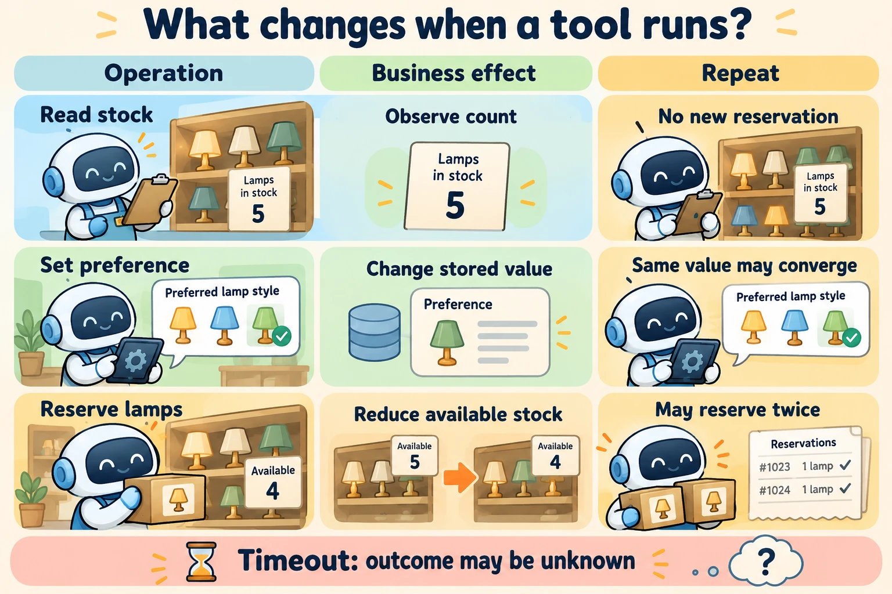

<!--
---
title: Results, failures, side effects, and confirmation
unit_id: P1-03-07-02
summary: Explain tool outcomes, uncertain failures, side effects, confirmation and
  idempotent retries.
prerequisites:
- Read [Tool capabilities, schemas, selection, and dispatch](01-tool-capabilities-schemas-selection-and-dispatch.md).
learning_objectives:
- Classify tool effects and distinguish transport errors from action outcomes.
- Explain idempotency keys and their limits.
- Trace a proposed action through confirmation and execution.
source_records:
- p1-03-07-02-idempotency
- p1-03-07-02-approval
- p1-03-07-02-errors
visual_assets:
- assets/images/03-building-blocks/07-tools-and-function-calling/02-results-failures-side-effects-and-confirmation/01-concept.webp
example_paths:
- examples/03-building-blocks/07-tools-and-function-calling/02-results-failures-side-effects-and-confirmation/main.py
pass: architecture
learning_path: main
status: complete
last_reviewed: '2026-10-10'
---
-->

# Results, failures, side effects, and confirmation

## Why this matters

The shop assistant now offers to reserve two lamps. The inventory service accepts the reservation, but its reply never reaches the assistant. Should the assistant try again? A fresh request might reserve two more lamps. Saying “the reservation failed” would also be misleading: the caller has lost the receipt, not necessarily the reservation.

Unlike [retrieval](../06-retrieval-and-rag/chapter-plan.md), which primarily supplies evidence, actions can change the environment. Handling their results requires a clear account of what the runtime knows.

## How it works

### Return outcomes the next step can use

A **result** is the output of an invocation. Our result contract distinguishes `succeeded`, `invalid_request`, `out_of_stock`, `pending_confirmation` and `unknown`. An ordinary negative business outcome, such as insufficient stock, can be delivered successfully. A network failure can leave the business outcome unknown.

Return the observed data, operation identifier and relevant timing, rather than only “done.” A later lookup of stock cannot by itself identify whether our reservation caused the change. An operation-specific receipt is more useful.

A **timeout** is a limit on how long the caller waits. It does not prove that remote work stopped. The Agents SDK supports timeout configuration for async function tools and can return error information to the model or raise an exception to the runtime. The surrounding application still needs to interpret the external outcome. [SDK tools](https://openai.github.io/openai-agents-python/tools/).

### Classify effects before choosing recovery

A **side effect** is an observable change beyond returning a value. For our shop, use this functional classification:

| Capability | Business state changed? | Can repeating it add another effect? | Useful next step after an uncertain reply |
| --- | --- | --- | --- |
| Read stock | No reservation change | No new reservation | Repeat the read if still useful |
| Set delivery preference | Yes | Same value may converge, notifications may repeat | Inspect the contract and current version |
| Reserve two lamps | Yes | Yes, without duplicate handling | Query or retry the same logical operation |
| Send a pickup message | Yes, externally visible | A second message may be sent | Inspect delivery record |

A read can still create logs, incur charges or return a different value later. “Read-only” here describes the business resource, not the absence of every possible effect.



*Figure 1. Read across each row. First ask what changes, then what a repeat would do. Recovery depends on this contract, not only on whether a response contains an error.*

### Keep the identity of a retry stable

**Idempotency** means repeated application has the same intended effect as one application. An **idempotency key** identifies repeated attempts at the same logical operation. It is different from a model call ID: separate call attempts can belong to one reservation.

Stripe API v1 illustrates a service-side contract: it stores an executed response for a key, checks parameters on reuse and applies a retention period. The behavior is specific to that API. [Idempotent requests](https://docs.stripe.com/api/idempotent_requests).

In our design, generate the key before the first reservation attempt, preserve it with the pending operation, and reuse it only with the same parameters. Changing the quantity means a different operation. A local dictionary teaches the idea but does not handle crashes, simultaneous callers or a remote service that ignores the key.

### Confirmation precedes the effect

**Confirmation** is a person's decision on a concrete proposed action. Show “Reserve two lamps at this shop” before executing. The runtime records a pending decision and resumes or cancels that proposal. A changed action needs a new decision; the old decision was about a different request.

The SDK exposes pending tool approvals as interruptions and supports decisions and resumption through `RunState`. This packages pause and resume behavior; it does not turn confirmation into a successful reservation. [Human-in-the-loop](https://openai.github.io/openai-agents-python/human_in_the_loop/).

## Worked example

The [offline reservation example](../../../examples/03-building-blocks/07-tools-and-function-calling/02-results-failures-side-effects-and-confirmation/main.py) begins with four lamps. Before confirmation, stock stays at four. After approval, the service reserves two but simulates losing its reply. The caller sees a timeout while stock is already two. A retry using the original key returns the stored receipt without taking more stock. Reusing the key with a different quantity returns `key_conflict`.

<details><summary>Expand minimal Python implementation</summary>

```python
if key in receipts:
    old_request, result = receipts[key]
    if old_request != request:
        return {"status": "key_conflict"}
    return dict(result)
```

</details>

This is one step in the example, not a complete production implementation. Durable storage, concurrency and atomic recording of the effect and receipt are outside this small mock.

## Limitations and trade-offs

Retries can improve recovery from temporary failures, but only when the operation contract permits them. Invalid arguments usually need correction, not repetition. Limit retry count and elapsed time; repeated attempts should not keep a run alive forever.

Two independent reads may run in parallel. A reservation and a cancellation of that reservation have an ordering dependency. Two writes to the same stock count can also conflict even if the model requested them together.

Tools have a lifecycle: their descriptions, handlers and result contracts may change. Keep enough version information to interpret a pending request when the runtime resumes later. An unavailable tool should produce an explicit outcome, not a silent substitute.

## Security preview

Confirmation, duplicate handling and authority are separate parts of the system. [Identity and authorization](../08-identity-authorization-and-secrets/chapter-plan.md) develops the functional authority model. Pass 2 examines unsafe calls and excessive agency in [tools, identity and credentials](../../07-security-by-component-and-workflow-stage/03-tools-identity-and-credentials/chapter-plan.md).

## Key takeaways

- A timeout may leave an action outcome unknown.
- Classify side effects before choosing retries or parallel execution.
- Preserve the same operation key across retries with unchanged arguments.
- Confirmation decides whether to proceed; execution produces the receipt.

<details><summary>Check your understanding</summary>

Does a timeout prove that a reservation failed? No. The operation may have committed before its response was lost.

</details>

## References

- Stripe. [Idempotent requests](https://docs.stripe.com/api/idempotent_requests). API v1 semantics, verified for this run.
- OpenAI. [Human-in-the-loop](https://openai.github.io/openai-agents-python/human_in_the_loop/).
- OpenAI. [Tools](https://openai.github.io/openai-agents-python/tools/). Living SDK documentation, verified for this run.

---

[Next unit: Identity, authentication, authorization, and delegation →](../08-identity-authorization-and-secrets/01-identity-authentication-authorization-and-delegation.md)
