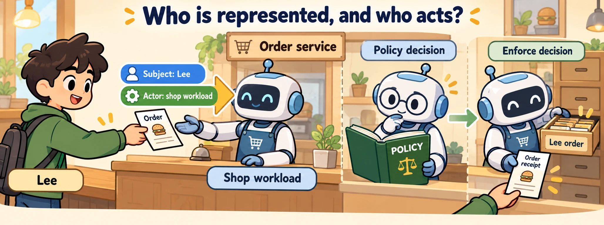

<!--
---
title: Identity, authentication, authorization, and delegation
unit_id: P1-03-08-01
summary: Trace the represented subject, acting workload and authorization decision
  through a delegated tool action.
prerequisites:
- Read [Results, failures, side effects, and confirmation](../07-tools-and-function-calling/02-results-failures-side-effects-and-confirmation.md).
learning_objectives:
- Distinguish identity, authentication and authorization.
- Trace subject and actor across a delegation.
- Locate policy decisions and enforcement at a resource boundary.
source_records:
- p1-03-08-01-oauth
- p1-03-08-01-exchange
- p1-03-08-01-oidc
visual_assets:
- assets/images/03-building-blocks/08-identity-authorization-and-secrets/01-identity-authentication-authorization-and-delegation/01-concept.webp
example_paths:
- examples/03-building-blocks/08-identity-authorization-and-secrets/01-identity-authentication-authorization-and-delegation/main.py
pass: architecture
learning_path: main
status: complete
last_reviewed: '2026-10-10'
---
-->

# Identity, authentication, authorization, and delegation

## Why this matters

Lee asks a shop assistant to check an order. The same assistant also serves Pat. Its tool can read orders, but which order may it read for this request? A tool name describes an operation. It does not identify the customer or establish access to every order.

This chapter adds authority to the [tool-call path](../07-tools-and-function-calling/chapter-plan.md). The next chapter follows the credentials used by the workload that actually executes the call.

## Simple mental model

A courier carries a signed request on someone else's behalf. The building receptionist needs to know both whose request it is and which courier delivered it. Checking the courier's badge answers one question. Deciding whether this request may reach this room answers another.

An **identity** names an entity. A **principal** is an entity that can be authenticated and considered in an access decision, such as a human user or service. **Authentication** verifies a claimed identity using evidence. **Authorization** decides whether a principal may perform a particular operation on a particular resource. A **resource** is the object or service being accessed.

## How it works

### Give each participant a clear role

A **workload** is running software, such as the shop assistant's worker process. A named “agent” can describe a role within that software without being a separately authenticated principal. Our application records an agent-role name for diagnostics and a workload identity for service calls. It does not assume that naming a model makes it an authenticated entity.

| Participant in our example | Role in the order request |
| --- | --- |
| Lee | Human asking for an order lookup |
| Shop application | Receives the authenticated session and starts the run |
| Assistant workload | Executes the requested tool |
| Order service | Decides access and returns the order |

OpenID Connect supplies authentication information through an identity layer over OAuth, including an ID token. OAuth access tokens serve resource access. An ID token for the application is not a substitute for an access token expected by the order service. [OpenID Connect Core](https://openid.net/specs/openid-connect-core-1_0.html).

### Preserve the represented person and the acting software

A **subject** is the principal a request represents. An **actor** is the principal acting for that subject. **Delegation** gives another principal authority to act on someone's behalf while retaining that relationship. A **delegation chain** records successive actors when more than one service participates.

RFC 8693 distinguishes delegation from **impersonation**, where the recipient sees the acting party as the represented subject rather than maintaining the same explicit actor relationship. It defines subject and actor inputs for token exchange, an operation that obtains a token using an existing token. [OAuth token exchange](https://www.rfc-editor.org/rfc/rfc8693.html).

In our order lookup, Lee is the subject and the assistant workload is the actor. If the assistant delegates to a reporting worker, both steps matter to the action's history. Token exchange can express such relationships, but the authorization service still chooses what authority to issue. Exchange does not automatically make every downstream token narrower.

### Make a decision, then enforce it

A **policy decision point** evaluates an access request against policy. A **policy enforcement point** applies that decision before the resource operation. These are logical roles; one service can implement both.

Our request contains the subject, actor, action and resource. The policy allows the shop workload to read Lee's order for Lee, but not cancel it or read Pat's order. The enforcement step returns data only after an allowed decision. A successful login alone does not replace this step.



*Figure 1. Follow the request toward the order service. The subject and actor stay distinct. Inside the service, the policy decision precedes the resource operation.*

### Describe the bounds of authority

A **token** is a value carried as evidence or access authority. A **scope** names a category of granted access. An **audience** identifies an intended recipient. A **capability** is an authority-bearing reference or credential for a bounded operation or resource; not every tool description is such a credential.

OAuth defines access tokens with scope and duration and separates the client, authorization server and resource server roles. How the resource service maps a scope such as `orders.read` to Lee's particular order is an application policy decision. [OAuth 2.0 framework](https://www.rfc-editor.org/rfc/rfc6749.html).

## Worked example

The [offline policy example](../../../examples/03-building-blocks/08-identity-authorization-and-secrets/01-identity-authentication-authorization-and-delegation/main.py) evaluates four requests. Lee's order read succeeds. A cancellation, another customer's order and an unknown workload do not. Each decision carries a policy version, so the recorded outcome can be interpreted later.

The script assumes identities have already been authenticated. Its strings are labels, not credentials. Passing a string such as `user:lee` from unverified input would not implement authentication.

<details><summary>Expand minimal Python implementation</summary>

```python
decision = decide(request)
if not decision.allowed:
    return {"status": "denied", "policy_version": decision.policy_version}
# Only now perform the resource operation.
```

</details>

## Limitations and trade-offs

Delegated user access and a service acting on its own behalf are different designs. A scheduled stock report may use the workload's own authority. A customer order lookup needs the represented user's relationship to the order. Document which design applies rather than inferring it from the assistant's conversational role.

A scope can be too coarse to describe individual resources. Detailed resource decisions may require current order ownership or organization membership. Keep those facts in the service's decision model; a model's explanation of why it needs access is not the decision itself.

## Security preview

The identities used by [execution environments](../09-execution-environments/chapter-plan.md) determine which resource boundaries matter. Pass 2 examines confused-deputy, token and secret risks in [tools, identity and credentials](../../07-security-by-component-and-workflow-stage/03-tools-identity-and-credentials/chapter-plan.md).

## Key takeaways

- Authentication verifies identity; authorization decides access to an operation and resource.
- Separate the represented subject from the acting workload.
- Preserve delegation relationships and record the policy decision.
- Tool availability, login and access authority answer different questions.

## References

- IETF. [RFC 6749: OAuth 2.0](https://www.rfc-editor.org/rfc/rfc6749.html), 2012. Foundational roles and concepts; later updates apply to deployment guidance.
- IETF. [RFC 8693: Token exchange](https://www.rfc-editor.org/rfc/rfc8693.html), 2020.
- OpenID Foundation. [OpenID Connect Core 1.0, errata set 2](https://openid.net/specs/openid-connect-core-1_0.html), 2023.

---

[Next unit: Workload identity, credentials, and revocation →](02-workload-identity-credentials-and-revocation.md)
