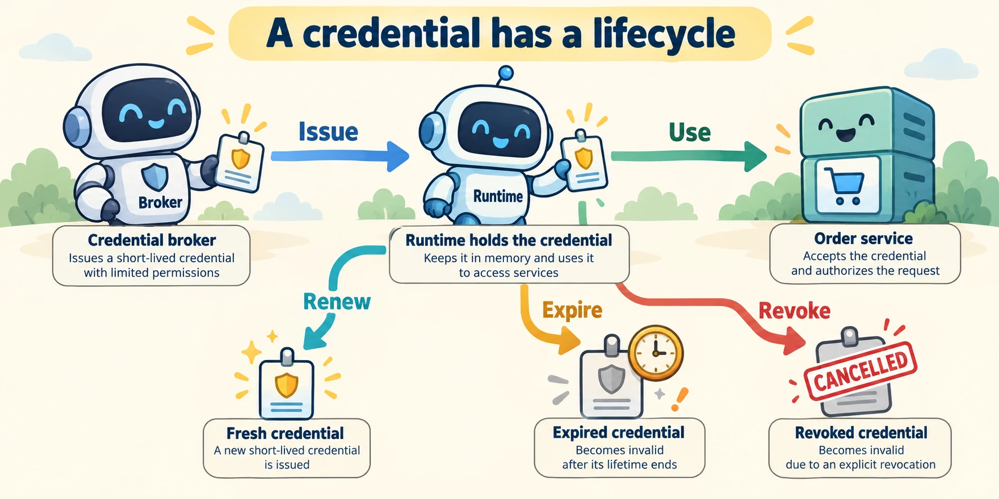

<!--
---
title: Workload identity, credentials, and revocation
unit_id: P1-03-08-02
summary: Follow workload credentials through issuance, use, renewal, expiry and revocation
  without exposing them as model context.
prerequisites:
- Read [Identity, authentication, authorization, and delegation](01-identity-authentication-authorization-and-delegation.md).
learning_objectives:
- Explain workload identity and credential brokering.
- Distinguish rotation, renewal, expiration and revocation.
- Describe scope, audience and resource limits in a short-lived grant.
source_records:
- p1-03-08-02-spiffe
- p1-03-08-02-revocation
visual_assets:
- assets/images/03-building-blocks/08-identity-authorization-and-secrets/02-workload-identity-credentials-and-revocation/01-concept.webp
example_paths:
- examples/03-building-blocks/08-identity-authorization-and-secrets/02-workload-identity-credentials-and-revocation/main.py
pass: architecture
learning_path: main
status: complete
last_reviewed: '2026-10-10'
---
-->

# Workload identity, credentials, and revocation

## Why this matters

Lee's order lookup is allowed, but the worker still needs to authenticate when it contacts the order service. The worker may restart, move to another machine or resume after an hour. A credential that worked when the run began may no longer work when the next tool call executes.

This chapter follows the credential lifecycle behind [tools](../07-tools-and-function-calling/chapter-plan.md). It keeps the model's request separate from the runtime's proof of identity and authority.

## Simple mental model

Think of a visitor badge with an expiry time and a named destination. The badge desk issues it after checking who the visitor represents. The receiving desk checks it again. Renewing the badge, replacing its proof material and canceling access are related operations with different meanings.

A **credential** is evidence used to establish identity or authority. A **secret** is information that must remain confidential, such as a private signing key or a bearer access token. A public workload identifier is not necessarily a secret. A **bearer token** grants access based on possession, subject to the receiving service's checks.

## How it works

### Identify the running software

**Workload identity** identifies running software independently of the assistant's display name. A service can have multiple worker instances with the same logical workload identity. Whether each instance also needs a distinct identifier depends on the application.

SPIFFE defines workload identifiers, called SPIFFE IDs, and **SVIDs**, verifiable identity documents carrying those identifiers. The documents can use X.509 certificates or JWT tokens. Its Workload API supplies identity material, with short-lived credentials and rotation. These are authentication mechanisms; resource authorization still belongs to the receiving system. [SPIFFE concepts](https://spiffe.io/docs/latest/spiffe-about/spiffe-concepts/).

An **X.509 certificate** binds an identity to a public key under an issuing authority. A **JWT**, or JSON Web Token, is a structured token format. Neither term means “permission to every tool.” SPIFFE also assumes adequate workload isolation, which we develop in [execution environments](../09-execution-environments/chapter-plan.md).

### Let a broker prepare the credential

A **credential broker** obtains or issues credentials for the runtime. In our design, the model asks to read an order, while runtime code asks the broker for the corresponding bounded grant. The broker uses authenticated session and workload information; a model-supplied customer name is not proof of that customer's identity.

The result returned to the model contains order data and an operation status, not the access credential. A **secret store** holds confidential material for authorized runtime components. A stored secret reference is different from the secret value it resolves to.

| Credential information | Purpose in our mock |
| --- | --- |
| Subject and actor | Lee, represented by the shop workload |
| Audience | Only the order service |
| Resource | Only Lee's selected order |
| Scope | Read, not cancel |
| Expiry | End of a short validity interval |

These names describe our application contract. Real token formats and services do not universally support this exact set of fields.

### Follow the lifecycle precisely

**Issuance** creates a credential. **Renewal** obtains a credential for another validity interval. **Rotation** replaces credential or key material. **Expiration** ends validity according to time. **Revocation** withdraws validity before its natural end. Renewing a credential should involve whatever current policy the broker requires; it is not simply extending a timestamp because the model wants to continue.



*Figure 1. The badge is runtime material. Follow issuance and use, then the separate renewal and ending paths. Revocation changes future acceptance; it does not undo an earlier order read.*

OAuth's revocation specification describes an endpoint for invalidating tokens. It also discusses propagation delays and differences between token designs. A resource service checking a self-contained token locally may need another mechanism to learn that it has been revoked. [RFC 7009](https://www.rfc-editor.org/rfc/rfc7009.html).

## Worked example

The [offline broker](../../../examples/03-building-blocks/08-identity-authorization-and-secrets/02-workload-identity-credentials-and-revocation/main.py) issues a mock handle valid for 60 seconds, with order audience, read scope and a single resource. The example supplies a fake clock, so it checks the exact expiration boundary without waiting. At time 159 the first handle works; at 160 it does not. A newly issued handle works, then stops working after revocation. Wrong audiences and actions are rejected.

<details><summary>Expand minimal Python implementation</summary>

```python
grant = grants.get(handle)
allowed = bool(
    grant and now < grant.expires_at
    and grant.audience == audience
    and grant.resource == resource
    and action in grant.scopes
)
```

</details>

The handles are predictable labels in a local dictionary. This is a lifecycle simulation, not token cryptography, remote authentication, SPIFFE implementation or a deployable broker.

## Limitations and trade-offs

Short validity intervals require renewal and create an availability dependency on the issuing service. Longer intervals reduce renewal traffic but delay expiration. A paused run may therefore need to obtain fresh authority before a later call.

A secret reference is not a guarantee that a secret stays confidential: the resolving component still handles the value. Record which component issues, resolves, uses and disposes of each credential. Removing local copies and revoking remote authority are separate operations, and neither reverses completed side effects.

## Security preview

Pass 2 examines token misuse, secret exposure and delegated authority in [tools, identity and credentials](../../07-security-by-component-and-workflow-stage/03-tools-identity-and-credentials/chapter-plan.md). Here the goal is to understand which runtime components hold the evidence and how its validity changes.

## Key takeaways

- A workload name and a credential serve different purposes.
- Brokering prepares access material for the runtime, rather than model context.
- Renewal, rotation, expiration and revocation describe distinct lifecycle changes.
- Revocation can take time to reach a recipient and does not undo prior effects.

## References

- SPIFFE. [SPIFFE concepts](https://spiffe.io/docs/latest/spiffe-about/spiffe-concepts/). Living documentation, verified for this run.
- IETF. [RFC 7009: OAuth 2.0 Token Revocation](https://www.rfc-editor.org/rfc/rfc7009.html), 2013.

---

[Next unit: Execution boundaries, isolation, and sandboxes →](../09-execution-environments/01-execution-boundaries-isolation-and-sandboxes.md)
