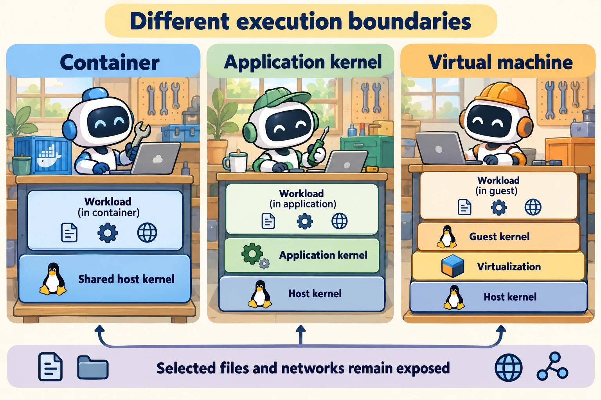

<!--
---
title: Execution boundaries, isolation, and sandboxes
unit_id: P1-03-09-01
summary: Compare execution locations and isolation mechanisms, then describe their
  resources through an executor contract.
prerequisites:
- Read [Workload identity, credentials, and revocation](../08-identity-authorization-and-secrets/02-workload-identity-credentials-and-revocation.md).
learning_objectives:
- Distinguish processes, containers, application kernels and virtual machines.
- Explain why remote execution is a location rather than an isolation guarantee.
- State an execution contract without assuming a sandbox label is sufficient.
source_records:
- p1-03-09-01-docker
- p1-03-09-01-gvisor
- p1-03-09-01-firecracker
visual_assets:
- assets/images/03-building-blocks/09-execution-environments/01-execution-boundaries-isolation-and-sandboxes/01-concept.webp
example_paths:
- examples/03-building-blocks/09-execution-environments/01-execution-boundaries-isolation-and-sandboxes/main.py
pass: architecture
learning_path: main
status: complete
last_reviewed: '2026-10-10'
---
-->

# Execution boundaries, isolation, and sandboxes

## Why this matters

An assistant needs to summarize a sales file. Its tool might call a trusted Python function inside the application, launch a separate program or send work to a hosted execution service. All three can return the same total, yet they expose different files, credentials and machine resources.

The [identity chapter](../08-identity-authorization-and-secrets/chapter-plan.md) explained who acts. This chapter asks where that software runs and which boundary separates it from other work.

## Simple mental model

Think of workshops sharing a building. Different workbenches, separate rooms and separate buildings create different boundaries. A remote address tells you where the workshop is, but not what tools it can use or which other customers share it.

A **host** is the machine or operating-system environment supporting execution. A **process** is a running program with its own execution state and address space. The **kernel** is the operating-system component managing processes, memory and access to devices. A **system call** requests a service from the kernel.

## How it works

### Start with what the job needs

Our sales job needs one input file, a parser, temporary memory and an output summary. It does not need a browser session or order credentials. Before choosing an environment, describe the required interfaces, resource limits, persistent state and output contract.

An **execution boundary** separates the job from other software or resources. **Isolation** limits what it can observe or affect across that boundary. A **sandbox** is a configured environment that restricts execution. The word alone does not specify the mechanism or the exposed resources.

### Compare mechanisms rather than labels

| Mechanism | Where the job runs | Main distinction to understand |
| --- | --- | --- |
| In-process function | Application process | Shares the application's process and available resources |
| Subprocess | Separate process | Has a separate address space; can still inherit files and credentials |
| Container | Isolated operating-system views | Typically shares the host kernel |
| Application kernel | Workload behind an implemented kernel interface | Interposes a separate software layer on system calls |
| Virtual machine | Guest operating system | Runs its own guest kernel with virtualized machine resources |

A **namespace** gives processes a particular view of operating-system resources. A **container** packages a workload with such views and associated runtime settings. Docker uses namespaces and **control groups**, or cgroups, which account for and limit resources. Shared directories and runtime configuration change the resulting exposure. [Docker Engine security](https://docs.docker.com/engine/security/).

An **image** packages the files and configuration used to create an environment. It is not the same as a running container: writable changes and runtime settings belong to the instance.

gVisor supplies an application kernel in userspace, outside the host kernel. It handles workload system calls through its own implementations, so compatibility depends on the supported interfaces. [gVisor architecture](https://gvisor.dev/docs/architecture_guide/intro/).

A **virtual machine**, or VM, runs a guest operating system through virtualization. A **hypervisor** manages its virtualized machine boundary. A **microVM** uses a smaller virtual-machine design. Firecracker uses Linux KVM virtualization with a guest kernel and a minimal device model. [Firecracker design](https://raw.githubusercontent.com/firecracker-microvm/firecracker/main/docs/design.md).



*Figure 1. Compare the execution layers beneath each workload. The different layers change the boundary, but each environment still exposes selected files and interfaces. These are alternatives, not three mandatory layers in every agent.*

### Location and mechanism are separate

A **remote worker** executes outside the calling application's local environment. It might itself use a container, VM or ordinary process. A **hosted sandbox** is an execution service managed by another operator. Inspect its resource and lifecycle contract rather than treating “hosted” as an isolation mechanism.

The caller sends a job request and receives a result or job identifier. Network delivery, scheduling and remote failure handling are additional concerns. The caller's timeout does not necessarily stop the remote worker.

## Minimal implementation

The [offline executor interface](../../../examples/03-building-blocks/09-execution-environments/01-execution-boundaries-isolation-and-sandboxes/main.py) accepts a named operation, input identifier and environment label. Its mock supports two labels with one result contract. The example verifies unsupported jobs and environment names and never runs model-generated code.

<details><summary>Expand minimal Python implementation</summary>

```python
class Executor(Protocol):
    def submit(self, job: Job) -> Result: ...
```

</details>

The interface lets orchestration reason about a job without knowing container or VM implementation details. The mock's labels demonstrate routing only. They do not create actual isolation or measure its strength.

## Limitations and trade-offs

Isolation choices affect startup time, compatibility, operating effort and resource use. A trusted stock lookup and a general code-execution job may require different designs. Measure the actual workload; do not infer a universal performance ranking from the comparison table.

An environment can be separated from the host while retaining access to mounted data or external services. Its authority also depends on the credentials supplied to it. The next chapter maps these resources and follows the environment through cleanup.

## Security preview

Pass 2 revisits escape, network and resource-abuse risks in [execution and supply-chain security](../../07-security-by-component-and-workflow-stage/04-execution-and-supply-chain/chapter-plan.md). [Human oversight](../10-human-in-the-loop/chapter-plan.md) later explains decisions about execution. An approval decision and an isolation boundary have different jobs.

## Key takeaways

- State the job's required resources before choosing an environment.
- Processes, containers, application kernels and VMs create different boundaries.
- Remote execution describes location; its isolation mechanism needs a separate description.
- An executor contract can stay stable while the environment implementation changes.

## References

- Docker. [Docker Engine security](https://docs.docker.com/engine/security/).
- gVisor. [Introduction to gVisor security](https://gvisor.dev/docs/architecture_guide/intro/).
- Firecracker maintainers. [Firecracker design](https://raw.githubusercontent.com/firecracker-microvm/firecracker/main/docs/design.md). Living implementation documents, verified for this run.

---

[Next unit: Browsers, files, networks, resources, and cleanup →](02-browsers-files-networks-resources-and-cleanup.md)
