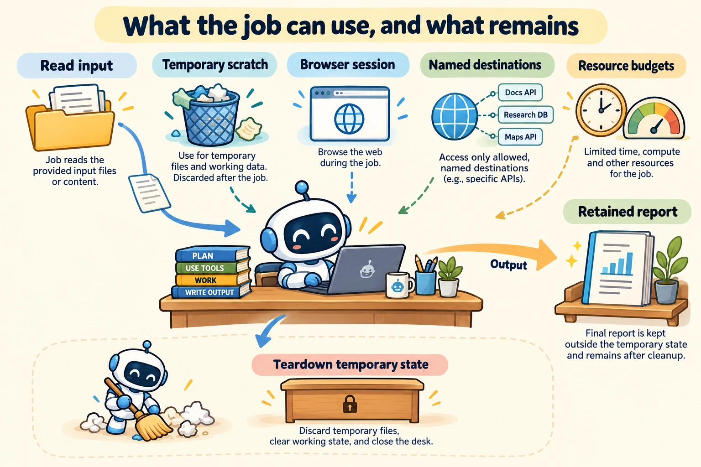

<!--
---
title: Browsers, files, networks, resources, and cleanup
unit_id: P1-03-09-02
summary: Map the files, browser sessions, network destinations and budgets exposed
  to a job, then separate retained output from temporary execution state.
prerequisites:
- Read [Execution boundaries, isolation, and sandboxes](01-execution-boundaries-isolation-and-sandboxes.md).
learning_objectives:
- Describe an execution resource map and its lifetime.
- Distinguish browser contexts from host isolation.
- Trace output publication and teardown after success and failure.
source_records:
- p1-03-09-02-browser-contexts
- p1-03-09-02-mounts
- p1-03-09-02-resources
- p1-03-09-02-network
visual_assets:
- assets/images/03-building-blocks/09-execution-environments/02-browsers-files-networks-resources-and-cleanup/01-concept.webp
example_paths:
- examples/03-building-blocks/09-execution-environments/02-browsers-files-networks-resources-and-cleanup/main.py
pass: architecture
learning_path: main
status: complete
last_reviewed: '2026-10-10'
---
-->

# Browsers, files, networks, resources, and cleanup

## Why this matters

The sales job runs in a separate environment, but its input file lives on the host and its report must survive after the environment closes. A browser-assisted job may also carry a logged-in session. “The job finished” tells us little about which files, sessions or remote changes remain.

This chapter maps resources around the execution boundary. [Identity](../08-identity-authorization-and-secrets/chapter-plan.md) explains the credentials supplied to that environment; [human oversight](../10-human-in-the-loop/chapter-plan.md) explains decisions about proposed actions.

## How it works

### Map each resource and its lifetime

A **filesystem mount** makes a file tree available at a location inside an environment. A **bind mount** exposes a host path; a separate **volume** is runtime-managed storage. Docker bind mounts can allow writes to host files, or be read-only. Their host is the Docker daemon's host, which may differ from the calling machine. [Bind mounts](https://docs.docker.com/engine/storage/bind-mounts/).

A **workspace** is the job's working file area. Our design separates immutable input, temporary scratch space and retained report artifacts. An **artifact** is an output kept for later use. Its ownership and lifetime need a separate decision from the temporary workspace.

| Resource | What our sales job receives | What happens at completion |
| --- | --- | --- |
| Input | One versioned sales file, readable | Source file remains |
| Scratch space | Temporary parse intermediates | Removed with the environment |
| Report | Output summary selected for retention | Published to artifact storage |
| Browser state | Fresh session if needed | Closed; retained state requires an explicit decision |
| Network | Named destinations needed by the job | Connections end; remote effects may remain |
| Budgets | Memory, time and output-size limits | Usage recorded |



*Figure 1. Read the labels around the worker as a resource inventory. The retained report leaves the temporary environment before teardown. Closing the environment does not erase the input source or undo a remote action.*

### Browser state has its own boundary

A **browser context** is a browser session container with its own cookies and storage. A **cookie** is site-associated data the browser may send with requests. Browser storage holds other site data. Playwright uses separate contexts to isolate such state between tests or users within one browser. [Browser contexts](https://playwright.dev/python/docs/browser-contexts).

This state boundary helps distinguish Lee's session from Pat's. It is not a separate operating-system kernel or virtual machine. A logged-in context can still perform actions the website accepts. Closing it does not cancel an order already placed there.

### Network and resource policies are distinct

A **network policy** describes which connections the job may make. Network separation and permitted outbound connections are different settings: a separate network view does not by itself mean “no internet.” Docker's `none` driver is one concrete design that provides only loopback networking, local to the container. [None network driver](https://docs.docker.com/engine/network/drivers/none/).

A **quota** bounds a resource's consumption. CPU capacity, memory, disk space, elapsed time and output size measure different things. Docker documents that containers have no resource constraints by default and exposes settings for CPU and memory. Application deadlines and remote-service charges need their own accounting. [Resource constraints](https://docs.docker.com/engine/containers/resource_constraints/).

Our mock describes destinations by service name. A real implementation must define the actual network enforcement semantics; a string comparison in a Python function is not network isolation.

### Publish outputs, then tear down

**Teardown** releases an execution environment and its temporary resources. Our lifecycle allocates the environment, supplies inputs, runs the job, records the outcome, publishes selected output and closes the environment. Failure paths also need teardown. Publication can fail even if calculation succeeded, so record these outcomes separately.

A **persistent** resource survives an environment's end. An **ephemeral** resource is temporary. Mounted host files and retained artifacts may be persistent even when the worker is ephemeral. A cleanup operation should target resources owned by this job, rather than treating all reachable storage as temporary.

## Minimal implementation

The [offline resource-policy example](../../../examples/03-building-blocks/09-execution-environments/02-browsers-files-networks-resources-and-cleanup/main.py) simulates an input allowlist, a destination set and an output-size quota. It records scratch and browser state in dictionaries. A `finally` block closes the environment after success or failure. Published report data remains in a separate artifact dictionary.

<details><summary>Expand minimal Python implementation</summary>

```python
try:
    artifacts["report"] = env.run(input_id, destination, output)
finally:
    env.close()
```

</details>

No browser, container or generated code runs. The example verifies lifecycle decisions, not enforcement by an operating system. It demonstrates cleanup after an output quota failure and a missing input as well as after success.

## Limitations and trade-offs

Fresh environments reduce dependence on previous state but add startup and setup work. Reusing them can preserve useful caches while retaining files and sessions that affect later jobs. Describe the intended reuse boundary, such as one run or one user, and which state crosses it.

A caller disconnecting, a worker process stopping and a remote service finishing are separate events. Record uncertain remote outcomes and reconcile them using the operation contracts developed in the tools chapters. Teardown does not supply exactly-once semantics.

## Security preview

Pass 2 maps exposed files, sessions, networks and budgets to [execution and supply-chain security](../../07-security-by-component-and-workflow-stage/04-execution-and-supply-chain/chapter-plan.md). Here the essential step is naming the resources, their owners and their lifetimes.

## Key takeaways

- Describe the resources exposed by an environment, not only its isolation label.
- Browser contexts separate session state but do not create a VM boundary.
- Resource quotas, network policies and application deadlines have different scopes.
- Retain selected outputs separately and tear down temporary state on every path.

<details><summary>Check your understanding</summary>

Does local teardown prove a remote tool stopped? No. Remote completion and cancellation need service-specific evidence.

</details>

## References

- Microsoft. [Playwright browser contexts](https://playwright.dev/python/docs/browser-contexts).
- Docker. [Bind mounts](https://docs.docker.com/engine/storage/bind-mounts/), [resource constraints](https://docs.docker.com/engine/containers/resource_constraints/), and [none networking](https://docs.docker.com/engine/network/drivers/none/). Living documentation, verified for this run.

---

[Next unit: Human control, approval, and escalation →](../10-human-in-the-loop/01-human-control-approval-and-escalation.md)
