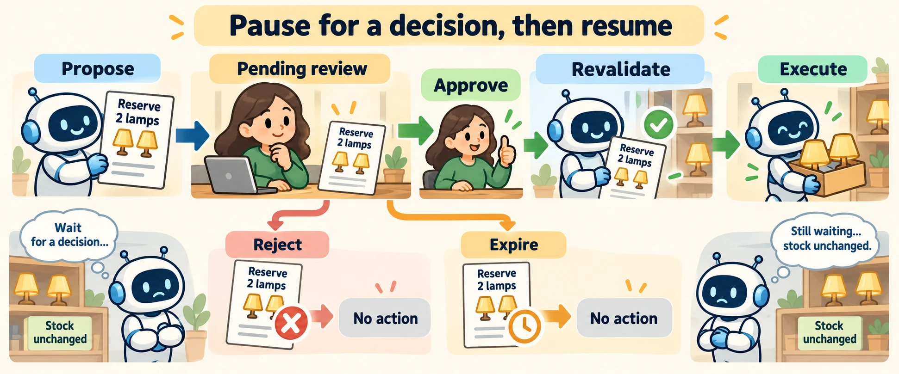

<!--
---
title: Human control, approval, and escalation
unit_id: P1-03-10-01
summary: Place explicit human decisions in a run, bind approval to a concrete proposal
  and define escalation and resumption behavior.
prerequisites:
- Read [Browsers, files, networks, resources, and cleanup](../09-execution-environments/02-browsers-files-networks-resources-and-cleanup.md).
learning_objectives:
- Distinguish clarification, review, approval and escalation.
- Design a paused approval lifecycle with expiry and revalidation.
- Explain human-in-the-loop and human-on-the-loop roles.
source_records:
- p1-03-10-01-sdk-approval
- p1-03-10-01-autogen
visual_assets:
- assets/images/03-building-blocks/10-human-in-the-loop/01-human-control-approval-and-escalation/01-concept.webp
example_paths:
- examples/03-building-blocks/10-human-in-the-loop/01-human-control-approval-and-escalation/main.py
pass: architecture
learning_path: main
status: complete
last_reviewed: '2026-10-10'
---
-->

# Human control, approval, and escalation

## Why this matters

The assistant has enough information to reserve two lamps, but the shop's workflow asks Lee to confirm before stock changes. Lee may respond immediately, reject the proposal or return tomorrow. The runtime must know what decision is pending and whether the original proposal still makes sense.

A human control point changes the workflow, not just the conversation. It connects a named decision to the [execution environment](../09-execution-environments/chapter-plan.md) and the action that may follow.

## How it works

### Name the kind of human input

**Clarification** supplies missing task information, such as which order Lee means. **Review** examines an output or proposal and may suggest changes. **Approval** grants permission to proceed with a specified action. **Confirmation** asks a person to verify intent or details; in our reservation workflow, it supplies the required approval decision. **Rejection** declines that proposal.

**Escalation** transfers a decision or task to someone with appropriate authority or expertise. An assistant unable to resolve conflicting delivery instructions may send a case to an operator rather than repeatedly asking the customer the same question. This is a workflow outcome, not evidence of model failure alone.

**Human-in-the-loop** means a defined step depends on human input before it proceeds. **Human-on-the-loop** means a person observes ongoing work and can intervene, without deciding every step. These roles can coexist: the assistant reads stock automatically, pauses for a reservation decision and remains visible to an operator.

### Match autonomy to consequences

**Autonomy** is the scope of decisions the system can make without new human input. For our shop, consider both consequence and reversibility:

| Action class | Example | Human role in this illustrative design |
| --- | --- | --- |
| Observation | Read available stock | Monitor automatically executed reads |
| Revisable local output | Draft a pickup note | Review or edit the draft |
| Customer-visible effect | Send the pickup note | Approve the exact recipient and message |
| Difficult-to-reverse commitment | Submit a custom manufacturing order | Escalate to an authorized specialist |

This is a design example, not a universal rule that all messages require approval. Existing user instructions and application policy may already authorize an operation. A useful control point resolves a real decision and supplies the information needed to make it.

### Pause with a concrete proposal

Our pending reservation contains a proposal ID, item and quantity, target shop, current resource version, consequence summary and decision deadline. A **resource version** identifies the state used when preparing the action. The reviewer needs to see what would happen, who it affects and what remains uncertain.

Record the trigger, required reviewer role, accepted decisions and outcome for no response. Our queue expires unattended proposals. Expiration is not approval. Other workflows might escalate an overdue case, but that outcome also needs to be defined.



*Figure 1. The action stays pending while the reviewer decides. The approved path checks that the proposal is still current before execution. The rejection and expiry paths end without the proposed effect.*

### Resume the decision that was made

**Resumption** continues a paused workflow using recorded state. It should refer to the same proposal and decision, rather than interpreting an unrelated chat message as approval. Changed arguments or changed relevant resource state may require a new proposal.

The runtime distinguishes decision received, decision accepted, action dispatched and action completed. [Observability](../11-observability-and-tracing/chapter-plan.md) gives these transitions a common record. Approval does not establish that the external operation succeeded.

The OpenAI Agents SDK exposes pending tool approvals as interruptions; `RunState` supports approval, rejection and resumption. It also supports serializing paused state for later decisions. These mechanisms package the lifecycle, while application policy determines reviewer authority and proposal freshness. [SDK human-in-the-loop](https://openai.github.io/openai-agents-python/human_in_the_loop/).

## Minimal implementation

The [mock approval queue](../../../examples/03-building-blocks/10-human-in-the-loop/01-human-control-approval-and-escalation/main.py) checks reviewer role, expiry and resource version. It rechecks expiry and version before executing. Its assertions cover execution before approval, a wrong reviewer, rejection, expiry, stale state, state changing after approval and repeated execution requests.

<details><summary>Expand minimal Python implementation</summary>

```python
if item["status"] != "approved":
    return "not_ready"
if now >= proposal.expires_at or version != proposal.resource_version:
    item["status"] = "needs_new_review"
    return item["status"]
```

</details>

This mock uses an in-memory queue, fake clock and a list of effects. Real systems need authenticated reviewers, durable records and service-side concurrency semantics. A version check followed by a remote write is not automatically atomic.

## Framework implementations

AutoGen offers immediate feedback through `UserProxyAgent` and feedback between stopped runs, where application code can persist team state. The in-run proxy blocks the team and is intended for short interactions. `HandoffTermination` can stop a team when control transfers to a user. These options differ from keeping a durable approval queue outside an active call. [AutoGen human-in-the-loop](https://microsoft.github.io/autogen/stable/user-guide/agentchat-user-guide/tutorial/human-in-the-loop.html).

## Limitations and trade-offs

More approvals increase reviewer workload and waiting time. Fewer approvals give the runtime greater responsibility for interpreting existing authority. Measure whether reviewers understand the proposal and whether the workflow routes cases to someone able to decide.

If the proposal has become stale, ask for a decision on the revised action. Do not silently apply an old approval to a new quantity or recipient. Separate acceptance of a decision from the eventual success or uncertainty of its external effect.

## Security preview

Human participation is not a guarantee of correctness. Pass 2 examines approval fatigue and deceptive interfaces in [human interfaces and observability security](../../07-security-by-component-and-workflow-stage/05-human-interfaces-and-observability/chapter-plan.md).

## Key takeaways

- Specify whether a person clarifies, reviews, approves, monitors or takes over.
- Bind approval to a concrete, current proposal and an authorized reviewer.
- Define rejection, expiration, escalation and resumption explicitly.
- Record the decision separately from execution and its outcome.

## References

- OpenAI. [Agents SDK human-in-the-loop](https://openai.github.io/openai-agents-python/human_in_the_loop/).
- Microsoft. [AutoGen human-in-the-loop](https://microsoft.github.io/autogen/stable/user-guide/agentchat-user-guide/tutorial/human-in-the-loop.html). Living framework documentation, verified for this run.

---

[Next unit: Interrupts, steering, feedback, and operator experience →](02-interrupts-steering-feedback-and-operator-experience.md)
