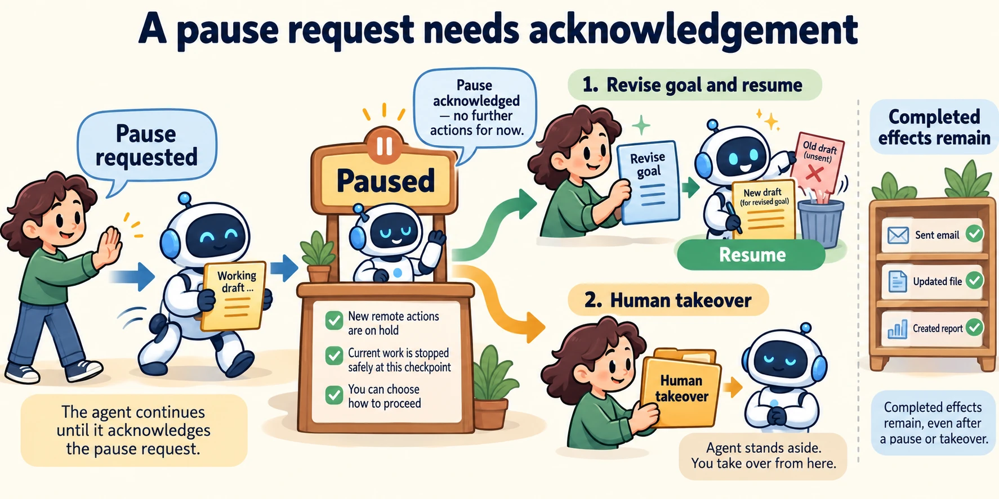

<!--
---
title: Interrupts, steering, feedback, and operator experience
unit_id: P1-03-10-02
summary: Distinguish interruption requests from acknowledged pauses, then apply steering,
  feedback and takeover to a recorded run state.
prerequisites:
- Read [Human control, approval, and escalation](01-human-control-approval-and-escalation.md).
learning_objectives:
- Explain cooperative interruption and framework restart semantics.
- Separate task steering from approval and feedback from training.
- Describe an operator interface and measurable response objectives.
source_records:
- p1-03-10-02-interrupts
- p1-03-10-02-cancellation
- p1-03-10-02-interaction
visual_assets:
- assets/images/03-building-blocks/10-human-in-the-loop/02-interrupts-steering-feedback-and-operator-experience/01-concept.webp
example_paths:
- examples/03-building-blocks/10-human-in-the-loop/02-interrupts-steering-feedback-and-operator-experience/main.py
pass: architecture
learning_path: main
status: complete
last_reviewed: '2026-10-10'
---
-->

# Interrupts, steering, feedback, and operator experience

## Why this matters

While the assistant drafts a pickup message, Lee says “Change this to a delivery request.” The application needs to know whether a message was already sent, whether the worker has paused and which draft belongs to the revised goal. Adding Lee's text to context does not by itself stop an operation already in progress.

This chapter extends the approval lifecycle to intervention during work. It connects [execution](../09-execution-environments/chapter-plan.md) with the state shown to a human operator.

## How it works

### A request to stop is not an acknowledged stop

An **interruption** breaks the normal workflow so another event or decision can be handled. A **pause request** asks the runtime to reach a point where it can stop continuing the run. A **checkpoint** records state needed to continue later. A **cancellation request** asks for work to end; the runtime must report whether that happened and which effects remain.

In a cooperative design, the worker notices an interruption at a defined execution boundary. A long synchronous operation may not notice immediately. Python's asyncio cancellation delivers `CancelledError` at a later opportunity, and cleanup belongs in `try/finally`. This describes local task behavior, not the state of an order service the task already contacted. [Python 3.12 task cancellation](https://docs.python.org/3.12/library/asyncio-task.html#task-cancellation).

Our interface therefore distinguishes “Pause requested” from “Paused.” It does not announce that an external action stopped until its outcome is known. An uncertain send operation requires reconciliation with the messaging service.

### Steering changes the task being pursued

**Steering** changes the goal, constraints or next steps of an active task. **Feedback** supplies an assessment or correction, such as “the draft has the wrong address.” **Takeover** transfers task ownership to a human who performs the next steps directly. These inputs differ from approving an existing proposal.

Our design pauses at a boundary, records a new goal version and invalidates drafts and pending proposals that depend on the previous goal. Work already completed remains in the record. Resumption uses the revised goal to choose future steps. Takeover leaves the task human-owned, so the automated worker does not also continue it.



*Figure 1. Follow the acknowledgement before steering. The revised goal creates a new draft, while takeover transfers ownership. Earlier completed actions remain part of the history.*

### Understand what a framework resumes

LangGraph interruptions use a checkpointer and thread ID to preserve the run's state. Resumption supplies a value through `Command`. The interrupted node restarts from its beginning, so code before the interruption runs again. Place externally visible effects with those restart semantics in mind; saving state is not the same as reversing an effect. [LangGraph interrupts](https://docs.langchain.com/oss/python/langgraph/interrupts).

Our mock uses explicit methods rather than framework nodes. It demonstrates a chosen application contract, not LangGraph's exact execution mechanism. A different runtime may resume at a different boundary or require restarting an operation.

### Make operator state understandable

An **operator** is a person responsible for observing or managing the workflow. The interface should show the active task, latest known step, pending human decisions, completed effects, uncertain outcomes and available interventions. “Working” is too vague when the system is actually waiting for a reviewer.

Amershi and colleagues' human-AI interaction guidelines recommend communicating system capabilities and limits, supporting dismissal and correction, and allowing feedback and control. We apply those ideas to run state and interventions; their research does not establish that an approval button guarantees correct decisions. [Guidelines for Human-AI Interaction](https://www.microsoft.com/en-us/research/wp-content/uploads/2019/01/Guidelines-for-Human-AI-Interaction-camera-ready.pdf).

For Lee's delivery change, show that the old note is unsent, the run is paused and the new delivery draft is being prepared. If the old note was sent, say so and explain what next step is available. The interface should describe observed effects, not the model's speculative account of them.

## Minimal implementation

The [offline interruption example](../../../examples/03-building-blocks/10-human-in-the-loop/02-interrupts-steering-feedback-and-operator-experience/main.py) records a pause request, acknowledges it at a boundary, revises the goal and clears the dependent draft. It tests that steering before acknowledgement is refused. A later takeover records human ownership.

<details><summary>Expand minimal Python implementation</summary>

```python
run.request_pause()
# The worker reaches a defined boundary:
run.boundary()
run.steer("Prepare a delivery note")
run.resume()
```

</details>

The script has no simultaneous workers, remote calls or saved database. It illustrates the transitions that a real implementation must coordinate. It also does not train a model. Recorded feedback can inform a future prompt or offline evaluation; updating model parameters is a separate process.

## Limitations and trade-offs

Frequent interruptions can prevent useful progress. Slow acknowledgement can make an interface feel unresponsive even when it has received the user's message. Define a **service-level objective**, a measurable target for service behavior, such as acknowledging 95% of pause requests within two seconds under a specified workload. This number is illustrative, not a recommended universal threshold.

Measure acknowledgement delay, time waiting for human input, reviewer queue size and the fraction of tasks requiring takeover. [Observability](../11-observability-and-tracing/chapter-plan.md) will show how those records relate to complete runs. Averages alone can hide a small number of very slow interventions.

## Security preview

Pass 2 examines misleading state displays and approval fatigue in [human interfaces and observability security](../../07-security-by-component-and-workflow-stage/05-human-interfaces-and-observability/chapter-plan.md). The architecture must first distinguish requested intervention, acknowledged state and completed effects.

## Key takeaways

- Record the request to intervene separately from acknowledgement.
- Steering revises the goal; approval accepts a proposal; takeover changes task ownership.
- Know the framework's restart boundary before resuming work with side effects.
- Show observed state and measure intervention delays and workload.

## References

- LangChain. [LangGraph interrupts](https://docs.langchain.com/oss/python/langgraph/interrupts). Living documentation, verified for this run.
- Python Software Foundation. [Python 3.12 coroutines and tasks](https://docs.python.org/3.12/library/asyncio-task.html).
- Amershi et al. [Guidelines for Human-AI Interaction](https://www.microsoft.com/en-us/research/wp-content/uploads/2019/01/Guidelines-for-Human-AI-Interaction-camera-ready.pdf). CHI 2019. DOI: 10.1145/3290605.3300233.

---

[Next unit: Events, traces, metrics, and correlation →](../11-observability-and-tracing/01-events-traces-metrics-and-correlation.md)
