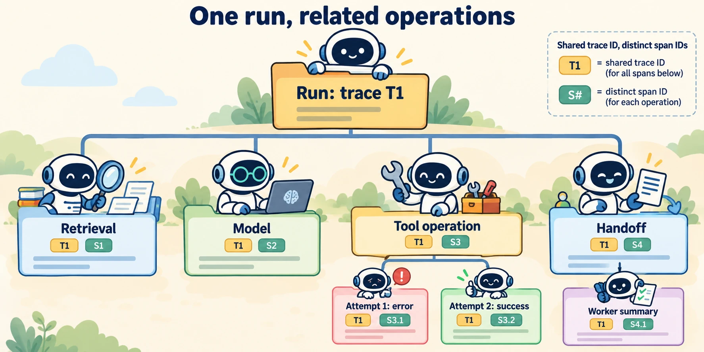

<!--
---
title: Events, traces, metrics, and correlation
unit_id: P1-03-11-01
summary: Use structured events, span relationships and aggregate measurements to reconstruct
  and measure an agent run.
prerequisites:
- Read [Interrupts, steering, feedback, and operator experience](../10-human-in-the-loop/02-interrupts-steering-feedback-and-operator-experience.md).
learning_objectives:
- Distinguish logs, events, traces, spans and metrics.
- Correlate attempts, operations and runs across services.
- Interpret latency and error measurements without equating transport success with
  task quality.
source_records:
- p1-03-11-01-traces
- p1-03-11-01-metrics
- p1-03-11-01-context
- p1-03-11-01-genai
- p1-03-11-01-sdk-tracing
visual_assets:
- assets/images/03-building-blocks/11-observability-and-tracing/01-events-traces-metrics-and-correlation/01-concept.webp
example_paths:
- examples/03-building-blocks/11-observability-and-tracing/01-events-traces-metrics-and-correlation/main.py
pass: architecture
learning_path: main
status: complete
last_reviewed: '2026-10-10'
---
-->

# Events, traces, metrics, and correlation

## Why this matters

Lee says the assistant took too long to answer. A final response cannot tell us whether retrieval was slow, the model waited on a tool, an attempt failed or the workflow paused for human input. We need records from the components that performed the work.

**Observability** is the ability to understand a system's behavior from its outputs and records. **Telemetry** is the measured or recorded data it emits. Begin with questions: Where did time go? Which action completed? What was retried? Was the system waiting for [human input](../10-human-in-the-loop/chapter-plan.md)?

## How it works

### Give records different jobs

An **event** describes something that happened, such as `approval_received`. A **log** is a timestamped record, often carrying an event and its fields. A **trace** follows an end-to-end operation across related steps. A **span** represents one timed operation within a trace. An **attribute** is a named value attached to a record, such as a tool name or attempt number.

OpenTelemetry spans carry identifiers, parent relationships, time bounds and status; they can also contain events and links to other spans. Parent-child relationships describe operations within larger operations. Links can connect asynchronous work without forcing everything into one nested lifetime. [OpenTelemetry traces](https://opentelemetry.io/docs/concepts/signals/traces/).

For our shop, a run span contains retrieval, a model request and tool attempts. A handoff records transfer to another worker, whose summary operation is related to that transfer. An approval request is a point event; time spent waiting for the decision can be measured separately. These are observable runtime operations, not a transcript of hidden model reasoning.



*Figure 1. Start at the run, then inspect its child operations. The two tool attempts belong to one logical lookup. A shared trace ID joins the records; separate span IDs identify individual operations.*

### Correlate the right identities

A **correlation identifier** connects related records. Different identifiers answer different questions:

| Identifier | Question it answers in our design |
| --- | --- |
| Session ID | Which continuing conversation contains this run? |
| Run ID | Which attempt to fulfill a task is this? |
| Trace ID | Which instrumented operation contains this span? |
| Span ID and parent ID | Which timed step is this, and what contains it? |
| Model call ID | Which model-requested call receives this output? |
| Operation ID and attempt number | Which retries belong to the same logical action? |

**Context propagation** transports trace context between components, allowing a receiving service to relate its work to the caller's span. It requires cooperation at the boundary. A trace header is correlation data, not proof that the caller is authorized. [Context propagation](https://opentelemetry.io/docs/concepts/context-propagation/).

Use causal relationships and sequence numbers alongside timestamps. Machines can have different clock settings, so sorting logs by time alone may misrepresent distributed ordering. The mock uses one synthetic clock to make its timing checks deterministic.

### Summarize runs with metrics

A **metric** measures behavior numerically across observations. A **counter** accumulates occurrences, such as completed tool attempts. A **gauge** reports a current value, such as waiting tasks. A **histogram** groups measured values, such as durations, into a distribution. OpenTelemetry defines these instrument types and aggregation mechanisms. [Metrics](https://opentelemetry.io/docs/concepts/signals/metrics/).

Our mock has one logical lookup, two attempts and one attempt error. The complete run succeeds. “Tool error rate” therefore needs a defined denominator: attempts and logical operations are different populations. User-visible task success is another measurement, requiring [evaluation](../12-evaluation-and-benchmarks/chapter-plan.md) against the goal.

**Latency** measures elapsed time. Distinguish end-to-end response time from retrieval duration, tool duration and human wait time. Parallel span durations can overlap, so adding every child duration is not a general way to calculate total latency.

**Cardinality** is the number of distinct attribute combinations. Aggregate metrics by bounded categories such as tool name and outcome. A separate metric series for every run ID or full prompt can create an unbounded set. Preserve individual identifiers in records intended for per-run inspection.

### Keep the application contract stable

OpenTelemetry's GenAI agent conventions describe operations such as agent invocation, workflows and tool execution. They are currently marked **Development**, so implementations should pin a version and map to a stable application schema. [GenAI agent spans](https://raw.githubusercontent.com/open-telemetry/semantic-conventions-genai/main/docs/gen-ai/gen-ai-agent-spans.md).

Record measured model usage when available, with units and provenance. Missing token usage is not zero usage. A cost estimate also depends on the applicable pricing and caching contract, not just a span duration. This guide does not embed a pricing assumption.

## Minimal implementation

The [OpenTelemetry-shaped offline example](../../../examples/03-building-blocks/11-observability-and-tracing/01-events-traces-metrics-and-correlation/main.py) creates a trace with a retrieval step, model step, two tool attempts and a handoff. Assertions check identifiers, parent links, time ranges and metric denominators. It prints JSON to the terminal and exports nothing.

<details><summary>Expand minimal Python implementation</summary>

```python
tools = [s for s in spans if s["name"] == "lookup_stock"]
counts = Counter(s["status"] for s in tools)
operations = {s["attributes"]["project.operation_id"] for s in tools}
```

</details>

The simplified shape and `project.*` attributes are our teaching schema, not the exact OTLP wire format. **OTLP** is OpenTelemetry's protocol for transporting telemetry.

## Framework implementations

The OpenAI Agents SDK supplies tracing for model generations, tool calls and handoffs, with configuration and custom processors. Its identifiers and span data differ from OpenTelemetry's. Map the shared concepts and preserve required relationships when integrating the systems rather than renaming an SDK JSON object “OTLP.” [SDK tracing](https://openai.github.io/openai-agents-python/tracing/).

## Limitations and trade-offs

**Sampling** retains only selected telemetry, reducing volume while limiting what can be reconstructed. Missing spans can also reflect instrumentation gaps or export failures. A quiet dashboard does not establish that no operation happened.

Record known outcomes at the component that observes them. A model's final statement that a reservation succeeded is different from the order service's receipt. Traces help locate a discrepancy, while evaluation determines whether the resulting answer fulfilled the task.

## Security preview

Telemetry can contain sensitive data. Pass 2 examines that exposure and detection needs in [human interfaces and observability security](../../07-security-by-component-and-workflow-stage/05-human-interfaces-and-observability/chapter-plan.md). Useful reconstruction does not require recording every raw prompt.

## Key takeaways

- Events describe changes, spans time operations, traces connect them and metrics summarize measurements.
- Preserve run, span, call and operation identifiers for their different purposes.
- Define denominators and units before interpreting error rates or latency.
- Observable execution success and task quality require different evidence.

## References

- OpenTelemetry. [Traces](https://opentelemetry.io/docs/concepts/signals/traces/), [metrics](https://opentelemetry.io/docs/concepts/signals/metrics/), and [context propagation](https://opentelemetry.io/docs/concepts/context-propagation/).
- OpenTelemetry. [GenAI agent and framework spans](https://raw.githubusercontent.com/open-telemetry/semantic-conventions-genai/main/docs/gen-ai/gen-ai-agent-spans.md). Development-stage conventions, verified for this run.
- OpenAI. [Agents SDK tracing](https://openai.github.io/openai-agents-python/tracing/). Living documentation, verified for this run.

The next chapter is an optional lineage and telemetry deep dive. Readers staying on the main path can continue to [evaluation and benchmarks](../12-evaluation-and-benchmarks/chapter-plan.md).

---

[Next unit: Lineage, replay, redaction, retention, and integrations →](02-lineage-replay-redaction-retention-and-integrations.md)
