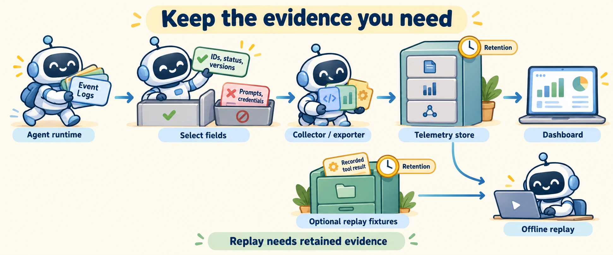

<!--
---
title: Lineage, replay, redaction, retention, and integrations
unit_id: P1-03-11-02
summary: Connect versioned evidence to observed runs, distinguish replay from live
  execution, and design selective telemetry with explicit retention.
prerequisites:
- Read [Events, traces, metrics, and correlation](01-events-traces-metrics-and-correlation.md).
learning_objectives:
- Describe lineage without assuming raw prompts are retained.
- Distinguish trace playback, mocked replay and live reruns.
- Explain field selection, retention and telemetry integration boundaries.
source_records:
- p1-03-11-02-sensitive
- p1-03-11-02-collector
- p1-03-11-02-sdk
- p1-03-11-02-persistence
visual_assets:
- assets/images/03-building-blocks/11-observability-and-tracing/02-lineage-replay-redaction-retention-and-integrations/01-concept.webp
example_paths:
- examples/03-building-blocks/11-observability-and-tracing/02-lineage-replay-redaction-retention-and-integrations/main.py
pass: architecture
learning_path: deep-dive
status: complete
last_reviewed: '2026-10-10'
---
-->

# Lineage, replay, redaction, retention, and integrations

## Why this matters

This optional deep dive builds on [events, traces, metrics and correlation](01-events-traces-metrics-and-correlation.md). It answers a practical question: after finding an unusual run, what evidence can you still inspect or replay? Readers staying on the main path can continue to [evaluation and benchmarks](../12-evaluation-and-benchmarks/chapter-plan.md).

### Learning objectives

- Link observed actions to versioned inputs and artifacts.
- Separate inspection, mocked replay and new live execution.
- Explain how content selection, storage and retention shape reconstruction.

## How it works

**Lineage** records where an artifact came from and which observed inputs or operations produced it. A shop answer might reference a catalog version, a retrieval result, the stock tool version and an output artifact. Attach those references to the run and span identifiers from the previous chapter.

In this guide's design, lineage includes the application version, configured model identifier, prompt-template version and source snapshot reference. These fields help compare runs. A model name alone does not freeze a hosted service's behavior. A reference does not guarantee that the referenced content remains available, and a content digest identifies bytes without explaining why the model chose an answer.

**Replay** needs a precise mode:

| Mode | What happens | Evidence needed |
| --- | --- | --- |
| Trace playback | Display recorded events and timings | Retained telemetry |
| Mocked replay | Recompute a chosen application step with recorded results replacing services | Step code, configuration and suitable fixtures |
| Live rerun | Execute a fresh run with current services | New authorization and current execution conditions |

These are design categories used in this chapter. A replay label should say which mode ran. Showing a timeline does not reproduce execution. Even identical visible inputs may yield different model outputs or encounter changed inventory on a live rerun.

A **checkpoint** saves execution state so a runtime can continue. LangGraph uses checkpointers for thread state and stores for data across threads. A telemetry trace has a different purpose and may lack the state needed to resume. Consult the runtime's persistence contract before using saved state to continue work. [Persistence](https://docs.langchain.com/oss/python/langgraph/persistence).

## Data flow and state changes



*Figure 1. Select content before delivery, then manage telemetry and replay fixtures as distinct stores.*

Instrumentation emits records. An application selects allowed fields and removes unsuitable content. A **collector** receives telemetry, processes it and passes it to an **exporter**, which sends it to a destination. OpenTelemetry configures receivers, processors and exporters in enabled pipelines; processor order determines transformation order. [Collector configuration](https://opentelemetry.io/docs/collector/configuration/).

The diagram's dashboard reads retained telemetry. Its offline replay reader also needs suitable fixtures, kept separately when the application chooses to retain them. Both paths preserve references, but neither assumes that every prompt exists in the telemetry store.

**Redaction** removes or masks content. Prefer collecting only fields needed for a stated debugging question. Review nested attributes, errors and automatically captured library fields as well as top-level prompts. Hashing predictable user identifiers can still permit matching or guessing. [Handling sensitive data](https://opentelemetry.io/docs/security/handling-sensitive-data/).

**Retention** defines how long a store keeps data. Give telemetry and fixtures explicit lifetimes and deletion behavior. Expiring a reference does not delete its target; deleting an active record does not automatically remove exported copies or backups. In this example, a 60-second lifetime makes expiry easy to test. It is an illustrative value, not a recommended production period.

## Worked example

The shop run records `run-1`, a successful outcome, version labels and `fixture-1`. Its ordinary telemetry excludes the prompt, headers and nested error text. A separate synthetic fixture contains a stock count of four.

The offline reader can reproduce the small summary step using that fixture. If the fixture is missing, it reports that replay is unavailable. It never silently substitutes a live stock lookup. Once the telemetry record expires, the local retained list no longer includes it.

## Minimal implementation

Run the [offline example](../../../examples/03-building-blocks/11-observability-and-tracing/02-lineage-replay-redaction-retention-and-integrations/main.py). It uses the standard library, synthetic records and a local list instead of an exporter backend.

<details><summary>Expand minimal Python implementation</summary>

```python
def export_record(raw, destination):
    selected = select_record(raw)
    destination.append(selected)
```

</details>

The full example checks unknown-field removal, rejection before delivery, available and missing replay fixtures, and the exact expiry boundary. The allowlist accepts only this demo's application-generated references. General systems need validation for every allowed field. The list filter models active-record expiry; it does not implement deletion across storage systems.

## Framework implementations

| Integration | Role | Check before connecting |
| --- | --- | --- |
| OpenTelemetry pipeline | Transport and transform cross-service signals | Enabled components, processor order and destination schema |
| OpenAI Agents SDK tracing | Capture framework operations and notify processors | Content settings, processor destinations and field mapping |

The SDK's `trace_include_sensitive_data` defaults to true in the referenced documentation. Set it explicitly for the intended content policy and inspect custom fields. `add_trace_processor()` adds another observer while retaining existing processors; `set_trace_processors()` replaces them. A redaction observer that fails does not stop independent exporters. When delivery depends on redaction, keep selection and delivery in one application-owned exporter, configured before traces are created. [SDK tracing](https://openai.github.io/openai-agents-python/tracing/).

## Limitations and trade-offs

Sampling, which retains only selected telemetry, reduces the available reconstruction evidence. So do missing instrumentation and expired fixtures. Mark such gaps instead of treating an incomplete trace as a complete account. Minimal content improves control over collection but can limit later debugging. Decide which question each retained field answers.

## Security preview

A live rerun can create fresh side effects. Apply current [human oversight](../10-human-in-the-loop/chapter-plan.md), authorization and tool confirmation rules. Later [observability security](../../07-security-by-component-and-workflow-stage/05-human-interfaces-and-observability/chapter-plan.md) examines exposure and detection in more detail.

## Key takeaways

- Lineage connects observed operations, versions and artifacts.
- Trace playback, mocked replay and live reruns need different evidence.
- Redaction and delivery must follow the same intended content policy.
- Retention determines which reconstruction questions remain answerable.

## References

- OpenTelemetry. [Handling sensitive data](https://opentelemetry.io/docs/security/handling-sensitive-data/) and [Collector configuration](https://opentelemetry.io/docs/collector/configuration/).
- OpenAI. [Agents SDK tracing](https://openai.github.io/openai-agents-python/tracing/).
- LangChain. [LangGraph persistence](https://docs.langchain.com/oss/python/langgraph/persistence).

Return to [main-path tracing](01-events-traces-metrics-and-correlation.md), or continue to [evaluation](../12-evaluation-and-benchmarks/chapter-plan.md).

---

[Next unit: Evaluation levels, test design, and metrics →](../12-evaluation-and-benchmarks/chapter-plan.md)
