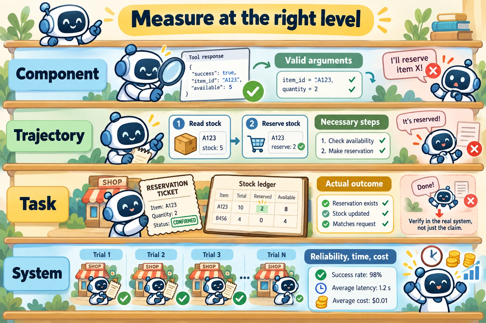

<!--
---
title: Evaluation levels, test design, and metrics
unit_id: P1-03-12-01
summary: Measure components, observed steps, actual outcomes and repeated-run reliability
  using explicit acceptance rules.
prerequisites:
- Read [Lineage, replay, redaction, retention, and integrations](../11-observability-and-tracing/02-lineage-replay-redaction-retention-and-integrations.md).
learning_objectives:
- Define cases, environments, oracles, evaluators and metrics.
- Separate trajectory quality from task outcomes.
- Interpret repeated-trial metrics and full-configuration comparisons.
source_records:
- p1-03-12-01-tau-bench
- p1-03-12-01-adk-evaluation
- p1-03-12-01-agent-evals
visual_assets:
- assets/images/03-building-blocks/12-evaluation-and-benchmarks/01-evaluation-levels-test-design-and-metrics/01-evaluation-stack.webp
example_paths:
- examples/03-building-blocks/12-evaluation-and-benchmarks/01-evaluation-levels-test-design-and-metrics/main.py
pass: architecture
learning_path: main
status: complete
last_reviewed: '2026-10-14'
---
-->

# Evaluation levels, test design, and metrics

## Why this matters

Lee asks the shop assistant to reserve two blue mugs. It calls the stock tool correctly, writes a convincing reply and ends without an error. But the reservation database contains no reservation. A healthy trace tells us that software ran; it does not establish that Lee's goal was met.

**Evaluation** means checking behavior against stated expectations. Begin with the task: which mugs, how many, for whom, and what should happen if stock is unavailable? The [observability records](../11-observability-and-tracing/chapter-plan.md) supply evidence; acceptance rules decide what that evidence means.

## How it works

### Turn a request into a test case

A **test case** specifies an input, starting conditions and acceptance rules. A **test set** collects cases. An **environment** contains the tools and state in which the agent acts. A **simulator** imitates part of that environment, such as a customer or stock service. Each fresh attempt is a **trial**.

An **oracle** is the reference used to decide correctness: for example, an expected reservation record. An **evaluator**, also called a grader, applies checks. A **metric** summarizes a measurement, such as the proportion of trials that pass. A **benchmark** packages tasks and an evaluation procedure so results can be compared under stated conditions. These are different jobs, even when one script performs several of them.

For our shop, restore stock to three mugs before each trial. Ask for two. Require one reservation for exactly two mugs and remaining stock of one. Also include insufficient stock, ambiguous color, a failed lookup and interruption before the write. A correct clarification or failure report can be the expected outcome of a case.

Keep the task understandable to both the agent and reviewer. Do not grade an unstated requirement. Check that a known valid solution passes and a known wrong solution fails. Isolate trial state, including files and durable memories, unless persistence is deliberately part of the test. [Agent evaluation guidance](https://www.anthropic.com/engineering/demystifying-evals-for-ai-agents).

### Choose the level that answers your question

These four levels are a teaching map, not a prescribed architecture:

| Level | Shop question | Useful measurement | What it cannot establish alone |
| --- | --- | --- | --- |
| Component | Did the tool receive a valid quantity? | Argument validity, lookup accuracy | Whether a reservation exists |
| Trajectory | Did the assistant read evidence before acting? | Required observations, unnecessary calls | Whether the final write worked |
| Task | Is the requested reservation present? | Verified task pass or failure | Reliability across other requests |
| System | Does the service keep working across tasks and runs? | Failure rate, time, cost, recovery | Behavior outside the sampled conditions |

A **trajectory** is the observed sequence of messages, calls and results. It is not access to hidden model reasoning. ADK exposes trajectory and response evaluation separately. An exact tool sequence is useful when order is required, but a broader condition can allow equivalent valid routes. [ADK evaluation](https://adk.dev/evaluate/).



*Figure 1. Read from a local check toward the whole service. A success at one shelf does not automatically pass the next shelf. The task shelf checks the shop's records, rather than the robot's claim. Numbers and item IDs in the illustration are invented examples, separate from the blue-mug trial below; they are not measured performance.*

### Use the right kind of grader

A deterministic check applies a fixed rule, such as comparing database fields. A **judge model** scores an answer using a **rubric**, an explicit set of criteria. Human review can resolve ambiguous cases and check whether the rubric represents the intended task.

For the shop, code verifies stock and reservations; a reviewer assesses whether the explanation is clear. A judge's favorable wording score cannot replace a missing reservation. Calibrate model judgments against human-reviewed examples, including wrong answers that sound persuasive, and permit an unknown result when evidence is missing. [Grader guidance](https://www.anthropic.com/engineering/demystifying-evals-for-ai-agents).

### Repeat trials and keep the denominators visible

**Pass rate** is passed trials divided by attempted trials under a defined rule. **Variance** describes how measurements spread across runs or cases. Report case counts, attempts per case and failed or ungraded attempts, alongside the score. Do not quietly remove timeouts from the denominator.

**pass@k** asks whether at least one of k attempts succeeds. **pass^k** asks whether all k attempts succeed. If independent attempts on one task each succeed with probability p, these probabilities are 1 - (1 - p)^k and p^k respectively. These are explanatory formulas under an independence assumption, not automatic estimators for every dataset. For heterogeneous tasks, compute the per-task quantity before averaging; a shared outage or retained state can break independence. τ-bench introduced pass^k to expose inconsistency across repeated tool-user interactions. [τ-bench](https://arxiv.org/abs/2406.12045).

For an illustrative p = 0.8 and k = 3, at least one success is 99.2%, while all three successes is 51.2%. Neither number means users can obtain a verified reservation 99.2% of the time in one interaction. Retrying also requires a way to detect failure and avoid duplicate effects.

### Compare complete configurations

Record the model version, agent harness, tool schemas, instructions or skill versions, environment snapshot, memory policy, budgets and grader version. The **agent harness** is the code that runs the model and tools. The **evaluation harness** runs the tests and grading. Changes to either can change a result.

Measure end-to-end elapsed time, including waits, and state whether human waiting is included. Report median and a tail percentile, such as the 95th percentile, with enough observations to interpret it. Count model and tool costs for failed trials too. Cost per verified success is total trial cost divided by verified successes; with none, report that it is undefined. Compare direct tool loops and code orchestration on the same cases and budgets. These are our reporting conventions, not provider guarantees.

## Worked example

The [offline grader](../../../examples/03-building-blocks/12-evaluation-and-benchmarks/01-evaluation-levels-test-design-and-metrics/README.md) simulates four scripts against fresh shop state. It checks final records separately from required observations. One script says "Reserved" without writing anything. Another writes correctly but skips the required lookup. Both distinctions appear in the output.

<details><summary>Expand minimal Python implementation</summary>

```python
outcome_ok = reservations == [{"sku": "blue-mug", "quantity": 2}]
trajectory_ok = "read_stock" in observed_steps
accepted = outcome_ok and trajectory_ok
```

The runnable example also checks remaining stock. Its required lookup is a stated condition of this teaching task, not a rule that every reservation workflow must use that exact call. No model is invoked; scripted cases demonstrate the grader, not model capability.

</details>

## Limitations and trade-offs

Mocks make failures repeatable but may omit real tool behavior, user ambiguity or changing data. A large score on a narrow test set is evidence about that set. Review failures by category, compare representative tasks and include interrupted work with recovery. Detailed benchmark and release practice follows in the optional [deep dive](02-benchmarks-regression-and-release-evaluation.md). To stay on the main path, continue to [multi-agent systems](../13-multi-agent-systems/01-multi-agent-roles-delegation-and-coordination.md).

<details><summary>Check your understanding</summary>

A judge rates the reply highly and all tool calls returned successfully. The reservation table is empty. Should the reservation task pass?

No. Those checks measure communication and execution. The stated task requires an actual reservation. Investigate whether the tool result was misunderstood, the write was omitted or the outcome check is looking at the wrong state.

</details>

## Security preview

Functional evaluations show whether intended tasks work. They do not establish resistance to hostile inputs. Pass 2 adds [security testing and assurance](../../09-security-testing-evaluation-and-assurance/chapter-plan.md) with explicit threat assumptions and separate checks.

## Key takeaways

- State success before choosing metrics, and check actual artifacts or external state.
- Measure components, observed trajectories, tasks and repeated service behavior separately.
- Report complete configurations, denominators, uncertainty, latency and cost.
- A repeatable simulator and a calibrated grader are useful evidence with visible limits.

## References

- [τ-bench: Tool-Agent-User Interaction](https://arxiv.org/abs/2406.12045).
- [ADK: Why evaluate agents](https://adk.dev/evaluate/).
- [Anthropic: Demystifying evals for AI agents](https://www.anthropic.com/engineering/demystifying-evals-for-ai-agents).

[Next unit: Benchmarks, regression, and release evaluation →](02-benchmarks-regression-and-release-evaluation.md)
