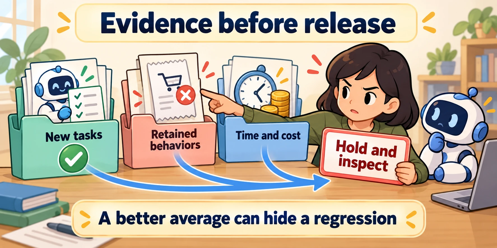

<!--
---
title: Benchmarks, regression, and release evaluation
unit_id: P1-03-12-02
summary: Use benchmark results as scoped evidence and test candidate releases against
  retained behaviors, new cases and operational budgets.
prerequisites:
- Read [Evaluation levels, test design, and metrics](01-evaluation-levels-test-design-and-metrics.md).
learning_objectives:
- Choose benchmarks that match the intended workflow.
- Separate development, held-out and regression cases.
- Explain a release decision with per-case evidence and complete configuration records.
source_records:
- p1-03-12-02-tau-bench
- p1-03-12-02-gaia
- p1-03-12-02-agentbench
- p1-03-12-02-swebench
- p1-03-12-02-harnessbench
- p1-03-12-02-contamination
visual_assets:
- assets/images/03-building-blocks/12-evaluation-and-benchmarks/02-benchmarks-regression-and-release-evaluation/01-release-evidence.webp
example_paths:
- examples/03-building-blocks/12-evaluation-and-benchmarks/02-benchmarks-regression-and-release-evaluation/main.py
pass: architecture
learning_path: deep-dive
status: complete
last_reviewed: '2026-10-14'
---
-->

# Benchmarks, regression, and release evaluation

## Why this matters

Lee's new assistant answers product questions better, but now fails an old cancellation case. Its overall score improved because most test cases ask product questions. Lee still needs to know whether replacing the existing assistant is a good decision.

This deep dive follows the [evaluation levels](01-evaluation-levels-test-design-and-metrics.md). A benchmark measures performance under its procedure. A **regression** is a loss of behavior that previously worked. A release decision connects both to the service's actual requirements.

## How it works

### Ask what the benchmark actually measures

A benchmark result belongs to a task distribution, environment, grader and agent configuration. Match those to your use case before interpreting a score.

| Primary benchmark | What it exercises | What Lee still needs to test locally |
| --- | --- | --- |
| [AgentBench](https://arxiv.org/abs/2308.03688) | Decisions in eight interactive environments | Shop-specific tasks, tool failures and recovery |
| [GAIA](https://arxiv.org/abs/2311.12983) | Questions combining reasoning, browsing, tools and multimodal input | Whether reservations and cancellations change the correct records |
| [SWE-bench](https://www.swebench.com/SWE-bench/guides/evaluation/) | Patches applied to repositories and graded by tests | Shop behavior; software tests cover only their assertions |
| [τ-bench](https://arxiv.org/abs/2406.12045) | Simulated customer interactions, policies, tools and final database states | Actual customer behavior and deployed tool semantics |

These are examples of benchmark designs, not a current ranking. A browser-dependent question may change when its page changes. A simulated user can omit the pauses, mistakes or corrections real customers make. Passing a coding benchmark does not directly measure reservation-service quality.

The 2026 [Harness-Bench preprint](https://arxiv.org/abs/2605.27922) compares model-harness pairings under shared offline tasks and budgets, examining artifacts, traces and resource use. Its lesson for this guide is a bounded reporting practice: name the configuration you evaluated. Do not assign the whole system's score to its base model alone.

### Give datasets different jobs

**Development cases** guide changes to prompts, tools or skills. **Held-out cases** are kept out of those tuning decisions. A **regression set** retains behaviors the product must keep. A **capability set** probes new or difficult work. One case can be relevant to several purposes, but repeated inspection of its answer means it is no longer untouched evidence of generalization.

**Contamination** occurs when evaluation information enters training or tuning in a way that weakens the intended test. It can involve benchmark answers in model training, or a developer repeatedly optimizing a prompt against a supposedly held-out set. Exact text matching is insufficient to exclude all leakage; rephrased samples can still distort results. [Rephrased-sample contamination research](https://arxiv.org/abs/2311.04850).

Our shop convention is to tune on development cases, use a separate retained regression suite, and reserve fresh cases for final comparison. Split related requests by scenario family when paraphrases share the same answer. Keep reviewer notes and grader access separate from the inputs provided to the agent. If final results inform another change, document that reuse and obtain new held-out evidence where needed.

### Make comparisons fair and inspectable

Run baseline and candidate against the same case IDs, starting snapshots and budgets. Pair results by case; record which cases improved and which regressed. Repeat trials because one run can be lucky. Inspect [traces and lineage](../11-observability-and-tracing/chapter-plan.md) to separate task failure, tool failure and a broken evaluation environment.

Record model, harness, tool, prompt, skill, memory and evaluator versions. Include timeouts, missing outputs and interrupted runs. Report outcome pass rates alongside latency and total cost. A one-case improvement in a tiny set is not strong evidence of a durable gain; uncertainty should reflect task sampling as well as repeated runs.

Some evaluation harnesses cache results. SWE-bench documents that reuse of the same run and instance identifiers can reuse prior results even when a patch changes. A fresh configuration comparison needs appropriate run identifiers and verified artifacts. A completed harness operation also differs from a resolved issue. [SWE-bench evaluation guide](https://www.swebench.com/SWE-bench/guides/evaluation/).

### Define the release decision before seeing the scores

A **release gate** is a stated acceptance rule for a candidate. The following is an illustrative shop policy, not an industry threshold:

| Requirement | Evidence checked | Decision on failure |
| --- | --- | --- |
| Retain mandatory cancellation and reservation cases | Per-case outcomes over repeated trials | Hold the candidate and inspect the failure |
| Improve new product-question cases | Baseline and candidate on fresh cases | Seek more evidence if the difference is uncertain |
| Remain within time and cost budgets | End-to-end measurements including failed trials | Adjust the design or decline the release |
| Preserve interrupted-work recovery | Verified external records after resume | Fix recovery before release |

Do not hide a mandatory failure inside an aggregate score. Also avoid pretending that zero failures in a finite sample proves a zero failure rate. A team can set stricter rules for high-impact tasks and accept a documented trade-off for optional behaviors.



*Figure 1. Read each evidence folder before the decision. A better new-task score cannot erase a failed required behavior. The reviewer owns the release decision; the folders supply evidence.*

## Worked example

The [offline release comparison](../../../examples/03-building-blocks/12-evaluation-and-benchmarks/02-benchmarks-regression-and-release-evaluation/README.md) uses invented outcomes. Both configurations pass reservation cases. The candidate improves product answers but loses one cancellation trial. Its aggregate pass rate is higher, yet the mandatory regression rule holds the release. A missing case also holds it.

<details><summary>Expand minimal Python implementation</summary>

```python
regressions = [case for case in required_cases
               if not all(candidate_results[case])]
release = not regressions
```

The runnable version checks that expected case IDs are present and trial counts match, and applies an illustrative cost budget. It evaluates supplied records; it does not run a model or provide statistical confidence from this small fixture.

</details>

## Limitations and trade-offs

A frozen suite protects known behaviors but can miss new usage. Add cases from reviewed failures, keeping personal data out of teaching fixtures. Preserve the old suite and configuration so you can explain score changes after grading updates. Beyond the offline gate, observe a controlled rollout, define when to restore the earlier configuration and reconcile any external actions already taken. Changing a deployment version does not undo those actions.

The next main-path section covers [multi-agent systems](../13-multi-agent-systems/chapter-plan.md), where coordination creates additional trajectories and failure categories to evaluate.

<details><summary>Check your understanding</summary>

The candidate gains ten product-answer successes and loses one mandatory cancellation case. Its overall score rises. Is that enough to release it?

No. Check the predeclared gate and repeat the disputed case to understand the failure. A higher aggregate measures a different trade-off from preserving mandatory behavior. Record the uncertainty and decision rather than silently changing the gate after seeing the result.

</details>

## Security preview

Functional regression suites do not replace [security testing and assurance](../../09-security-testing-evaluation-and-assurance/chapter-plan.md). Pass 2 adds hostile scenarios and tests for component boundaries using separate acceptance rules.

## Key takeaways

- Compare benchmark designs and configurations, not isolated leaderboard numbers.
- Keep tuning, retained behavior checks and fresh evaluation evidence distinct.
- Use per-case regressions, operational budgets and explicit release rules.
- Keep the environment, grader and result provenance visible when scores change.

## References

- [AgentBench](https://arxiv.org/abs/2308.03688), [GAIA](https://arxiv.org/abs/2311.12983), [τ-bench](https://arxiv.org/abs/2406.12045).
- [SWE-bench evaluation guide](https://www.swebench.com/SWE-bench/guides/evaluation/).
- [Harness-Bench](https://arxiv.org/abs/2605.27922), May 2026 preprint.
- [Rethinking Benchmark and Contamination with Rephrased Samples](https://arxiv.org/abs/2311.04850).

[Next unit: Multi-agent roles, delegation, and coordination →](../13-multi-agent-systems/chapter-plan.md)
