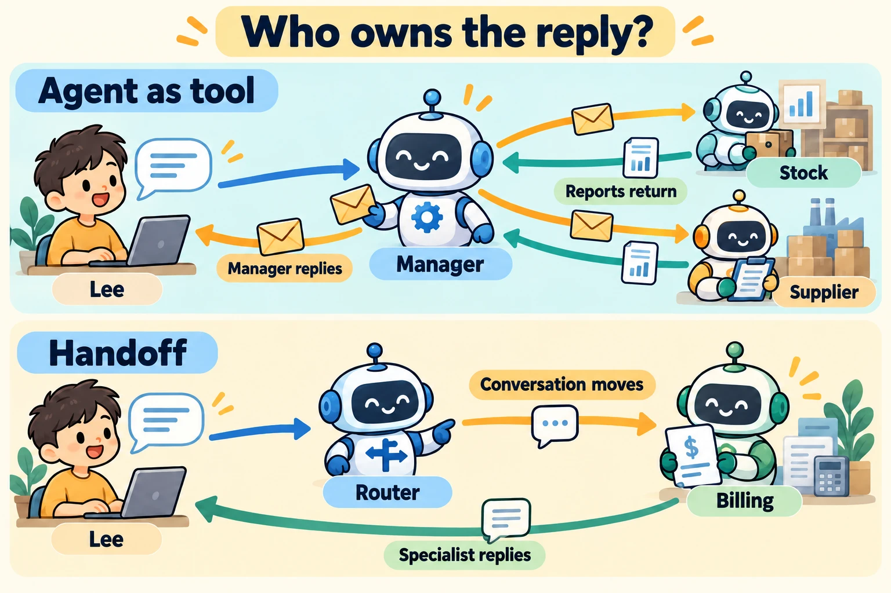
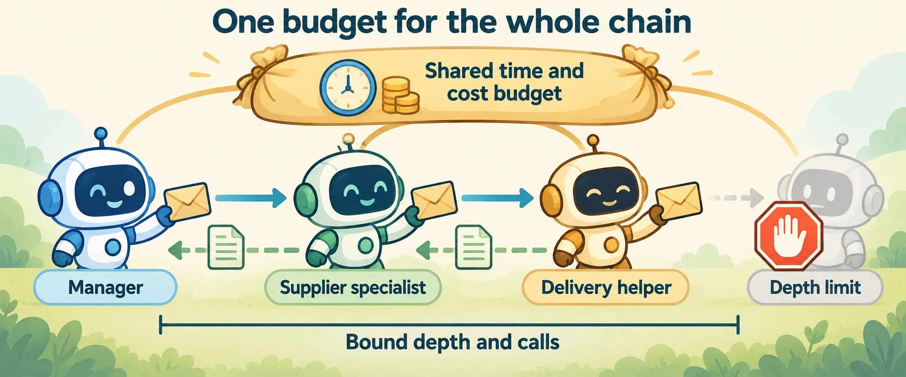

<!--
---
title: Multi-agent roles, delegation, and coordination
unit_id: P1-03-13-01
summary: Decide who owns the reply, what specialists receive and return, and how team
  work stops before adding agents.
prerequisites:
- Read [Evaluation levels, test design, and metrics](../12-evaluation-and-benchmarks/01-evaluation-levels-test-design-and-metrics.md).
learning_objectives:
- Distinguish agent-as-tool delegation from handoff.
- Compare manager, router, shared-board and peer coordination.
- Define message, state, authority and completion contracts for a team.
source_records:
- p1-03-13-01-openai-orchestration
- p1-03-13-01-autogen-teams
- p1-03-13-01-sk-orchestration
visual_assets:
- assets/images/03-building-blocks/13-multi-agent-systems/01-multi-agent-roles-delegation-and-coordination/02-bounded-delegation-chain.webp
- assets/images/03-building-blocks/13-multi-agent-systems/01-multi-agent-roles-delegation-and-coordination/01-delegation-and-handoff.webp
example_paths:
- examples/03-building-blocks/13-multi-agent-systems/01-multi-agent-roles-delegation-and-coordination/main.py
pass: architecture
learning_path: main
status: complete
last_reviewed: '2026-10-14'
---
-->

# Multi-agent roles, delegation, and coordination

## Why this matters

Lee wants a report on which products need restocking and whether suppliers can deliver them this week. The assistant could handle both lookups itself. A team becomes useful only if separating stock analysis from supplier research makes the task clearer or performs better under the same evaluation conditions.

A **multi-agent system** contains multiple agent instances that coordinate work. A **role** describes an instance's job; a **specialist** has a narrower job, context or tool set. Different roles can use the same model. Naming two prompts "agents" does not by itself create useful cooperation.

Start with a single-agent **baseline**, a reference configuration for comparison. Add a specialist for a concrete reason, such as a separate tool contract or an independent research subtask, then measure the result. AutoGen also recommends trying an adequately equipped single agent before adopting a team. [AutoGen teams](https://microsoft.github.io/autogen/stable/user-guide/agentchat-user-guide/tutorial/teams.html).

## How it works

### First decide who owns the answer

**Delegation** assigns a bounded piece of work. In an **agent-as-tool** pattern, the caller invokes a specialist and receives a result, much like any other tool. A **manager**, also called a supervisor, remains responsible for combining results and responding to the user.

A **handoff** transfers active conversation control to another agent. The receiving specialist owns the next response for that branch. This differs from calling a helper and waiting for its return. OpenAI's Agents SDK exposes both patterns: Python `Agent.as_tool()` wraps a specialist as a callable capability, while `handoffs` specifies agents that may take over. These are SDK mechanisms, not permission grants. [OpenAI orchestration](https://developers.openai.com/api/docs/guides/agents/orchestration).

In Lee's report, stock and supplier specialists return evidence to a manager. If Lee instead asks a billing question, a router could hand the conversation to billing, which asks any needed follow-up itself. **Routing** selects the destination; it need not be another model call. Fixed code can route a known category.



*Figure 1. In the upper scene, reports return to the manager. In the lower scene, the conversation moves to a specialist. Follow the owner of the user reply, rather than merely counting robots.*

### Choose coordination to match the task

A **peer** communicates with other agents without one agent serving as permanent manager. A **team** is the participating agents plus the coordination rules. A **blackboard** is a shared task or evidence store that workers inspect and update. **Consensus** is agreement under a declared rule; agreement does not make a factual claim correct.

The following are design patterns, not mutually exclusive product categories:

| Pattern | Control and message flow | State and action ownership | Failure and stopping rule in a concrete design |
| --- | --- | --- | --- |
| Supervisor-worker | Manager delegates; workers return results | Manager owns task record and final reply; workers have bounded tools | Manager detects missing results, applies deadline and checks acceptance |
| Router-specialist | Router chooses one branch; specialist continues | Chosen specialist owns conversation state and permitted branch actions | Unknown category falls back; handoff count and task budget are bounded |
| Sequential team | Each stage passes its result to the next | Runtime owns stage state; each stage writes its artifact | Missing required output stops downstream work |
| Concurrent team | Independent subtasks run together; collector joins results | Workers keep local context; collector owns combined result | Join records partial failures and cancels unneeded work |
| Blackboard | Workers claim tasks and publish evidence on a board | Store owns task state; writes need explicit conflict rules | Claims expire or are reassigned; finish only when required tasks are accepted |
| Group chat or debate | Participants discuss; a scheduler chooses turns | Shared messages provide context; a designated actor performs external writes | Bound rounds and decide with evidence, not endless discussion |
| Peer-to-peer or event-driven team | Peers send messages or react to recorded events | Local state plus shared identifiers; each action has a named owner | Detect missing, duplicate or cyclic work; apply deadlines and completion checks |

Semantic Kernel documents concurrent, sequential, handoff, group-chat and Magentic orchestrations, while marking this feature experimental. AutoGen's round-robin team schedules turns; its selector team uses a model to choose a speaker. A group conversation is therefore not necessarily simultaneous execution. [Semantic Kernel orchestration](https://learn.microsoft.com/en-us/semantic-kernel/frameworks/agent/agent-orchestration/) and [AutoGen teams](https://microsoft.github.io/autogen/stable/user-guide/agentchat-user-guide/tutorial/teams.html).

### Make each assignment a small contract

For the shop, the manager gives stock analysis the product IDs, inventory snapshot, question, result format and budget. Supplier research receives only the products needing stock and the delivery window. Neither receives an instruction to place an order.

Each request and response carries a task ID, parent task ID, sender, recipient and attempt identifier. The request states scope, allowed tools, expected evidence, deadline and completion rule. The response distinguishes success, partial evidence, failure and a need for clarification. It includes artifact references and unresolved assumptions, rather than only a polished summary.

**Shared context** is information shown to multiple agents. **Shared state** is a durable record that more than one participant may read or change. They are not equivalent: two specialists can receive the same old inventory snapshot without seeing each other's updates. Link task IDs to the existing [trace records](../11-observability-and-tracing/chapter-plan.md).

A role such as "buyer" is descriptive. [Identity and authorization](../08-identity-authorization-and-secrets/chapter-plan.md) determine whether its actual tool credentials can place an order. Delegating analysis does not automatically delegate the caller's permissions. A team's state and messaging design must preserve that distinction.

### Bound the delegation chain

A worker may delegate a smaller subtask, creating a parent-child chain. Give that chain a total call, time and cost budget, not merely a fresh unlimited budget at every child. Set a maximum depth and decide which failures propagate to the parent. These are shop application rules, not automatic guarantees of an agent framework.



*Figure 2. Task envelopes move outward; evidence returns to the caller. The shared budget spans every participant. A new helper does not reset that budget, and the depth limit stops another level of delegation.*

Define **termination**, the condition that stops work. A manager may stop after required evidence is accepted, after a deadline, or when Lee cancels. Record the reason. A timeout ends computation under the runtime's cancellation behavior; it does not prove that already-issued external actions were undone. The optional [coordination deep dive](02-shared-state-failures-termination-and-evaluation.md) examines these cases.

## Worked example

In the [offline manager-specialist example](../../../examples/03-building-blocks/13-multi-agent-systems/01-multi-agent-roles-delegation-and-coordination/README.md), a stock specialist returns low-stock IDs. A supplier specialist returns delivery evidence. The manager joins them and owns the answer. Missing supplier evidence produces a partial result, and nobody places an order.

<details><summary>Expand minimal Python implementation</summary>

```python
stock_result = stock_specialist(inventory_snapshot)
delivery_result = supplier_specialist(stock_result.low_stock)
answer = manager_combine(stock_result, delivery_result)
```

The runnable version uses fixed Python functions to expose contracts. It is a simulation of orchestration; there are no model calls or claims that multiple agents improve performance.

</details>

## Framework implementations

Map the ownership contract before choosing framework APIs:

| Framework | How the shop design maps | Boundary to keep explicit |
| --- | --- | --- |
| OpenAI Agents SDK | Manager calls specialists through `as_tool()`; conversation transfer uses `handoffs` | Reply ownership and supplied history are distinct from external service permissions |
| AutoGen AgentChat | Teams coordinate participants; selectors or fixed turn order choose who responds | A team message is not a durable inventory transaction |
| Semantic Kernel | Sequential or concurrent orchestration passes or collects outputs; handoff changes active agent | Experimental APIs and runtime behavior require version checks |

These mappings were checked against the linked documentation on October 14, 2026. They are conceptual translations; the offline example does not install these SDKs.

## Limitations and trade-offs

More agents add calls, message volume and coordination work. Parallelism helps only when work is sufficiently independent; a dependency on fresh stock keeps supplier work sequential here. Two agents can repeat the same mistake, especially when they use the same model and evidence. Debate and consensus need outcome verification too.

Evaluate against the single-agent baseline using [the same cases and budgets](../12-evaluation-and-benchmarks/chapter-plan.md). Track final outcomes, missing handoffs, duplicate work, total calls and combined cost. Improvements in local worker answers do not guarantee a better combined report.

To stay on the main path, continue to the [learning section](../14-learning-and-self-improvement/01-adaptation-reflection-feedback-and-skills.md), which separates changes to team instructions or skills from model training.

<details><summary>Check your understanding</summary>

A supplier agent returns delivery dates to the manager, which writes the final report. Was that a handoff?

No. It was bounded delegation using an agent as a tool. A handoff would transfer the active conversation so the supplier agent owns the next user-facing response. In either case, ordering stock still requires a separately permitted action.

</details>

## Security preview

Each transfer introduces another component that receives information and may request actions. Pass 2 maps cascading trust and cross-agent risks to [multi-agent and protocol security](../../07-security-by-component-and-workflow-stage/06-multi-agent-and-protocols/chapter-plan.md).

## Key takeaways

- Add agents for a measured reason and retain a single-agent baseline.
- Agent-as-tool delegation returns a result; handoff changes conversation ownership.
- Define message, state, action, failure and stopping contracts for every pattern.
- Shared messages and agreement do not establish current state or factual truth.

## References

- [OpenAI: Orchestration and handoffs](https://developers.openai.com/api/docs/guides/agents/orchestration).
- [AutoGen: Teams](https://microsoft.github.io/autogen/stable/user-guide/agentchat-user-guide/tutorial/teams.html).
- [Semantic Kernel: Agent Orchestration](https://learn.microsoft.com/en-us/semantic-kernel/frameworks/agent/agent-orchestration/).

[Next unit: Shared state, failures, termination, and evaluation →](02-shared-state-failures-termination-and-evaluation.md)
