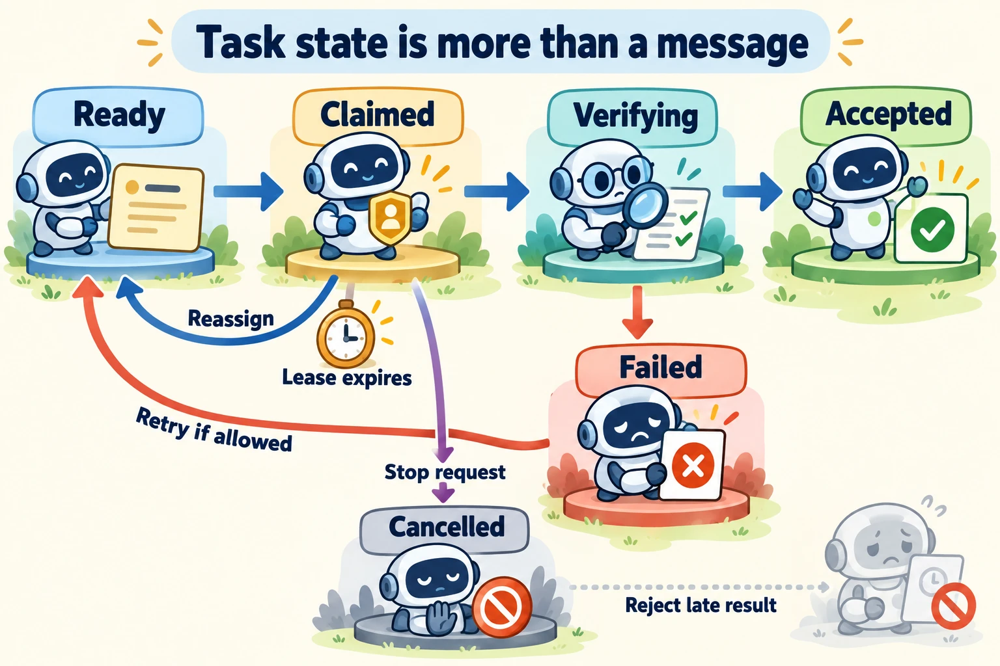

<!--
---
title: Shared state, failures, termination, and evaluation
unit_id: P1-03-13-02
summary: Track task ownership, reject stale results and separate accepted outcomes
  from the reasons a multi-agent run stops.
prerequisites:
- Read [Multi-agent roles, delegation, and coordination](01-multi-agent-roles-delegation-and-coordination.md).
learning_objectives:
- Explain stale reads, conflicting writes and expired task ownership.
- Distinguish task acceptance, cancellation and budget termination.
- Evaluate coordination failures against a single-agent baseline.
source_records:
- p1-03-13-02-autogen-termination
- p1-03-13-02-autogen-state
- p1-03-13-02-postgres-isolation
- p1-03-13-02-mast
visual_assets:
- assets/images/03-building-blocks/13-multi-agent-systems/02-shared-state-failures-termination-and-evaluation/01-task-state-and-recovery.webp
example_paths:
- examples/03-building-blocks/13-multi-agent-systems/02-shared-state-failures-termination-and-evaluation/main.py
pass: architecture
learning_path: deep-dive
status: complete
last_reviewed: '2026-10-14'
---
-->

# Shared state, failures, termination, and evaluation

## Why this matters

Two shop agents see that blue mugs need restocking. Both prepare an order. Their conversation sounds cooperative, yet the shop could receive twice the intended quantity. Another worker finishes after its task has been reassigned and overwrites the newer answer.

This deep dive builds on [roles and delegation](01-multi-agent-roles-delegation-and-coordination.md). It explains how a team records ownership and progress. Readers returning to the main path can continue to [learning and adaptation](../14-learning-and-self-improvement/chapter-plan.md).

## How it works

### Separate messages from the task record

A message is evidence that a participant said or returned something. The **task record** states the system's current accepted view: task ID, parent, required dependencies, owner, attempt, status, deadline and artifact reference. An **artifact** is an output such as a report or a file. A final sentence saying "done" is not the task record.

Two participants can hold different context histories even when they read the same shared board. A **stale read** uses an older value. A **conflicting write** changes state based on an assumption that another participant has already changed. A **lost update** overwrites another accepted change.

For our shop, peers can prepare independent evidence, but only a designated component commits an order. Inventory and order creation need the store's concurrency rules. Database transaction isolation describes which concurrent effects are permitted; PostgreSQL's stronger isolation modes can require retrying the whole transaction after a serialization failure. That guarantee covers the database transaction, not every remote tool in the workflow. [PostgreSQL transaction isolation](https://www.postgresql.org/docs/18/transaction-iso.html).

### Give a claim an owner and an expiry

A **claim** assigns a task to a worker. A **lease** is a claim valid until a specified time. If the worker stops responding, another worker can take the task after expiry. Our teaching board issues an increasing **generation number** with each reassignment. Submitted results must match the current owner and generation.

Suppose stock analysis generation 1 belongs to peer A until time 5. At time 5, peer B claims generation 2. A late result from A must not replace B's output. Check ownership and generation as part of the same state change that stores the result. Checking first and writing later in separate operations leaves a race, a timing window in which ownership can change.

A generation check protects the board only where it is enforced. It does not stop an old worker from calling an external service that ignores that generation. Action ownership, cancellation and retry behavior must still match [the execution design](../09-execution-environments/chapter-plan.md).

### Use explicit states and acceptance

The shop board uses the following states as an application convention:

| State | Meaning | Next decision |
| --- | --- | --- |
| Ready | Dependencies allow the task to begin | A peer may claim it |
| Claimed | One current owner has a valid lease | Collect result, renew claim or reassign after expiry |
| Verifying | A current result exists but has not passed acceptance | Accept it or record why it failed |
| Accepted | Evidence satisfies the task's declared rule | Dependents can use the accepted artifact |
| Failed | The current attempt did not meet its rule | Retry if allowed, otherwise report failure |
| Cancelled | The task has been stopped by request or policy | Reject later results and reconcile external effects |

A task can return to Ready for a permitted new attempt. Keep prior attempts and rejection reasons in its event history. Parent completion requires all mandatory child results to be accepted, not simply that every worker has spoken. An optional child can fail while a report is explicitly partial; that rule must be stated in advance.



*Figure 1. Follow the normal path toward an accepted artifact. The return path represents a new claim after expiry. The cancellation branch stops accepting work. None of these arrows implies that a remote purchase was reversed.*

### Handle incomplete or repeated messages

A **duplicate** is a repeated delivery of the same message or operation. Record a message ID and the attempt it belongs to. A repeated accepted message should not create a second artifact or action. If the same ID carries different content, treat it as a conflict to investigate. This is a local design rule; it does not promise exactly-once delivery.

A **deadlock** occurs when participants wait on each other without a runnable step. A **livelock** keeps exchanging or revising work without making accepted progress. A circular handoff can create either. Track dependencies, bound handoff depth and detect repeated task destinations or unchanged results. A human review state needs a named reviewer and a resume condition, not a loop asking the same question indefinitely.

When saving and resuming, preserve task ownership, pending work and identifiers alongside agent history. AutoGen documents agent and team `save_state()` and `load_state()` operations. Such snapshots help restore framework state; they do not atomically snapshot all outside services. Before retrying an uncertain write, inspect the external operation's actual status. [AutoGen state](https://microsoft.github.io/autogen/stable/user-guide/agentchat-user-guide/tutorial/state.html).

### Record why the run stopped

A **stop reason** explains termination: accepted required outputs, a message or cost limit, deadline, cancellation, an unresolved failure or a request for human input. Distinguish successful completion from "no more calls will be scheduled".

AutoGen offers message, token, timeout, text, handoff and external stop conditions. A text condition such as detecting "APPROVE" is a scheduling mechanism. It does not independently prove that the output is correct. Keep an outcome check separate from that stop condition. [AutoGen termination](https://microsoft.github.io/autogen/stable/user-guide/agentchat-user-guide/tutorial/termination.html).

Cancellation should stop new scheduling, request cancellation of active work and account for late results. A call already sent may still complete. Store the actual outcome, then report any unresolved effect. Likewise, a budget limit can stop a team safely with a partial report; it must not label the task successful merely because all workers stopped.

## Worked example

The [offline peer-task board](../../../examples/03-building-blocks/13-multi-agent-systems/02-shared-state-failures-termination-and-evaluation/README.md) lets peer A claim a task, then simulates its lease expiry. Peer B reclaims it. The board rejects A's late generation, accepts B's current submission, ignores the same delivered message twice and verifies the artifact before marking it Accepted. A cancellation case rejects a late result too.

<details><summary>Expand minimal Python implementation</summary>

```python
if worker != task.owner or generation != task.generation:
    return "stale result"
if now >= task.lease_until:
    return "expired claim"
```

In the runnable example the check and write happen in one sequential function call. A real shared store needs an atomic update or transaction. No LLM, database or network is used, and no external action is performed.

</details>

## Reliability failures

### Evaluate the coordination, then the outcome

Use the [evaluation levels](../12-evaluation-and-benchmarks/01-evaluation-levels-test-design-and-metrics.md) for the whole team. The following shop cases exercise distinct failures:

| Case | Coordination observation | Required outcome |
| --- | --- | --- |
| One specialist lacks evidence | Partial result retains the missing dependency | Report does not invent a delivery date |
| Worker expires and returns late | Current generation remains authoritative | Late result cannot replace accepted evidence |
| Message arrives twice | Delivery is recognized as repeated | One artifact or permitted action |
| Peers keep disagreeing | Round budget stops the discussion | Unresolved status remains visible |
| Cancellation during a write | New work stops; issued operation is reconciled | Real external result is reported |
| All workers say done without an artifact | Parent rejects missing evidence | Task is not counted as successful |

The MAST research taxonomy groups sampled failures into system design, inter-agent misalignment and task verification. It helps organize diagnoses; it does not establish that every failure fits a universal list. [Why Do Multi-Agent LLM Systems Fail?](https://arxiv.org/abs/2503.13657).

Compare team and single-agent outcomes under matched budgets. Separate coordinator mistakes from worker mistakes and grader failures. Count total tokens, calls, end-to-end time, duplicate work and unresolved tasks. A team that gets better individual answers but fails the join may perform worse for Lee.

## Limitations and trade-offs

A shared board makes coordination inspectable but adds a service and consistency rules. Leases need a defined clock and renewal behavior. Stricter acceptance can delay work while avoiding unsupported completion. Agreement between same-model peers may reflect shared blind spots, so consensus needs independent evidence or a task-specific oracle.

<details><summary>Check your understanding</summary>

Peer A's lease expired and peer B now owns the task. A later sends a correct-looking result with generation 1. Can the board accept it just because its content seems good?

No. Accepting it as the current result would violate the ownership contract and may overwrite newer evidence. Keep it as historical evidence if useful, then verify a result under the current generation. Its arrival also does not prove A's external actions were cancelled.

</details>

## Security preview

This chapter handles ordinary coordination failures. Pass 2 examines deliberately misleading cross-agent messages and state manipulation in [multi-agent and protocol security](../../07-security-by-component-and-workflow-stage/06-multi-agent-and-protocols/chapter-plan.md).

## Key takeaways

- Give shared tasks explicit owners, attempts, states and acceptance rules.
- Enforce stale-result checks where state changes, and deduplicate repeated deliveries.
- Stop reasons, successful outcomes and external rollback are separate facts.
- Evaluate the team's combined artifacts and recovery, not just each worker's answer.

## References

- [AutoGen: Termination](https://microsoft.github.io/autogen/stable/user-guide/agentchat-user-guide/tutorial/termination.html).
- [AutoGen: Managing State](https://microsoft.github.io/autogen/stable/user-guide/agentchat-user-guide/tutorial/state.html).
- [PostgreSQL 18: Transaction Isolation](https://www.postgresql.org/docs/18/transaction-iso.html).
- [Why Do Multi-Agent LLM Systems Fail?](https://arxiv.org/abs/2503.13657).

[Next unit: Adaptation, reflection, feedback, and skills →](../14-learning-and-self-improvement/chapter-plan.md)
