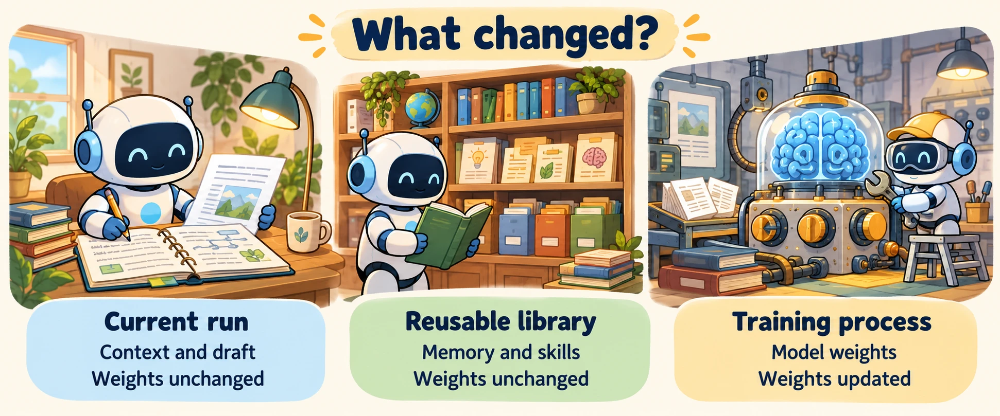
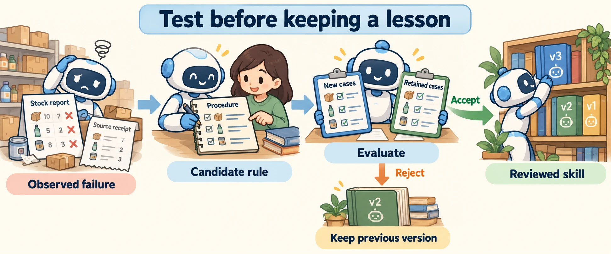

<!--
---
title: Adaptation, reflection, feedback, and skills
unit_id: P1-03-14-01
summary: Separate revising a run, retaining experience, authoring reusable skill packages
  and training model parameters; require evidence for improvement.
prerequisites:
- Read [Multi-agent roles, delegation, and coordination](../13-multi-agent-systems/01-multi-agent-roles-delegation-and-coordination.md).
- The optional [coordination deep dive](../13-multi-agent-systems/02-shared-state-failures-termination-and-evaluation.md)
  explains stale state and task acceptance.
learning_objectives:
- Locate what changes during adaptation and how long it persists.
- Distinguish research skill acquisition from authored instruction packages.
- Design a bounded feedback loop with held-out, retention and rollback checks.
source_records:
- p1-03-14-01-self-refine
- p1-03-14-01-reflexion
- p1-03-14-01-voyager
- p1-03-14-01-self-correction
- p1-03-14-01-agent-skills
visual_assets:
- assets/images/03-building-blocks/14-learning-and-self-improvement/01-adaptation-reflection-feedback-and-skills/01-adaptation-mechanisms.webp
- assets/images/03-building-blocks/14-learning-and-self-improvement/01-adaptation-reflection-feedback-and-skills/02-feedback-to-reviewed-skill.webp
example_paths:
- examples/03-building-blocks/14-learning-and-self-improvement/01-adaptation-reflection-feedback-and-skills/main.py
- examples/03-building-blocks/14-learning-and-self-improvement/01-adaptation-reflection-feedback-and-skills/skill-record.json
- examples/03-building-blocks/14-learning-and-self-improvement/01-adaptation-reflection-feedback-and-skills/stock-report/SKILL.md
pass: architecture
learning_path: main
status: complete
last_reviewed: '2026-10-14'
---
-->

# Adaptation, reflection, feedback, and skills

## Why this matters

Lee's assistant reports that a product is available without checking the stock record. A reviewer points out the missing evidence. The assistant revises the report, and the revised answer is correct. Has the model learned a new permanent behavior?

Several different mechanisms could produce that change. The current conversation may contain a correction; a memory record may be saved for future runs; an instruction package may be revised; or a training process may change model parameters. Saying "the agent improved" without naming the mechanism hides what actually happened.

## How it works

### Locate the change

**Adaptation** means adjusting behavior to a task, environment or feedback. **Inference time** is when an existing model produces outputs. **Training** changes learned model parameters, also called **weights**. The following is a teaching taxonomy, not a formal standard:

| Mechanism | What changes | Persistence and limit |
| --- | --- | --- |
| In-context adaptation | Current messages, retrieved evidence or instructions shown to the model | Lasts while that information remains in usable context |
| Refinement | The current draft or proposed action | A better artifact does not imply a better next run |
| Memory update | Stored observations, feedback or summaries | Can influence later runs if retrieved; may be wrong or stale |
| Prompt optimization | A selected version of reusable instructions | Persists in application configuration; can overfit the cases used to select it |
| Skill acquisition or package revision | Reusable procedures, code or instruction files | Persists in a library; retrieval, compatibility and testing still matter |
| Weight update | Model parameters through a training method | Changes the trained model; needs a separate training and evaluation process |

A **policy** is a rule or strategy for choosing actions. In application discussions, a policy update may mean changing rules or a prompt. In machine-learning research, it may mean training the action-producing model. Ask which object changed before interpreting the term.



*Figure 1. Find the changed object. Editing the current notebook or the reusable library can alter behavior without changing the model's weights. The separate training workspace represents a different mechanism.*

### Use feedback to revise a bounded attempt

**Feedback** supplies information about an output or action. It may come from a user, a reviewer, a tool result, an executable test or the model itself. Its usefulness depends on whether it contains correct, relevant evidence.

**Reflection** is an assessment of a previous attempt, often expressed in language. **Refinement** changes the attempt in response. Self-Refine generates a draft, obtains self-feedback and revises it using the same model without further training. That describes the method evaluated in the paper, not a guarantee for every task. [Self-Refine](https://arxiv.org/abs/2303.17651).

For the shop, the strongest feedback says: "Your report lacks a stock source. Snapshot S17 shows one blue mug, but the request asks for two." That is more useful than "think harder". The revised report should state the shortage, rather than only become more confident.

A bounded loop drafts, checks, revises and checks again. Stop on an accepted result, a revision budget, unavailable evidence or a need for clarification. Retain the earlier draft so you can detect a revision that makes it worse. A correct final answer is not evidence that every intermediate revision helped.

Model-generated feedback can repeat the generator's mistake. A study of intrinsic self-correction found unreliable correction on its evaluated reasoning tasks without external feedback. Treat it as counterevidence to universal self-improvement claims, with its historical scope visible. [Self-correction study](https://arxiv.org/abs/2310.01798).

### Decide what deserves to survive the run

An **experience** is a recorded attempt and its feedback, evidence and outcome. A durable memory can preserve a useful lesson, but storing a reflection does not make that reflection true. Follow [persistent memory lifecycle rules](../05-memory/03-persistent-memory-types-and-lifecycle.md): record origin, scope, review status, expiry and invalidation conditions.

Reflexion stores textual reflections in an episodic memory buffer to guide later trials, without updating weights. Its title uses "verbal reinforcement learning" for this feedback mechanism. It should not be read as saying that the underlying model receives a parameter update after each conversation. [Reflexion](https://arxiv.org/abs/2303.11366).

In our shop design, a failed case can suggest the candidate rule "attach the stock snapshot ID to availability reports". Keep the original incident separately from the general rule. A human or stated review process decides whether it is broadly useful, whether it conflicts with older requirements and when it should expire. Do not copy one customer's stock count into a permanent universal fact.

### Distinguish two meanings of skill

A **skill** is a reusable capability or procedure. In research, skill acquisition can mean deriving and storing behavior from experience. Voyager builds a library of executable code skills in Minecraft, with a curriculum and environment feedback, without parameter fine-tuning. A **curriculum** selects which tasks or challenges the agent tries next. Minecraft results do not establish that the same process works for shop operations. [Voyager](https://arxiv.org/abs/2305.16291).

An **authored skill package** is prepared instruction material that an agent loads. The Agent Skills specification uses a `SKILL.md` file with required `name` and `description` metadata, followed by instructions. Optional `scripts`, `references` and `assets` hold code, detail and resources. **Progressive disclosure** means loading descriptions first, then the chosen instructions and resources when needed. [Agent Skills specification](https://agentskills.io/specification).

The package may be written by a person or generated and reviewed through a workflow. Reading it changes available context; it does not train weights. Package discovery also differs from action permission: the runtime still controls tools and credentials. The specification's optional `allowed-tools` field is experimental and client-dependent; it is not a universal external authorization mechanism.

Version packages and record why a change was made. In the example, `metadata.version` is our chosen version field within the specification's arbitrary metadata map, not a mandatory versioning standard. Keep the previous package and evaluation record so you can restore it.



*Figure 2. A single failure proposes a change; it does not promote the change automatically. Test the candidate on new cases and previously supported behavior before updating the reusable library. Preserve the previous version on rejection. Book version labels in the illustration are examples; the runnable candidate below uses version 1.1.*

## Worked example

The [offline refinement example](../../../examples/03-building-blocks/14-learning-and-self-improvement/01-adaptation-reflection-feedback-and-skills/README.md) starts with a report that guesses availability. A deterministic checker identifies a missing source and a quantity mismatch. A mocked refiner reads the snapshot and produces a corrected report within a bounded loop.

A separate candidate package describes a stock-report procedure. Its [versioned record](../../../examples/03-building-blocks/14-learning-and-self-improvement/01-adaptation-reflection-feedback-and-skills/skill-record.json) names the incident, intended scope, baseline, transfer and retention cases, and previous version. The example demonstrates these records; it does not autonomously rewrite its own code or invoke training.

<details><summary>Expand minimal Python implementation</summary>

```python
for _ in range(max_revisions):
    feedback = check_report(draft, snapshot)
    if not feedback:
        break
    draft = mock_refine(draft, feedback, snapshot)
```

The full script performs a final acceptance check, including when the revision budget is zero. The checker compares evidence fields with the supplied snapshot. Real evaluations would also check whether that snapshot is an appropriate, fresh source.

</details>

## Limitations and trade-offs

### What evidence would establish improvement?

A **baseline** is the earlier configuration used for comparison. **Transfer** asks whether a change helps tasks beyond the incident that suggested it. **Retention** asks whether earlier capabilities still work. Learning-system discussions use **plasticity** for ability to adapt and **catastrophic forgetting** for a substantial loss of earlier learned performance after new learning. Application prompt or package revisions can cause regressions without any weight update.

For this chapter's candidate skill, record all five elements:

| Element | Shop example |
| --- | --- |
| Mechanism | Revised stock-report instructions; weights unchanged |
| Baseline | Earlier rule that guessed availability without a source |
| Transfer test | Unseen product and changed requested quantity |
| Retention test | Out-of-stock case still reports a shortage; missing data remains unknown |
| Rollback | Restore the previous package version and invalidate the candidate selection |

Use [evaluation methods](../12-evaluation-and-benchmarks/chapter-plan.md) with separate development and held-out cases, repeated trials for actual models, and cost accounting for feedback calls. Compare against both the original one-shot system and a baseline given the same extra call budget. Otherwise an apparent gain may reflect extra attempts rather than the proposed learning mechanism.

The example's fixed refiner improves its supplied fixtures by construction. Those assertions check the teaching behavior; they do not measure real model improvement. Detailed optimization, continual learning and forgetting belong in the [next deep dive](chapter-plan.md). Operational deployment and recovery follow in [reliability and operations](../15-reliability-and-operations/chapter-plan.md).

### Costs and failure modes

Extra feedback calls add latency and cost. Durable experiences can become stale, while large libraries can make the relevant skill harder to select. A narrow instruction can fix one example and break another. Evaluate changes to the generator, checker and selected package separately, and label unverified feedback as such.

<details><summary>Check your understanding</summary>

An assistant reads an updated `SKILL.md` and handles a new stock task better. No training job ran. Were its model weights updated?

No. The package supplied new instructions at inference time. The application's reusable procedure changed, and its benefit still needs held-out and retention evidence. A weight update requires a separate training mechanism.

</details>

## Security preview

Feedback and reusable experiences become inputs to later decisions. Pass 2 examines misleading feedback and unsafe optimization through [retrieval, memory and data security](../../07-security-by-component-and-workflow-stage/02-retrieval-memory-and-data/chapter-plan.md) and [end-to-end attack paths](../../07-security-by-component-and-workflow-stage/07-end-to-end-attack-paths/chapter-plan.md).

## Key takeaways

- Name the changed object: current context, artifact, memory, instructions, skills or weights.
- Reflection generates a possible explanation; evidence and acceptance checks decide whether a revision works.
- Authored packages and experience-derived code skills are distinct forms of reuse.
- Every claimed improvement needs a baseline, transfer and retention checks, and a rollback path.

## References

- [Self-Refine](https://arxiv.org/abs/2303.17651).
- [Reflexion](https://arxiv.org/abs/2303.11366).
- [Voyager](https://arxiv.org/abs/2305.16291).
- [Large Language Models Cannot Self-Correct Reasoning Yet](https://arxiv.org/abs/2310.01798).
- [Agent Skills specification](https://agentskills.io/specification).

[Next unit: Optimization, continual learning, forgetting, and evaluation →](chapter-plan.md)
