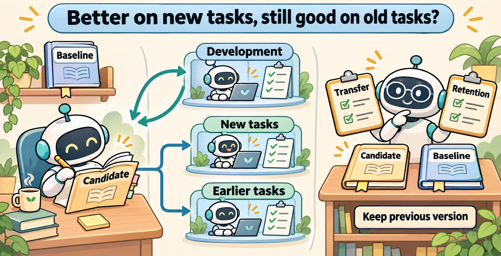

<!--
---
title: Optimization, continual learning, forgetting, and evaluation
unit_id: P1-03-14-02
summary: Evaluate prompt, memory and weight changes with separate transfer, retention
  and rollback evidence.
prerequisites:
- Read [Adaptation, reflection, feedback, and skills](01-adaptation-reflection-feedback-and-skills.md).
learning_objectives:
- Distinguish prompt optimization from parameter learning.
- Evaluate transfer and retention across task streams.
- Reject an average gain that conceals a regression.
source_records:
- p1-03-14-02-opro
- p1-03-14-02-ewc
- p1-03-14-02-gem
- p1-03-14-02-agentcl
visual_assets:
- assets/images/03-building-blocks/14-learning-and-self-improvement/02-optimization-continual-learning-forgetting-and-evaluation/01-transfer-and-retention.webp
example_paths:
- examples/03-building-blocks/14-learning-and-self-improvement/02-optimization-continual-learning-forgetting-and-evaluation/main.py
learning_path: deep-dive
status: complete
last_reviewed: '2026-11-16'
pass: architecture
---
-->

# Optimization, continual learning, forgetting, and evaluation

## Why this matters

Lee adds a new supplier format to the shop assistant's instructions. The assistant now reads that supplier's stock file correctly. A week later, Lee notices that reports from the older supplier no longer distinguish an empty shelf from missing data. A successful update on one task has hidden a regression on another.

This optional deep dive explains how to evaluate changes across tasks and time. Read [adaptation, reflection, feedback, and skills](01-adaptation-reflection-feedback-and-skills.md) first. The main path continues with [reliability and operations](../15-reliability-and-operations/chapter-plan.md). This chapter examines improvement mechanisms, rather than giving a model-training tutorial.

## How it works

### Name the object being optimized

**Optimization** means searching for a better candidate according to a stated measure, called an **objective**. A candidate might be an instruction, a retrieved procedure, a tool-selection rule or a set of model weights. A higher objective score only means improvement according to that measure on the evaluated cases.

For Lee, an objective could be the share of stock reports with a correct quantity and a valid source. The candidate is a version of the report instructions. The model weights stay fixed. Choosing the instruction with the best score is prompt optimization, even if a language model proposes the candidates.

OPRO, a research method, gives an optimizer model previously proposed candidates and their scores, then evaluates new proposals. In its prompt-optimization experiments, the candidates are instructions and the objective is training-set accuracy. It does not imply that the model trains its own weights during that search. Results depend on the task, scoring model and optimization setup. [OPRO](https://arxiv.org/html/2309.03409v3).

Changing a **policy**, a strategy for choosing actions, is similarly ambiguous. A developer might revise application rules, select a prompt or train an action-producing model. Record the exact changed object. A **weight update** changes learned model parameters through training; adding a memory record or reading a skill package supplies information at inference time instead.

### Keep development separate from the final test

A **development set** contains cases used to design or select candidates. A **held-out set** contains cases withheld from that process. **Overfitting** happens when a candidate fits development cases well but fails to generalize to other relevant cases. Repeatedly selecting against the same supposed final test turns it into development data.

Our teaching workflow is to freeze the baseline, candidate, scoring rules and resource budgets before opening the final results. Keep the model version, available tools and relevant data snapshots comparable. Compare equal call budgets as well as the original system: otherwise extra attempts can explain a gain.



*Figure 1. The development loop proposes a candidate. Separate new-task and earlier-task checks provide transfer and retention evidence. Keeping the baseline makes rejection or rollback possible.*

Read the middle stations as different questions, not three names for the same test. A report used to write the new instruction cannot also provide independent evidence that the instruction generalizes. The retained booklet at the right represents a recoverable configuration, not an automatic guarantee that restoring it will reverse external actions.

### Follow a sequence of learning and evaluation

**Continual learning** studies learning across a sequence of tasks or experiences while preserving useful prior capabilities. Say which mechanism persists across the sequence. A memory-based agent can accumulate experiences with fixed model weights; a training-based system changes parameters. Neither mechanism establishes improvement just by running for longer.

**Plasticity** is the ability to adapt to new tasks. **Retention** is preservation of previously supported behavior. **Transfer** is an effect of earlier learning on another task. Forward transfer concerns later tasks; backward transfer concerns how new learning affects earlier tasks. These are distinct from a single final average. GEM formalizes metrics for accuracy and transfer over a sequence of tasks. [GEM evaluation framework](https://arxiv.org/html/1706.08840v6).

For the shop, evaluate older stock reports before adding the new supplier, then evaluate both supplier families after the update. Continue evaluating older families after later changes. Keep each task family's score visible: many improved new tasks can hide a serious loss in a small older family.

A **curriculum** chooses the tasks and order used for learning. Easy cases followed by harder related cases may encourage reuse, but order also affects what an agent has seen. Log task order and adaptation checkpoints. During an independent evaluation, freeze the memory or copy its starting snapshot for each comparison so one candidate does not receive extra experience.

AgentCL is a 2026 research framework for memory-based language agents. It separates streams where earlier solutions can be reused, streams whose reuse relations are unknown, and independent held-out tasks with little expected reusable knowledge. This helps distinguish useful accumulation from interference caused by irrelevant memories. Its results concern the tested memory designs, not all learning agents. [AgentCL, version 3](https://arxiv.org/html/2606.02461v3).

### Distinguish forgetting from other regressions

**Catastrophic forgetting** is a substantial loss of earlier learned performance after new learning. In parameter learning, updates useful for the new task can interfere with parameters supporting older tasks. Elastic Weight Consolidation slows changes to weights judged important for earlier tasks. GEM uses stored examples to constrain updates. These research approaches address specific training settings; neither is a blanket retention guarantee. [Weight protection](https://arxiv.org/abs/1612.00796), [GEM mechanism](https://arxiv.org/html/1706.08840v6).

A fixed-weight agent can also get worse: a new instruction can conflict with an old one, an irrelevant memory can crowd out useful evidence, or skill selection can choose the wrong package. Describe these as application regressions or memory interference unless there is evidence of a training-related forgetting mechanism. A changed supplier file or a broken retrieval service can also lower scores without any learning change.

For each suspected regression, first locate what changed and preserve the failing trace. Compare with the earlier configuration on the same inputs. Then isolate prompt, memory, package, retrieval and weight changes where feasible. This makes the explanation testable instead of attributing every loss to forgetting.

## Worked example

### Reject an attractive average

The following counts are illustrative teaching fixtures, not benchmark results. Each family has four fixed cases. The baseline and candidate differ only in mocked report rules.

| Evaluation family | Baseline correct | Candidate correct | Interpretation |
| --- | --- | --- | --- |
| New supplier, held out | 1 of 4 | 4 of 4 | Candidate handles the new format |
| Earlier stock behavior | 4 of 4 | 3 of 4 | Missing data is now mistaken for zero |
| All eight cases | 5 of 8 | 7 of 8 | Better average hides the regression |

Lee's stated acceptance rule requires improvement on the new family and no loss on the earlier family. The candidate fails that rule. Keep the baseline and revise the candidate using development cases; use a fresh held-out set for any later final selection.

The [offline example](../../../examples/03-building-blocks/14-learning-and-self-improvement/02-optimization-continual-learning-forgetting-and-evaluation/README.md) evaluates the rules and records the decision. It shows a regression check, not a learning algorithm or an experiment with a real model.

<details><summary>Expand minimal Python implementation</summary>

```python
transfer_gain = candidate_new - baseline_new
retention_change = candidate_old - baseline_old
promote = transfer_gain > 0 and retention_change >= 0
selected = candidate_version if promote else baseline_version
```

This all-or-nothing rule is a teaching choice. Real acceptance thresholds should be set before evaluation and reflect sample size, task severity and uncertainty. Repeated model trials can produce different outcomes even when the route and prompt are fixed.

</details>

A reviewable improvement record for this example names all five elements:

| Element | Recorded evidence |
| --- | --- |
| Mechanism | Report rule version 2; no weight update |
| Baseline | Version 1 on the same frozen cases |
| Transfer test | Four unseen new-supplier cases |
| Retention test | Four earlier-behavior cases, including missing data |
| Rollback path | Keep version 1 selected and retain version 2's failed result |

## Limitations and trade-offs

Four cases per family cannot establish a reliable real-world improvement rate. In a real evaluation, include varied requests, unavailable evidence, changed formats and irrelevant prior experiences. Report denominators, failures, uncertainty, model calls, latency and memory size. A large experience library may improve reuse while increasing retrieval cost or introducing interference.

Restoring instructions or weights does not automatically restore an index, a memory store or an external system already modified by the candidate. Version dependent artifacts together and state what rollback actually restores. Operational recovery follows in [reliability and operations](../15-reliability-and-operations/chapter-plan.md); coordination-dependent outcomes also require the checks from [multi-agent systems](../13-multi-agent-systems/chapter-plan.md).

<details><summary>Check your understanding</summary>

A candidate improves the final average but loses the ability to report missing stock data as unknown. Its model weights were unchanged. Does the higher average prove continual improvement, and is the loss necessarily catastrophic forgetting?

No. The average hides a task-specific regression and fails the stated retention rule. With fixed weights, investigate instruction conflicts, memory interference and other application changes before assigning a training-related forgetting explanation.

</details>

## Security preview

Feedback, stored experience and optimization objectives can influence later actions. Pass 2 connects feedback poisoning and unsafe optimization to [retrieval, memory and data](../../07-security-by-component-and-workflow-stage/02-retrieval-memory-and-data/chapter-plan.md) and [end-to-end attack paths](../../07-security-by-component-and-workflow-stage/07-end-to-end-attack-paths/chapter-plan.md).

## Key takeaways

- Name the persistent change before calling it learning.
- Separate candidate selection from held-out transfer and retention evidence.
- Evaluate task families and successive checkpoints, not just a final average.
- Preserve the earlier configuration and define the scope of rollback.

## References

- [Large Language Models as Optimizers, version 3](https://arxiv.org/html/2309.03409v3).
- [Overcoming catastrophic forgetting in neural networks](https://arxiv.org/abs/1612.00796).
- [Gradient Episodic Memory for Continual Learning, version 6](https://arxiv.org/html/1706.08840v6).
- [AgentCL: Toward Rigorous Evaluation of Continual Learning in Language Agents, version 3](https://arxiv.org/html/2606.02461v3).

[Next unit: Service boundaries, queues, retries, and budgets →](../15-reliability-and-operations/chapter-plan.md)
