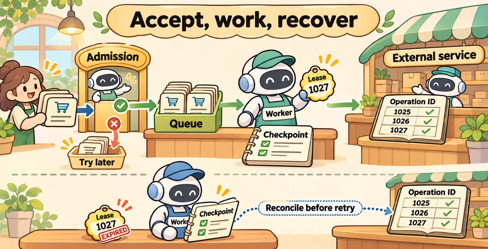
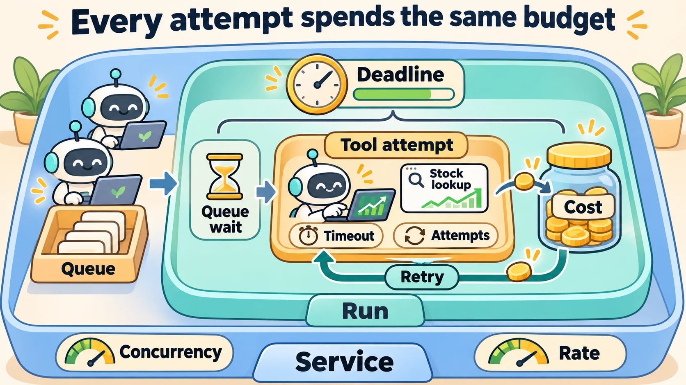

<!--
---
title: Service boundaries, queues, retries, and budgets
unit_id: P1-03-15-01
summary: Operate a bounded agent service and recover work without confusing a timeout
  with a failed external action.
prerequisites:
- Read [State and lifecycle](../04-state-and-lifecycle/chapter-plan.md) and [Learning
  and self-improvement](../14-learning-and-self-improvement/chapter-plan.md).
learning_objectives:
- Explain admission, queueing, leases and layered budgets.
- Distinguish retry, replay, resume, rollback and compensation.
- Recover an ambiguous external outcome across sessions.
source_records:
- p1-03-15-01-queue
- p1-03-15-01-retries
- p1-03-15-01-overload
- p1-03-15-01-fencing
- p1-03-15-01-breaker
- p1-03-15-01-temporal
- p1-03-15-01-managed
- p1-03-15-01-sessions
- p1-03-15-01-compensation
visual_assets:
- assets/images/03-building-blocks/15-reliability-and-operations/01-service-boundaries-queues-retries-and-budgets/01-queue-and-recovery.webp
- assets/images/03-building-blocks/15-reliability-and-operations/01-service-boundaries-queues-retries-and-budgets/02-layered-budgets.webp
example_paths:
- examples/03-building-blocks/15-reliability-and-operations/01-service-boundaries-queues-retries-and-budgets/main.py
learning_path: main
status: complete
last_reviewed: '2026-11-16'
pass: architecture
---
-->

# Service boundaries, queues, retries, and budgets

## Why this matters

Lee's assistant reserves the last mug at a supplier. The supplier accepts the request, but the response disappears before the assistant records it. A replacement worker starts after the first worker crashes. Should it reserve again?

The right answer depends on stored execution state and the supplier's operation record. More reasoning cannot recover a missing network response. This chapter connects the earlier [state and lifecycle](../04-state-and-lifecycle/chapter-plan.md) mechanisms into an operating service. It follows [learning and self-improvement](../14-learning-and-self-improvement/chapter-plan.md): even a better agent needs bounded execution and recoverable work.

## How it works

### Separate receiving work from doing work

A **service boundary** separates components that communicate through requests or events and can fail independently. A **queue** stores work waiting to be processed. A **worker** takes a queued item and executes it. Lee's application accepts a request, records its ID and deadline, queues it, and later lets a worker run the agent and its tools.

**Admission control** decides whether to accept new work. **Backpressure** tells an upstream producer to slow down when a downstream component cannot keep up. A bounded queue can absorb a short burst; it cannot create processing capacity. If arrivals keep exceeding completions, queue delay grows until work expires or capacity runs out. Keep worker concurrency within downstream limits. [Queue-based load leveling](https://learn.microsoft.com/en-us/azure/architecture/patterns/queue-based-load-leveling).

For Lee, an admission decision can return a job ID, a request to try later, or an explicit refusal because the task cannot meet its deadline. An accepted job needs a way to report later completion or failure. Acceptance is not completion.



*Figure 1. Work survives separately from the worker. The recovery path consults the external operation record before deciding whether another action is needed.*

Read the lower path as recovery, not a second reservation. The queue holds the request; the checkpoint holds execution progress; the supplier holds the actual reservation outcome. Those records answer different questions.

### Give each worker temporary ownership

A **lease** is a time-limited right to process work. The worker renews it while healthy. If renewal stops, another worker may take over. Queue delivery and lease expiry can produce duplicate execution, so temporary ownership alone cannot promise one external effect.

A paused old worker may wake after its lease expires. **Fencing** prevents that stale worker from committing updates by attaching an increasing ownership token and making the destination reject older tokens. The destination must enforce the rule. A token in a log does not stop writes to a supplier that ignores it. [Fencing tokens](https://docs.hazelcast.com/hazelcast/5.7/data-structures/fencedlock).

Use the [idempotency and concurrency mechanisms](../04-state-and-lifecycle/03-retries-idempotency-and-concurrency.md) introduced earlier. An **idempotent** operation can be repeated without adding another effect. A stable operation ID can support deduplication if the receiving service implements that contract. Worker lease tokens and business operation IDs have different purposes: the first rejects stale ownership; the second identifies the intended action across retries.

### Bound every layer of execution

A **timeout** limits how long a caller waits for an attempt. A **deadline** is the latest acceptable completion time for the whole task. A **budget** bounds a resource such as calls, tokens or cost. A **quota** limits an allocation, often per account or time period. A **rate limit** bounds activity over time; a **concurrency limit** bounds work happening at once.

These limits belong outside the model loop, in the scheduler and tool clients. Queue wait, model calls, tool calls, retries and cleanup all consume the run's available time. A retry does not receive a fresh run budget. Reserve capacity before dispatch when parallel calls could otherwise overspend the same balance.



*Figure 2. Service limits constrain aggregate work, run limits constrain the task, and attempt limits constrain one call. Queue wait counts against the deadline, and retries spend from the same cost balance.*

The layers are a teaching model, not a standard configuration format. For example, Lee might allow one worker, two waiting jobs, three tool attempts and three simulated cost units per run. These are example settings, not recommended production defaults. Count queue delay, attempts, resource use and rejected work separately. Google SRE's overload guidance explains why request counts alone can miss large differences in resource consumption. [Handling overload](https://sre.google/sre-book/handling-overload/).

### Retry only when another attempt is useful and safe

A **retry** makes another attempt at an operation. A **transient failure** is a temporary failure, such as a short connection outage. **Backoff** waits longer between retries, and **jitter** adds random variation so clients do not all retry together. Cap both attempts and waiting time, honor the remaining deadline, and define one owner for retries so nested layers do not multiply them. [Timeouts, retries, and jitter](https://aws.amazon.com/builders-library/timeouts-retries-and-backoff-with-jitter/).

A timeout ends waiting; it does not prove that the remote operation failed. After Lee's reservation times out, record the outcome as unknown. **Reconciliation** compares local intent with the external service's authoritative status. Query by the stable operation ID before deciding whether to retry. If the service cannot identify the outcome, retain the uncertainty and route it to a stated recovery process.

A **circuit breaker** temporarily prevents calls to an unhealthy dependency. Closed allows calls; open rejects them; half-open allows limited recovery probes. A **fallback** uses an alternative behavior, such as producing a stock report without a reservation. Label its reduced result clearly. The breaker decides whether to call; the fallback decides what else to do. [Circuit breaker pattern](https://learn.microsoft.com/en-us/azure/architecture/patterns/circuit-breaker).

### Assign recovery to named owners

A **harness** runs the model and tool loop. An **environment** supplies the process, files and compute where code runs. The application connects these pieces to product behavior. Ownership varies by runtime:

| Responsibility | Self-hosted harness and environment | Managed harness |
| --- | --- | --- |
| Agent loop and execution state | Application team operates the harness and persistence | Provider operates the documented harness; application verifies its recovery contract |
| Compute and workspace lifecycle | Application provisions, reconnects, preserves files and shuts down | Provider may manage compute; self-hosted environments remain application-owned |
| Business operation semantics | Application and external services define IDs, status and compensation | Application and external services still define these semantics |
| Admission, product budgets and results | Application defines acceptance and observes completion | Application still defines product acceptance and handles its integrations |

OpenAI's managed architecture distinguishes harness, environment and application server. It leaves application function handling to application code and assigns self-hosted environment lifecycle to the application. This is one provider's contract, not a universal runtime guarantee. [Managed architecture](https://developers.openai.com/api/docs/guides/agents-api/architecture).

A **checkpoint** records resumable execution state. **Resume** continues interrupted work. **Replay** reconstructs execution from recorded history under a framework's rules. Temporal replays workflows against an event history and requires deterministic workflow behavior; it is more than reloading a conversation. Neither checkpointing nor replay makes arbitrary remote effects transactional. [Temporal workflow execution](https://docs.temporal.io/workflow-execution).

For the reservation crash, the recovery owner loads the checkpoint, obtains current ownership, reconciles the outstanding operation ID, records the known result and releases local resources. If the supplier already reserved the mug, it does not reserve again. A local shutdown or cancellation may leave the remote operation running.

**Rollback** restores a previous configuration or local state. **Compensation** performs a business action intended to offset an earlier effect, such as releasing a reservation. It can itself fail. If the release service is unavailable, record compensation as pending and make that unresolved state visible; do not report the reservation as undone. [Compensating transactions](https://learn.microsoft.com/en-us/azure/architecture/patterns/compensating-transaction).

## Worked example

The [offline scheduler and recovery example](../../../examples/03-building-blocks/15-reliability-and-operations/01-service-boundaries-queues-retries-and-budgets/README.md) compares a reservation in one session with the same reservation across two simulated sessions. Both use a local mocked supplier ledger. The interrupted run saves intent before dispatch, loses the response after the supplier commits, and reads the supplier ledger on recovery. It also demonstrates bounded admission, a retry budget, stale ownership rejection and failed compensation.

A small progress artifact records completed work, unresolved questions, next steps and verification results. A new session reads it instead of guessing from chat history. Anthropic's long-running coding-agent report uses progress artifacts and verification across context windows; a larger context window or compaction alone does not establish continuity. That engineering pattern complements durable runtime state rather than replacing it. [Long-running harnesses](https://www.anthropic.com/engineering/effective-harnesses-for-long-running-agents).

<details><summary>Expand minimal Python implementation</summary>

```python
save_checkpoint(operation_id, status="pending")
result = supplier.status(operation_id)
if result is None:
    result = supplier.reserve(operation_id)
save_checkpoint(operation_id, status="complete", result=result)
```

This fragment assumes an authoritative status lookup and an idempotent reservation contract. The full example simulates a crash between the external commit and the local completion record. A real deployment also needs durable storage, atomic ownership checks, timeouts and dependency-specific reconciliation.

</details>

Use explicit acceptance criteria when interpreting its fixed trace:

| Measure | Teaching criterion | Observed fixture |
| --- | --- | --- |
| Queue delay | At most 2 simulated ticks | 1 tick |
| Completion | Both execution modes reach the same reservation | 2 of 2 scenarios complete |
| Attempts and cost | At most 3 attempts and 3 cost units per retry scenario | 2 attempts, 2 units |
| Recovery | No duplicate reservation after lost response | One external effect in each execution mode |
| Cleanup | Local worker resource released | Released in both modes |
| Unresolved compensation | Failed release remains visible | Reservation retained, compensation pending |

These fixtures verify intended example behavior, not a measured service reliability rate. Real trials should include overload, expired deadlines, crash timing, failed status lookups and cleanup failures.

## Limitations and trade-offs

Queues trade immediate execution for delay. More workers can exhaust a dependency sooner. Retries spend capacity, fallbacks can reduce usefulness, and checkpoints add storage and compatibility obligations. When work reaches a terminal state, distinguish completed, failed, cancelled and unresolved external outcomes in the user-facing result.

The example uses files and a simulated clock in one process. It cannot establish distributed atomicity, isolation, real cancellation delivery or provider availability. The next deep dive covers caching, deployment and capacity. Durable reports and progress files also need the lifecycle rules introduced in [artifacts and multimodal input/output](../16-artifacts-and-multimodal-io/chapter-plan.md).

<details><summary>Check your understanding</summary>

A worker times out after sending a reservation and its lease expires. A replacement worker has a checkpoint but no result. Is it safe to issue a new reservation immediately?

No. The supplier may already have committed the first action. Reconcile the stable operation ID and use the receiving service's idempotency contract. A new lease establishes current ownership, but does not reveal or reverse the earlier external outcome.

</details>

## Security preview

Unbounded execution and operational abuse affect these runtime components. Pass 2 maps them to [execution and supply-chain security](../../07-security-by-component-and-workflow-stage/04-execution-and-supply-chain/chapter-plan.md) and [end-to-end attack paths](../../07-security-by-component-and-workflow-stage/07-end-to-end-attack-paths/chapter-plan.md).

## Key takeaways

- Accept work only when queue, time and downstream capacity permit it.
- Give retries, tool calls and cleanup one bounded run budget.
- A timeout or cancellation does not establish the remote outcome.
- Recover ownership and reconcile effects before resuming work.
- Progress artifacts preserve continuity; durable execution and external contracts preserve recoverability.

## References

- [Queue-Based Load Leveling pattern](https://learn.microsoft.com/en-us/azure/architecture/patterns/queue-based-load-leveling).
- [Timeouts, retries, and backoff with jitter](https://aws.amazon.com/builders-library/timeouts-retries-and-backoff-with-jitter/).
- [Handling Overload](https://sre.google/sre-book/handling-overload/).
- [FencedLock: Fencing Tokens](https://docs.hazelcast.com/hazelcast/5.7/data-structures/fencedlock).
- [Circuit Breaker pattern](https://learn.microsoft.com/en-us/azure/architecture/patterns/circuit-breaker).
- [Workflow Execution](https://docs.temporal.io/workflow-execution).
- [Agents API architecture](https://developers.openai.com/api/docs/guides/agents-api/architecture).
- [Effective harnesses for long-running agents](https://www.anthropic.com/engineering/effective-harnesses-for-long-running-agents).
- [Compensating Transaction pattern](https://learn.microsoft.com/en-us/azure/architecture/patterns/compensating-transaction).

[Next unit: Caching, deployment, service objectives, and capacity →](02-caching-deployment-service-objectives-and-capacity.md)
