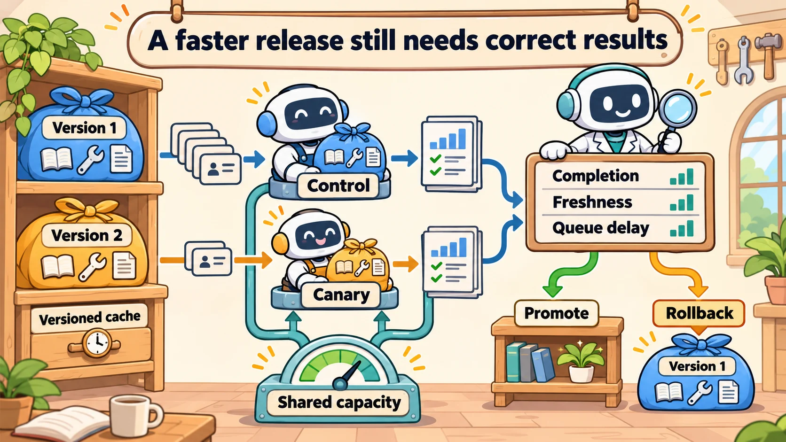

<!--
---
title: Caching, deployment, service objectives, and capacity
unit_id: P1-03-15-02
summary: Relate cache freshness, versioned releases, service objectives and sustainable
  capacity to correct user outcomes.
prerequisites:
- Read [Service boundaries, queues, retries, and budgets](01-service-boundaries-queues-retries-and-budgets.md).
learning_objectives:
- Distinguish cache reuse from answer correctness.
- Evaluate a versioned release against explicit service objectives.
- Explain why capacity depends on workload and shared limits.
source_records:
- p1-03-15-02-http-cache
- p1-03-15-02-slo
- p1-03-15-02-canary
- p1-03-15-02-capacity
visual_assets:
- assets/images/03-building-blocks/15-reliability-and-operations/02-caching-deployment-service-objectives-and-capacity/01-versioned-release.webp
example_paths: []
learning_path: deep-dive
status: complete
last_reviewed: '2026-11-16'
pass: architecture
---
-->

# Caching, deployment, service objectives, and capacity

## Why this matters

Lee's assistant becomes faster after a release starts reusing stock reports. The service dashboard looks healthy, but one cached report still claims the last mug is available after it has been reserved. Faster responses have made the stale answer easier to obtain.

This optional operations deep dive connects caching, release decisions and capacity to user outcomes. Read [service boundaries, queues, retries, and budgets](01-service-boundaries-queues-retries-and-budgets.md) first. The main path continues with [artifacts and multimodal input/output](../16-artifacts-and-multimodal-io/chapter-plan.md).

## How it works

### Reuse only an appropriate result

A **cache** stores something computed or retrieved earlier so it can be reused. A **cache hit** finds a reusable entry; a **miss** requires new work. The **cache key** identifies the conditions under which an entry can be reused. A matching string alone is not enough if the answer also depends on a changed stock snapshot or a different instruction version.

HTTP, the web request/response protocol, has standardized caching rules. RFC 9111 defines freshness, validation and request-variant matching. A **fresh** entry has not exceeded its allowed freshness lifetime; a **stale** entry has. **Validation** checks with the original service whether a stored response can still be used. These HTTP meanings should not be confused with proving that an agent's answer is correct. [HTTP caching](https://www.rfc-editor.org/rfc/rfc9111.html).

For Lee's application, separate what is being reused:

| Cached object | Reuse condition in our teaching design | Important limit |
| --- | --- | --- |
| Parsed supplier document | Same document content and parser version | A new file needs a new parse |
| Retrieved stock snapshot | Same shop, product, snapshot and freshness policy | The underlying stock can change |
| Generated report | Same relevant inputs, model, instructions, output schema and data version | Matching text requests do not establish matching context |
| Repeated operation outcome | Same business operation ID under the receiving service's contract | This is deduplication of an action, not permission to perform another action |

This table is an application design, not a universal cache-key specification. A **schema** defines the expected structure of data. Include a version when changing that structure changes interpretation. Do not reuse a report across different shop contexts merely because the question looks similar.

**Time to live**, or **TTL**, is how long an entry may remain reusable under a policy. Expiry bounds age; it does not prove the supplier's stock stayed unchanged during that interval. **Invalidation** marks an entry unusable after a relevant change. In HTTP, successful state-changing requests trigger defined invalidation behavior. Application caches need their own dependency rules, because a reservation may affect several reports and indexes. [RFC 9111, invalidation](https://www.rfc-editor.org/rfc/rfc9111.html#section-4.4).

After a reservation, Lee's design stops reusing reports based on the previous snapshot. If refreshing the source fails, the result should identify the old snapshot and its limits rather than silently describe it as current. An expired entry, an unavailable source and a confirmed zero stock count are three different states.

### Release a known configuration

A **deployment** makes a versioned configuration available to a running service. For an agent, record the relevant application code, instructions, tool definitions, model identifier, skill versions, retrieval configuration and output schema. A change in any one can change behavior. Version cache namespaces alongside those dependencies so a new parser does not read an incompatible old entry.

A **canary release** exposes a limited portion of work to a candidate version for a limited time while a **control** continues using the earlier version. Compare outcomes before expanding the rollout. Google SRE describes this as a partial deployment plus evaluation, rather than simply putting a new version on one server. [Canarying releases](https://sre.google/workbook/canarying-releases/).

*Figure 1. The candidate and control produce separate evidence for a release decision. A versioned cache helps preserve compatibility, but the reviewer still checks freshness and completion.*

Read the two middle paths as comparable populations of work. Do not infer the traffic percentage from their drawing size. The shared meter reminds us that extra canary workers still draw on common model, tool and storage capacity.

In Lee's design, pin each admitted run to its configuration version. During a change, **draining** means stopping new assignments to old workers while allowing existing work to finish or reach a documented checkpoint. Preserve compatible code for resuming old checkpoints. A model alias that changes remotely may still limit exact reproduction, even when application versions are recorded.

**Rollback** selects an earlier working configuration. It does not undo a reservation, erase an emitted report or repair incompatible stored data. Before release, identify which persisted formats the old version can still read and what to do with candidate-created artifacts. A release that migrates data irreversibly may need a forward repair rather than a simple switch back. These are application recovery decisions, using the ownership rules from the previous chapter.

### Measure what Lee experiences

A **service-level indicator**, or **SLI**, is a defined measure of service behavior. A **service-level objective**, or **SLO**, sets its target over a stated window. An **error budget** is the allowed amount of failure under that target. These terms describe service engineering; they are separate from a per-run token or cost budget. [Service-level objectives](https://sre.google/sre-book/service-level-objectives/).

Define eligible requests, the observation window and what counts as good before measuring. An agent endpoint returning a successful network response does not establish task success. For the shop, a good stock report might require a supported answer, a suitable source snapshot and delivery within 30 seconds including queue wait. The 30-second limit is a local example, not a general recommendation.

Track availability, timeliness and correctness separately when they need different measurement methods. Correctness may require offline review or delayed verification; record that coverage and delay. Keep rejected admission requests visible as a separate measure so an accepted-job SLI cannot conceal that most users were turned away. Also record fallback use, unresolved external outcomes, queue age and resource use per completed task.

### Plan for work rather than just request counts

**Capacity** is the sustainable amount of work a service can handle within its objectives. **Throughput** is completed work per unit of time. Adding workers helps only until a shared limit, such as model requests, tool concurrency, memory or storage, becomes the bottleneck.

As a simplified calculation, six workers each occupied for an average of ten seconds could finish about 36 jobs per minute if there were no overhead or downstream constraints. If arrivals are 40 jobs per minute, backlog grows even under that optimistic assumption. Variation, retries, slow tools and cleanup reduce usable capacity further. This arithmetic is a teaching bound, not a sizing result.

Google SRE warns that requests can consume very different resources. For agents, distinguish short answers from long tool loops and multi-file tasks. Measure call counts, token usage, worker occupancy, memory, queue delay and dependency quotas with representative tasks. [Handling overload](https://sre.google/sre-book/handling-overload/).

Test both a **warm cache**, containing reusable entries, and a **cold cache**, initially empty. A rollout or namespace change may temporarily increase expensive misses. Many simultaneous refreshes of the same expired entry can also amplify load. In our design, share in-flight refresh work where appropriate, cap refresh concurrency and continue enforcing admission limits. More cache misses should not silently remove the service's bounds.

## Worked example

Lee compares the two configurations on separate fixed sets of 100 comparable eligible requests. These are illustrative counts, not observed production measurements. The teaching target is at least 98 good reports out of every 100 eligible requests in a five-minute evaluation window. A good report must satisfy the correctness, freshness and deadline conditions together.

| Measure | Control | Candidate |
| --- | --- | --- |
| Eligible requests | 100 | 100 |
| Timely responses | 99 | 100 |
| Reports satisfying all good-result conditions | 99 | 94 |
| Cache hits | 20 | 80 |
| Stale-snapshot failures | 0 | 6 |

The candidate is faster and has more cache hits, but it misses the 98% objective. Its six bad outcomes exceed the two permitted by that teaching target. Keep the control selected, inspect invalidation and key dependencies, and evaluate a revised candidate using fresh evidence. A single small comparison still cannot establish a production reliability rate or isolate all causal factors.

Record release ID, task population, cache state, resource usage, admission rejections and rollback result with the comparison. The [earlier optimization chapter](../14-learning-and-self-improvement/02-optimization-continual-learning-forgetting-and-evaluation.md) explains why a selective improvement claim needs transfer and retention evidence. A service release adds operational outcomes to that evidence.

## Limitations and trade-offs

Caching reduces repeated work at the cost of freshness and invalidation complexity. A canary limits initial exposure but may miss rare tasks, long-running failures or effects that only emerge at full load. A low average latency can also hide slow requests; examine the distribution and the user-visible deadline rate.

The worked comparison is a table because execution would only repeat arithmetic. It does not simulate distributed caches, real traffic assignment or deployment draining. Test actual runtime and storage contracts before applying the design. Persistent outputs have their own owners and lifecycle, covered next in [artifacts](../16-artifacts-and-multimodal-io/chapter-plan.md).

Check your understanding

A new release has an 80% cache-hit rate and all requests return quickly, but six of 100 reports use superseded stock snapshots. Does it meet a 98% objective for timely, current and correct reports?

No. Only 94 of 100 satisfy all required conditions. Cache efficiency and response speed do not compensate for stale results under that objective. Restoring the previous release also does not retract the six reports already delivered.

## Security preview

Cache scope, resource consumption and release dependencies also create security boundaries. Pass 2 revisits them in [retrieval, memory and data security](../../07-security-by-component-and-workflow-stage/02-retrieval-memory-and-data/chapter-plan.md) and [execution and supply-chain security](../../07-security-by-component-and-workflow-stage/04-execution-and-supply-chain/chapter-plan.md).

## Key takeaways

- A cache hit establishes reuse under a policy, not correctness or current truth.
- Version the configuration and the stored formats needed to interpret its results.
- Define good user outcomes, eligibility and measurement windows before setting targets.
- Compare releases under realistic capacity, cache and dependency conditions.

## References

- [RFC 9111: HTTP Caching](https://www.rfc-editor.org/rfc/rfc9111.html).
- [Service Level Objectives](https://sre.google/sre-book/service-level-objectives/).
- [Canarying Releases](https://sre.google/workbook/canarying-releases/).
- [Handling Overload](https://sre.google/sre-book/handling-overload/).

[Next unit: Messages, structured artifacts, and lifecycle →](../16-artifacts-and-multimodal-io/chapter-plan.md)
