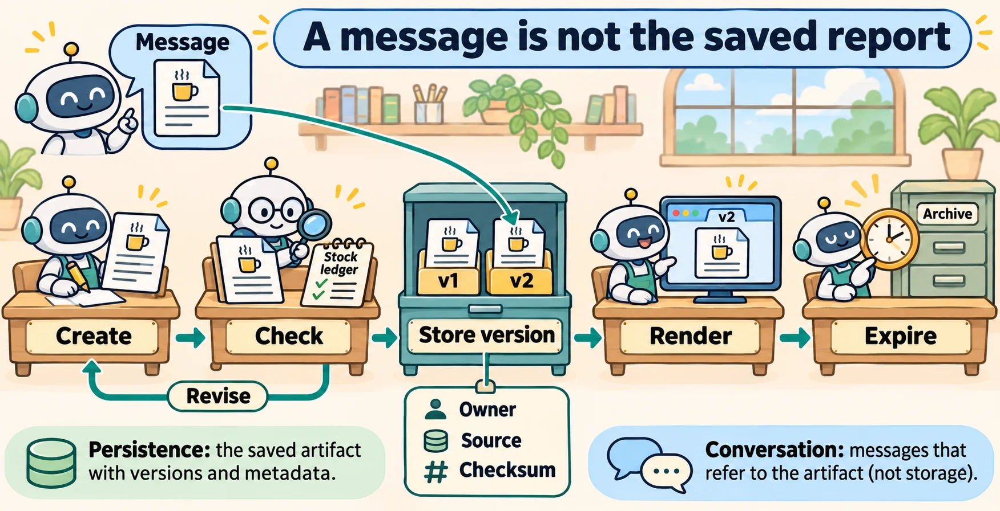

<!--
---
title: Messages, structured artifacts, and lifecycle
unit_id: P1-03-16-01
summary: Make saved outputs retrievable, versioned and interpretable while separating
  structure, content and rendering checks.
prerequisites:
- Read [Reliability and operations](../15-reliability-and-operations/chapter-plan.md).
learning_objectives:
- Distinguish messages, events, state and artifacts.
- Describe an artifact with type, provenance, storage and lifecycle metadata.
- Compare ADK artifact management with A2A content exchange.
source_records:
- p1-03-16-01-adk
- p1-03-16-01-a2a
- p1-03-16-01-media
- p1-03-16-01-schema
- p1-03-16-01-prov
- p1-03-16-01-hash
visual_assets:
- assets/images/03-building-blocks/16-artifacts-and-multimodal-io/01-messages-structured-artifacts-and-lifecycle/01-artifact-lifecycle.webp
example_paths:
- examples/03-building-blocks/16-artifacts-and-multimodal-io/01-messages-structured-artifacts-and-lifecycle/main.py
learning_path: main
status: complete
last_reviewed: '2026-11-16'
pass: architecture
---
-->

# Messages, structured artifacts, and lifecycle

## Why this matters

Lee asks for a stock report and receives the message "Done, the report is ready." The chat ends. The next morning, a colleague wants to open that exact report and compare it with yesterday's version. The message alone cannot supply the file, its source snapshot or the version that was checked.

A useful agent produces more than conversational text. It also creates and manages persistent outputs. This chapter follows [reliability and operations](../15-reliability-and-operations/chapter-plan.md), where checkpoints and progress files preserve work across interruptions.

## How it works

### Distinguish four objects

In this guide, an **artifact** is a persistent output, such as a report, image, spreadsheet, generated code file or structured record. A **message** is a conversational communication. An **event** records a transition or occurrence during execution. **State** is the stored information used to continue or interpret a workflow. These are teaching distinctions; frameworks may use the terms with different scopes.

| Object in Lee's workflow | What it answers |
| --- | --- |
| Message: "Your report is ready" | What did the assistant tell the user? |
| Event: report version 2 was saved | What occurred, and when? |
| State: report generation completed | Where does the run stand? |
| Artifact: the versioned report and metadata | What can someone retrieve, inspect and reuse later? |

A message can carry a file reference, and an event can announce an artifact update. Neither establishes that the referenced bytes will still exist tomorrow. A reference is a location or identifier used to retrieve content; its lifetime can differ from the content's lifetime.

### Put structure around the saved output

A **manifest** is a record describing one or more artifacts and how to find and interpret them. Our local manifest includes a stable artifact ID, owner, version, content type, size, checksum, source, producer, storage reference, lifecycle status and rendering choice. This is a teaching schema, not a required agent standard.

A **media type**, often called a **MIME type**, identifies a format using a type and subtype, such as `application/json` or `image/webp`. MIME originally names Multipurpose Internet Mail Extensions; media types are also used by HTTP and other protocols. The filename extension is a hint, not a format check. [Media type specification](https://www.rfc-editor.org/rfc/rfc6838.html).

A **schema** defines expected data structure and constraints. JSON is a text format for objects, arrays and simple values. JSON Schema can require a stock report to contain a product ID, a nonnegative integer quantity and a source snapshot ID. Passing those checks does not establish that the supplier actually has that quantity. Compare the values with suitable evidence as a separate evaluation. [JSON Schema tutorial](https://json-schema.org/learn/getting-started-step-by-step).

**Provenance** records where something came from and how it was produced. For the report, record the input snapshot, producing tool or run, transformation version and relevant review result. W3C's PROV vocabulary distinguishes the data, activities and people involved; our compact manifest borrows the underlying question without implementing the full PROV model. [PROV overview](https://www.w3.org/TR/prov-overview/).

A **checksum** is a value computed from content to help detect a change. The example uses a SHA-256 **digest**, a fixed-size fingerprint of the file bytes, calculated with Python's `hashlib`. Recomputing it after loading the file checks consistency with the recorded digest. A matching digest does not by itself prove who created the content or whether the quantity is true. [Python hashing documentation](https://docs.python.org/3/library/hashlib.html).

### Give artifacts an explicit lifecycle

Our report lifecycle creates candidate bytes, checks their structure and meaning, stores a version, makes that version available to an appropriate renderer, then retires it under a retention policy. **Retention** specifies how long content and associated records remain available. Expiry of a download reference is not necessarily deletion of the stored artifact.



*Figure 1. Conversation and persistence have different roles. The check can return a candidate for revision, while the stored version supplies the exact bytes later selected for rendering.*

Read the two folders as separate versions, not files to overwrite in place. The expiry station represents a lifecycle decision. It does not claim that one timer automatically removes every backup or downstream copy.

An **owner** is the person or service responsible for an artifact's scope and lifecycle. **Storage** is the service or location holding its bytes. A **renderer** turns those bytes into something a user can see or hear. Rendering is a separate boundary because a format may be saved successfully yet fail to display, lose information in conversion or require a different application.

For Lee's report, bind the displayed result to a specific version. If the application loads "latest" later, it may obtain version 3 rather than the version 2 the user reviewed. Store a new version for a revision and keep the relationship to the earlier one. Make expired, missing and superseded references distinguishable in the user interface.

A useful lifecycle record answers all of these questions:

| Artifact | Owner and provenance | Storage and lifecycle | Rendering and evaluation |
| --- | --- | --- | --- |
| Stock report, JSON | Lee's shop; mocked snapshot S17; report producer version 1 | Versioned local file in the example; retired when marked expired | Plain-text JSON view; check required fields and agreement with S17 |
| Guide illustration, WebP | Guide maintainers; saved generation prompt and selected image | Repository image file; versioned with the guide | Image preview with alt text; inspect labels and meaning, then verify digest on retrieval |
| Generated code file | Application owner; originating task and generator version | Versioned file; runtime retention policy | Source viewer first; execution is a separate workflow with its own outcome checks |

The guide illustration is an explanatory image, not a photograph or proof of shop inventory. A source-code artifact can be inspected without running it. Likewise, saving a user-interface description does not mean its buttons have executed their actions.

## Framework implementations

Google's **Agent Development Kit**, or **ADK**, manages named, versioned binary artifacts in session or user scope through an artifact service. Its documentation separates artifact storage from session state and represents content through a typed `Part`. Re-saving the same artifact filename creates another version. An in-memory service helps testing but does not provide process-independent persistence. [ADK artifacts](https://adk.dev/artifacts/).

**Agent2Agent**, or **A2A**, is a protocol for communication between agent systems. In version 1.0.0, both messages and artifacts contain `Part` objects. A part contains exactly one of `text`, `raw`, `url` or `data`; optional `mediaType` and `filename` describe the content. An artifact has an `artifactId` unique within its task and a nonempty list of parts. [A2A 1.0.0 specification](https://a2a-protocol.org/v1.0.0/specification).

These are different contracts. ADK offers artifact management through a storage service. A2A defines task-output exchange; the receiving application still needs to decide where to store bytes, which version to retain and how to display them. A2A can call an output an artifact while it is still being streamed. Our guide's persistent-output convention does not mean the protocol guarantees durable storage.

The example uses its own manifest fields, not ADK objects or A2A wire messages. Deeper protocol and framework comparisons belong in [frameworks and protocols](../../04-frameworks-and-protocols/chapter-plan.md). Check versions before copying field names from older examples.

## Worked example

The [typed manifest example](../../../examples/03-building-blocks/16-artifacts-and-multimodal-io/01-messages-structured-artifacts-and-lifecycle/README.md) creates a JSON report from a mocked stock snapshot and references this chapter's real local illustration. It calculates content digests and writes a manifest for both. It does not call a model, upload content or invoke a framework SDK.

The report is first checked against a small explicit contract and the supplied snapshot. The file is then reloaded and verified against its recorded size and digest. The image uses a local file reference and a format-signature check; its visual meaning was reviewed when the illustration was authored. That signature check is not a complete image-decoding test.

<details><summary>Expand minimal Python implementation</summary>

```python
payload = load_bytes(manifest.storage_ref)
if sha256(payload).hexdigest() != manifest.sha256:
    raise ValueError("Artifact bytes changed")
report = json.loads(payload)
check_report(report, snapshot)
```

The complete example also checks lifecycle status, size and the declared format before selecting a simple renderer. Python type annotations describe intended fields; explicit validation performs the checks. It is not a general JSON Schema engine.

</details>

If someone changes the quantity after the manifest was written, byte verification fails. If a new manifest is created for a wrong quantity, the bytes can match perfectly while the semantic check fails. If the artifact is marked expired, the example refuses to render it even though its file still exists. These are three different failure cases.

## Limitations and trade-offs

Manifests create metadata that must stay consistent with content. Large files usually belong in dedicated storage, with small references in messages or state. References can break, previews can differ from original files, and deleting one stored version may leave derived files elsewhere. State the storage and retention contract rather than assuming a filename is sufficient.

The example uses temporary local storage and removes its temporary outputs on exit. Its fixture tests verify metadata and content checks, not a production retention service or end-user download flow. Different formats need different validators and renderers. Images, audio, video and interactive streams add observation and timing questions in the next deep dive.

<details><summary>Check your understanding</summary>

A stock report passes its JSON field checks and its checksum matches the manifest, but the quantity disagrees with snapshot S17. Can the application mark the report correct?

No. The schema checks structure and the digest checks consistency with recorded bytes. Neither establishes agreement with the source. The report needs a separate semantic check, and a message saying it is ready does not replace that check.

</details>

## Security preview

Untrusted files, active content and misleading provenance cross the storage and rendering boundaries introduced here. Pass 2 covers them in [retrieval, memory and data security](../../07-security-by-component-and-workflow-stage/02-retrieval-memory-and-data/chapter-plan.md) and [execution security](../../07-security-by-component-and-workflow-stage/04-execution-and-supply-chain/chapter-plan.md).

## Key takeaways

- Keep conversational messages, execution events, resumable state and saved outputs distinct.
- Record type, owner, provenance, version, storage, lifecycle and evaluation with each artifact.
- Structure, byte consistency, semantic correctness and rendering need separate checks.
- Framework storage and protocol exchange provide different guarantees.

## References

- [Artifacts](https://adk.dev/artifacts/).
- [Agent2Agent Protocol Specification 1.0.0](https://a2a-protocol.org/v1.0.0/specification).
- [RFC 6838: Media Type Specifications and Registration Procedures](https://www.rfc-editor.org/rfc/rfc6838.html).
- [Creating your first schema](https://json-schema.org/learn/getting-started-step-by-step).
- [PROV Overview](https://www.w3.org/TR/prov-overview/).
- [hashlib: Secure hashes and message digests](https://docs.python.org/3/library/hashlib.html).

[Next unit: Multimodal input, output, streaming, and evaluation →](chapter-plan.md)
