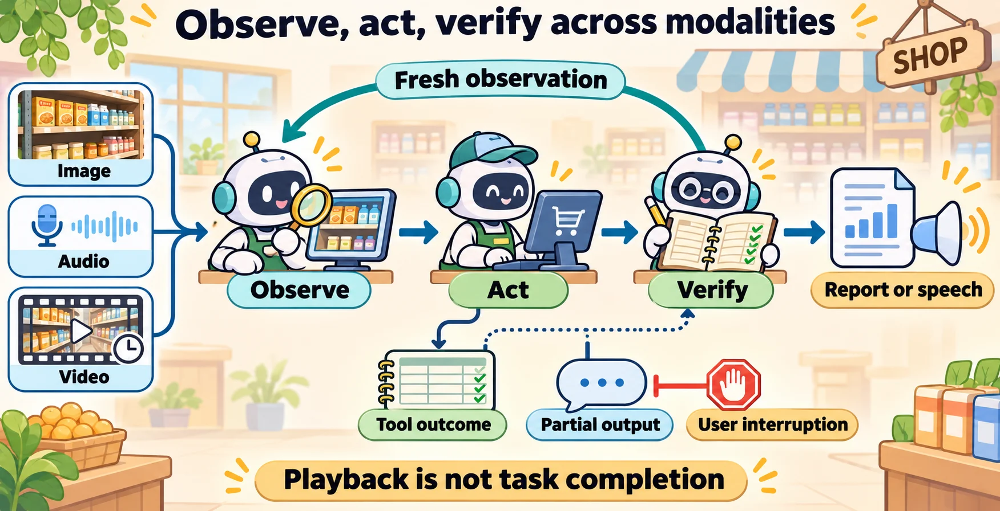

<!--
---
title: Multimodal input, output, streaming, and evaluation
unit_id: P1-03-16-02
summary: Preserve observation provenance and distinguish streamed content, interruption,
  verified effects and delivered acknowledgements.
prerequisites:
- Read [Messages, structured artifacts, and lifecycle](01-messages-structured-artifacts-and-lifecycle.md).
learning_objectives:
- Trace image, audio, video and interactive observations through an agent workflow.
- Separate content completion, playback, tool outcomes and task success.
- Evaluate interrupted workflows using the current intent and external state.
source_records:
- p1-03-16-02-vision
- p1-03-16-02-computer
- p1-03-16-02-voice
- p1-03-16-02-a2a
- p1-03-16-02-dyn-vqa
visual_assets:
- assets/images/03-building-blocks/16-artifacts-and-multimodal-io/02-multimodal-input-output-streaming-and-evaluation/01-observe-act-verify.webp
example_paths:
- examples/03-building-blocks/16-artifacts-and-multimodal-io/02-multimodal-input-output-streaming-and-evaluation/main.py
learning_path: deep-dive
status: complete
last_reviewed: '2026-11-16'
pass: architecture
---
-->

# Multimodal input, output, streaming, and evaluation

## Why this matters

Lee shows the assistant a shelf photo and says, "Reserve two blue mugs." While the assistant begins speaking, Lee interrupts: "Wait, do not reserve them." The screen still shows a loading spinner. Moments later, the supplier returns a reservation ID.

The photo, spoken correction, screen and tool result describe different moments and different kinds of evidence. Treating them as one text answer hides what the agent observed and what actually happened. This optional deep dive follows [messages, structured artifacts, and lifecycle](01-messages-structured-artifacts-and-lifecycle.md). The main path continues with [policy, guardrails, and validation](../17-policy-guardrails-and-validation/chapter-plan.md).

## How it works

### Preserve modality, origin and time

A **modality** is a form of information, such as text, an image, audio or video. A **multimodal** system handles more than one form. It may receive non-text input, produce non-text output, or combine several forms in one workflow. Supporting an image upload does not mean every model, tool and renderer supports that image format.

Keep the original artifact reference and record any derived representation. **Optical character recognition**, or **OCR**, extracts text from an image. **Transcription** converts speech into text. A **frame** is one image in a video sequence. These transformations make information easier to use, but can omit visual layout, tone, timing or events between selected frames.

| Observation | What the agent can inspect | Freshness and success check in Lee's workflow |
| --- | --- | --- |
| Shelf image | Visible products, labels and approximate arrangement | Record capture time and source; verify product and stock with suitable evidence |
| Audio recording | Spoken words and available acoustic cues | Record turn and time range; check quantity and corrected intent |
| Video | Supplied frames, timestamps and any supplied audio | Record sampling coverage; do not infer unseen intervals as observed |
| Browser or desktop | Current screenshot and information exposed by the driver | Observe again after actions; verify the intended record was saved |
| Live voice interaction | Incoming audio, turn events and delivered output | Track interruptions and tool outcomes separately; check final business state |

These are application observation rules, not promises that a model sees every pixel or hears every detail. OpenAI's vision documentation lists limitations including small text, rotation, counting and precise spatial reasoning, and notes that images can be resized before analysis. A shelf photo should not silently become a precise, current stock database. [Vision limitations](https://developers.openai.com/api/docs/guides/images-vision).

For each derived artifact, preserve its owner, source, storage reference, version, retention policy, renderer and evaluation method from the previous chapter. A transcript should point back to its audio segment; a video summary should identify the supplied frame times. An unavailable capture timestamp should remain unknown rather than be replaced with the upload time.

### Separate observation from action and verification

**Computer use** is an interactive loop in which an agent observes a user interface, chooses an action, lets a driver execute it, then checks a fresh observation. A **driver** is the software that operates the browser or desktop. It may expose screenshots, structured controls or other observations according to its contract.

A screenshot showing a button is evidence of the visible interface at capture time. It does not show hidden database state or prove that a click committed an order. OpenAI's computer-use guide recommends fresh screenshots around short groups of actions and distinguishes the API conversation from the execution environment. Continuing the conversation does not restore a lost browser session. [Computer-use loop](https://developers.openai.com/api/docs/guides/tools-computer-use).



*Figure 1. Input observations guide actions; new observations and operation records verify their effects. The interruption mark applies to partial output, while the external tool outcome remains a separate question.*

Read the return arrow as a request for fresh evidence after an action. A screenshot, an audio acknowledgement and a tool ledger each reveal something different. The loop can stop with an unresolved outcome when none supplies enough evidence.

**Voice interaction** also needs observation, action and verification, but its timing is continuous. In a **chained pipeline**, speech becomes text, the agent processes the text and tools, then text becomes speech. A **speech-to-speech** system handles audio within a model session. A separate conversation frontend can also continue speaking while a backend performs work. These are architectural options described in the current voice guide, rather than interchangeable implementations. [Voice architectures](https://developers.openai.com/api/docs/guides/voice-agents).

### Track partial output and completion separately

A **stream** delivers incremental pieces instead of waiting for one complete response. A **chunk** is one such piece. Early text or audio can make an interaction feel responsive, but a partial sentence or partial JSON document may not yet be a valid final artifact.

Keep distinct records for content received, content assembled, content validated, content rendered or played, tool completion and task completion. **Playback** means the client has emitted audio to the user. Receiving audio bytes from a server is an earlier event. Even a fully played sentence can describe work that has not completed.

A2A 1.0.0 makes a related distinction: an artifact update may append content and mark `lastChunk`, while task status is carried separately. A final chunk ends that artifact's chunk sequence; it is not a general declaration that the entire task succeeded. The application's acceptance checks still determine whether the result meets the request. [A2A streaming events](https://a2a-protocol.org/v1.0.0/specification).

Correlate chunks and results with their turn, task, operation and artifact IDs. A **turn** is a conversational contribution or response cycle under the application's convention. If the connection drops mid-artifact, preserve an incomplete state and recover using the protocol's supported state retrieval or resumption behavior. Do not assume arbitrary chunk sequences can always be replayed or resumed.

### Handle interruption without losing the external outcome

A user interruption can change the intended task and stop obsolete speech. It does not itself establish whether a pending tool was cancelled. Use the [reliability and reconciliation rules](../15-reliability-and-operations/01-service-boundaries-queues-retries-and-budgets.md) for operations already dispatched.

In Lee's case, record the corrected intent, stop old playback and mark the outstanding reservation as unresolved until its outcome is known. A late result for the earlier turn still belongs to the business operation. Keep it, even if late speech from that turn is discarded. If the reservation committed before the correction, communicate that fact and the remaining recovery work rather than saying the cancellation succeeded.

A **final acknowledgement** is the response delivered after the current outcome is checked. It may acknowledge success, failure or an unresolved issue. Delivery does not turn an unresolved task into a successful one. In our example, "The reservation was already saved; release is unconfirmed" is an accurate acknowledgement of a task that still needs resolution.

## Worked example

The [offline streaming reducer](../../../examples/03-building-blocks/16-artifacts-and-multimodal-io/02-multimodal-input-output-streaming-and-evaluation/README.md) processes a fixed sequence of application events. A **reducer** computes the next state from the current state and one event. Its event names are teaching conventions, not OpenAI or A2A wire fields.

It compares an uninterrupted reservation with an interrupted one. Both receive a completed tool result. In the interrupted trace, old-turn output is ignored, the reservation result is retained, a mocked ledger check confirms it, and a new acknowledgement explains that the changed goal remains unmet.

| Milestone | What it establishes | What it leaves open |
| --- | --- | --- |
| Partial response | Some output is available | Whether the tool or task completed |
| User interruption | Current intent changed; old speech should stop | Whether an external action already committed |
| Tool result | The tracked operation reports an outcome | Whether that outcome satisfies the corrected intent |
| Outcome verification | The mocked ledger agrees with the result | Whether the user has received the explanation |
| Final acknowledgement playback | The current explanation was delivered in the simulation | Whether unresolved business work has been repaired |

<details><summary>Expand minimal Python implementation</summary>

```python
if event.kind == "interruption":
    state = replace(state, current_intent="cancel",
                    partial_output="", needs_resolution=True)
elif event.kind == "tool_result":
    state = replace(state, tool_outcome=event.value,
                    outcome_verified=False)
```

The full example uses immutable state updates, rejects event gaps and correlates the tool result with its operation ID. A later verification event and a current-turn playback event are required before the acknowledgement counts as delivered. No speech, browser action or real cancellation occurs.

</details>

## Limitations and trade-offs

### Evaluate the channel and the task

Measure **latency**, the time between a defined start and end event, with the boundaries stated. Time to first byte, first visible text, first audible output and verified task completion are different measures. An early "I am checking" should not count as the substantive answer.

For the shop, hold the input artifacts, task, model configuration and tool behavior fixed when comparing changes. Repeat representative cases and record both successful task outcomes and channel failures. Useful checks include:

| Layer | Example check |
| --- | --- |
| Perception | Read product labels and quantities correctly; distinguish uncertainty |
| Temporal interpretation | Apply the latest correction and preserve frame or audio timing |
| Tool behavior | Send the intended arguments and correlate late results |
| Artifact quality | Validate the selected version and inspect its rendered output |
| Conversation | Stop obsolete playback and deliver an accurate current acknowledgement |
| Task outcome | Confirm the requested final state in the application or external record |
| Service behavior | Measure queue delay, latency, cost and incomplete sessions |

The current voice evaluation guide similarly separates timing, speech quality, tool outcomes and session reliability, and recommends checking the saved business state as well as listening to confirmation. Human listening remains useful for intelligibility and interaction timing. [Voice evaluation](https://developers.openai.com/api/docs/guides/voice-agents).

Dyn-VQA is a research benchmark for multimodal retrieval and visual question answering, including changing answers, multimodal knowledge and multi-hop questions. It is useful evidence about those tasks, but it cannot establish browser workflow success or voice interruption handling. Choose evaluation tasks that match the actual workflow. [Dyn-VQA research](https://arxiv.org/abs/2411.02937).

### State what the example cannot prove

The reducer verifies bookkeeping on fixed events. Its playback and ledger checks are simulated. It does not measure recognition accuracy, audio buffering, driver reliability, video coverage or real network ordering. The ordered local event convention is narrower than arbitrary distributed delivery; a detected gap needs recovery rather than silent acceptance.

Images can lack capture metadata, transcripts can lose corrections, selected frames can miss a decisive event, and rendered output can hide a malformed underlying file. Keep those limitations visible in the result. A polished screen or fluent voice should not substitute for evidence of completed work. Framework-specific transport details follow later in [frameworks and protocols](../../04-frameworks-and-protocols/chapter-plan.md).

<details><summary>Check your understanding</summary>

Lee interrupts a spoken reservation response. The application stops the audio, then receives a reservation ID for the previous turn. Should it discard that result because the speech was cancelled?

No. The late result describes a tracked external operation and must be reconciled with the corrected intent. Discard obsolete speech, retain the operation outcome, and explain any unresolved release. A delivered explanation can be accurate while the changed task remains incomplete.

</details>

## Security preview

Media, interface observations and generated outputs carry provenance and rendering risks. Pass 2 maps these inputs and outputs to [retrieval, memory and data security](../../07-security-by-component-and-workflow-stage/02-retrieval-memory-and-data/chapter-plan.md) and [execution security](../../07-security-by-component-and-workflow-stage/04-execution-and-supply-chain/chapter-plan.md).

## Key takeaways

- Preserve modality, source and time through transformations.
- Observe again after actions and verify the actual business outcome.
- Keep partial output, playback, interruption, tool results and task completion distinct.
- Evaluate perception, interaction quality, artifact quality and task success separately.

## References

- [Images and vision](https://developers.openai.com/api/docs/guides/images-vision).
- [Computer use](https://developers.openai.com/api/docs/guides/tools-computer-use).
- [Voice agents](https://developers.openai.com/api/docs/guides/voice-agents).
- [Agent2Agent Protocol Specification 1.0.0](https://a2a-protocol.org/v1.0.0/specification).
- [Benchmarking Multimodal Retrieval Augmented Generation with Dynamic VQA Dataset and Self-adaptive Planning Agent](https://arxiv.org/abs/2411.02937).

[Next unit: Policy control plane and input validation →](../17-policy-guardrails-and-validation/chapter-plan.md)
